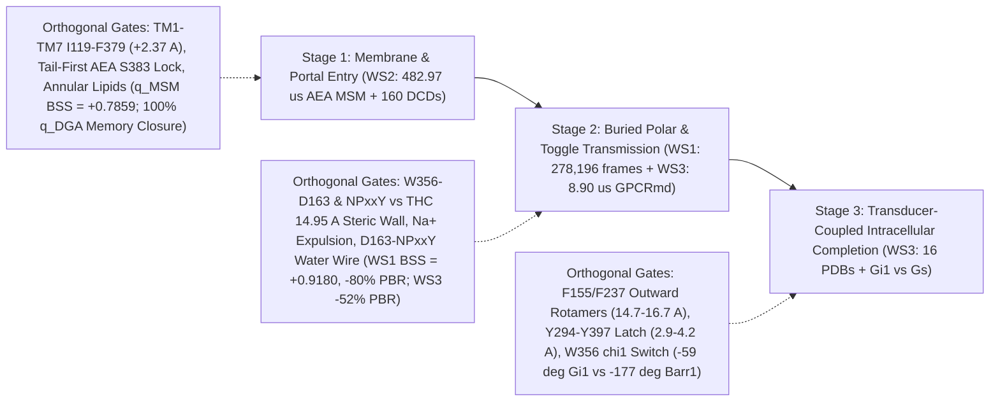

# Can We Predict Human $\text{CB}_1$ Activation from Its Molecular Dynamics?

**Forward Committors, Stage-Specific Orthogonal Microswitch Gating, and Mori–Zwanzig Memory Closure Across $519\ \mu\text{s}$ of Ensembles and $16$ Experimental Structures**

[](pyproject.toml)
[-success.svg)](data/processed/)
[](https://colab.research.google.com/github/thisizkavi-lab/cb1-dynamics/blob/main/notebooks/CB1_Activation_Committor_Discovery.ipynb)

---

## 1. Scientific Motivation & Statistical-Mechanics Formulation

Classical all-atom molecular dynamics (MD) of membrane proteins is Lyapunov-chaotic on picosecond timescales: femtosecond collisions with bulk water, ions, and acyl chains render deterministic trajectory extrapolation physically impossible over nanoseconds or microseconds. Yet a G protein-coupled receptor's **functional commitment**—whether an approaching lipid messenger enters the orthosteric pocket, or whether an outward-tilted transmembrane helix 6 ($\text{TM6}$) completes intracellular activation rather than collapsing back to its inactive basin—is a rigorous thermodynamic and kinetic observable governed by the **forward committor**:

$$q_+(\mathbf{x}) = \mathbb{P}\!\left(\tau_B < \tau_A \,\middle|\, \mathbf{X}_0 = \mathbf{x}\right) \in [0, 1], \qquad (\mathcal{L} q_+)(\mathbf{x}) = 0 \quad \text{on } \Omega \setminus (A \cup B).$$

In human **Cannabinoid Receptor 1 ($\text{CB}_1$, `CNR1`, UniProt `P21554`, 472 residues)**, standard 1D structural progress variables—such as cytoplasmic $\text{TM3–TM6}$ distance ($R_{\text{TM6}}$) or ligand-to-pocket distance ($R_{\text{portal}}$)—frequently group conformations with wildly divergent fates into the same geometric bin. Rather than training black-box deep sequence architectures that exploit trajectory autocorrelation, this repository tests **three first-principles physical hypotheses** across **`519.6 µs` of molecular simulations** and **all `16` human $\text{CB}_1$ experimental X-ray/cryo-EM structures**:

1. **Orthogonal Allosteric & Environmental Gating (`H1`, $\nabla_\perp q_+ \neq \mathbf{0}$):** At matched intermediate 1D progress, does a compact set of physical internal/lipid/ligand coordinates resolve hidden transition-state degeneracy (`Brier Skill Score` $\text{BSS}_{\text{int}}$ vs. 1D cubic spline `B1` and velocity-augmented `B2`), and reduce the model-free **Koopman Projected Bellman Residual ($\mathcal{E}_{\text{PBR}}$)** on a shared held-out witness subspace?
2. **Two-Step Mori–Zwanzig Memory Detection & Closure (`H2`):** By projection-operator theory, finite-lag trajectory history $\Delta\boldsymbol{\xi}(t; \delta t)$ improves committor log-likelihood ($\Delta\bar{\ell}_{\text{mem}} > 0$ above within-cell history-shuffle null `N2a`) **if and only if $\boldsymbol{\xi}(t)$ omits slow coupled degrees of freedom**. Does explicitly adding internal switches, annular lipids/pose, or explicit water/$\text{Na}^+$ wires collapse that non-Markovian memory ($\rho_{\text{mem}} \to 1$)?
3. **Ligand Efficacy & Biased Signaling (`H3` & `Pitfall 4`):** Do partial agonists ($\Delta^9$-THC), negative allosteric modulators (`ORG27569`), and biased transducers ($G_{i1}$ vs. $\beta\text{-arrestin-1}$ vs. engineered $G_s$) continuously rotate the within-well committor gradient ($\mathcal{S}_{\cos} < 0.85$), or act via discrete toggle-locked steric arrest and loose pocket-to-core coupling?

---

## 2. Core Discovery: Three-Stage Commitment Architecture of Human $\text{CB}_1$

Across three strictly fold-isolated workstreams (`WS1`, `WS2`, `WS3`), **human $\text{CB}_1$ activation is governed neither by a single 1D reaction coordinate nor by a universal static feature bank, but factorizes into three sequential stages**, each gated by stage-specific orthogonal coordinates whose omission generates measurable Mori–Zwanzig memory:



### Summary of Verified Out-of-Fold Quantitative Results

| Mechanistic Stage & Dataset | Matched Intermediate Slice | 1D Velocity `B2` Skill vs. `B1` | Stage-Matched Orthogonal Coordinate Skill (`BSS_int` `[95% CI]`) | Shared-Subspace Test $\mathcal{E}_{\text{PBR}}$ Reduction | Mori–Zwanzig Memory Closure ($\rho_{\text{mem}}$) | Reversibility Gate `N2b` ($\le 0.10$) |
| :--- | :--- | :--- | :--- | :--- | :--- | :--- |
| **Stage 1 (`WS2`):** `AEA` Lipid-Portal Entry (`5,000` runs = `482.97 µs` 800-state TPT + `160` `.dcd` runs = `15.72 µs`, `136` lineage groups) | $R_{\text{portal}} \in [9.5, 18.5]\text{ \AA}$ (`n = 86,893`) | `+0.0025` ($q_+^{\text{MSM}}$)<br>`+0.0135` ($q_+^{\text{DGA}}$) | **`Tier C` (Portal + Lipids + `AEA` Pose):**<br>`+0.7859 [+0.6852, +0.8627]` ($q_+^{\text{MSM}}$, `92.0%` of Oracle; leave-round-out `+0.7731`)<br>`+0.3497 [+0.2005, +0.4625]` ($q_+^{\text{DGA}}$) | **`-17.9%`** monotonic 10D witness decay (`0.0302` `B0` $\to$ `0.0261` `B1` $\to$ `0.0216` `Tier C` $\to$ **`0.0214`** `StoppedDGA`) | **`100.0%` (`0.5–10.0 ns`, `p = 0.975–1.000`)** on continuous $q_+^{\text{DGA}}$<br>(`55.0–64.5%` `0->C` / `9.7–27.0%` `A->C` on Voronoi $q_+^{\text{MSM}}$) | **`0.0474`** (Pass) |
| **Stage 2 (`WS1`):** Full Agonist vs. $\Delta^9$-THC Global $\text{TM6}$ Activation (`278,196` frames, `58` buffered macro-blocks) | $R_{\text{TM6}} \in [12.5, 14.5]\text{ \AA}$ (`n = 36,676`) | `+0.3066` | **6-Param `PT+Epistasis` (`TM6` + `W356–D163` + `NPxxY`):**<br>**`+0.9180 [+0.8725, +0.9524]`** (`93.45%` of Oracle `+0.9823`, `ECE = 0.0075`, `N1 p = 0.0123`, zero ligand label) | **`-80.0%`** (`5.0x` drop: `0.0982` `B1` $\to$ `0.0315` `PT+Epi` $\to$ **`0.0196`** `3-CV DGA`) | **`90.3%–94.9%`** collapse (`1-CV -> 3-CV` across `k = 2..35`); significant `5–10%` residual diagnoses stripped sidechains/water | **`0.0047`** train / **`0.0594`** indep test (Pass w/ Perron $\hat{\pi}$) |
| **Stage 2 (`WS3`):** Explicit-Solvent Buried Toggle `F200–W356` (`NaCl5` & `Open6`, `8.90 µs` GPCRmd, `<5%` censoring) | $d_{\text{F200–W356}} \in (3.6, 4.6)\text{ \AA}$ (`2.62%` cens) | `+0.0757` nats (`BSS = +0.1670`) | **10D Coupled Protein Switches vs. `B1`:**<br>`+0.0631` nats (`BSS = +0.1225`, `p = 0.0099`); static `Prot+Env vs Prot` is null (`+0.0049` nats, `p = 0.2475`) | **`-52.0%` vs. `B1`** and **`-15.2%` vs. `DGA_prot`** on shared 8D witness (`0.1494` $\to$ `0.0846` $\to$ **`0.0717`**) | **`50.0%–74.9%`** (`NaCl5`) & **`55.8%–79.3%`** (`Open6`) `1D -> Prot+Env` (`12.2–16.3%` & `22.7–55.6%` `Prot -> Env`) | **`0.0374`** (`NaCl5` Pass); **`0.0336`** (`Open6` Pass) |
| **Stage 3 (`WS3`):** `16`-PDB Structural Ground Truth & Matched Open-$\text{TM6}$ Hydration (`Gi1` vs. `Gs`) | Open $\text{TM6} > 14.1\text{ \AA}$ (`3` Ago-only vs. `8` `Gi`/`βarr1` PDBs; `[13.5, 16.5] Å` MD) | `B2` dominates fast `0.2 ns` `F155–F237` (`+0.0794` nats) | **`100%` (`16/16` PDB) Separation:** `5XRA, 5XR8, 7V3Z` stay trapped with inward `F155` (`9.20–12.29 Å`) & open `Y294–Y397` (`5.10–5.45 Å`) vs. all `8` `Gi`/`βarr1` PDBs (`14.67–16.72 Å`; `2.92–4.17 Å`). `6N4B` ($G_{i1}$) vs. `8WU1` ($\beta\text{arr1}$) flips `W356` $\chi_1$ by **`-118.47°`** | Matched-$\text{TM6}$ `Gi1_1201` maintains `17.44` waters & `0.9606` slice (`0.9701` overall) `D163–NPxxY` wire conductance vs. `Gs_2067` dehydration (`11.25` waters, wire collapse `0.8716 -> 0.3400`) | Lipid-facing `F155–F237` solvent closure is **incomplete (`7.6%–22.9%`)**, diagnosing `POPC` acyl viscosity + local dihedral inertia | **`0.0570`** (`Fine_0p2ns_SecondarySwitch` `R214–D338` Pass); **`0.3187`** on `Fine_0p2ns_5traj` (`F155–F237`) flags cross-regime `KCl`/`NaCl` pooling |

---

## 3. Mandatory Negative Controls, Falsifications & Anti-Overclaiming Guardrails

Every pre-registered negative control, falsified sub-hypothesis, and dataset scope boundary verified in our [Phase 2 Experimental Verification Audit](docs/05_phase2_experimental_audit.md) is preserved verbatim:

1. **`WS1` Smooth 3-CV Gradient Rotation (`H3`) Is Falsified ($\mathcal{S}_{\cos} = 0.9997$) & Within-Ligand 3-CV Skill Is Zero (`-0.0175` / `-0.0387`):**
   Under strict two-stage fold isolation (eliminating cross-fold DGA target smoothing), `W356–D163` and `NPxxY` add **zero out-of-fold skill within a single fixed-ligand well** (`Full Agonist BSS_int = -0.0175 [-0.2627, +0.1077]`; $\Delta^9$-THC `BSS_int = -0.0387 [-0.0850, +0.0087]`), and local committor gradients are collinear ($\mathcal{S}_{\cos} = 0.9997\ [0.9940, 1.0000]$ natural; `0.9725` shared `[12.8, 13.8] Å`). Their massive global predictive power (`BSS_int = +0.9180`) arises specifically because $\Delta^9$-THC fails to unlock `W356–D163`, imposing a **hard steric/thermodynamic ceiling at $R_{\text{TM6}} = 14.95\text{ \AA}$** (`0 / 104,336` frames reach $\ge 15.2\text{ \AA}$). Furthermore, `WS1` (`Tier 1C`) contains **zero** $\text{F155}^{2.42}$ or $\text{F237}^{4.46}$ coordinates.
2. **`WS2` Models Transducer-Free Ligand Entry (`Bulk -> B1`) & Discrete Voronoi `q_msm` Retains Unclosed Memory:**
   Without $G_i$ protein, intracellular microswitches (`F155`, `F237`, `W356`, `DRY`, `NPxxY`) remain near their inactive basin throughout `AEA` membrane entry (`BSS_int = +0.1051 < 0.15` on global $q_+^{\text{MSM}}$; quadratic epistasis `+0.0271` / `+0.0111`). Moreover, while `Tier C` closes **`100.0%`** of continuous $q_+^{\text{DGA}}$ memory, discrete 800-state ligand-COM Voronoi $q_+^{\text{MSM}}$ retains `73%–90%` of `Tier A` memory due to Voronoi boundary discretization and stripped explicit solvent.
3. **`WS3` Static Solvent Gain Is Null (`+0.0049` nats, `N1 p = 0.2475`), `F155–F237` Closure Is Incomplete (`7.6%–22.9%`), Pooled `Fine_0p2ns` Fails `N2b` (`0.3187 > 0.10`), and `Gi1` vs. `Gs` Is $N = 1$:**
   Explicit water/$\text{Na}^+$ acts as a **multi-nanosecond dynamical memory variable and Koopman operator stabilizer** (`-15.2%` `PBR`, `12%–56%` `Prot -> Env` toggle memory collapse) rather than an instantaneous static predictor beyond cavity distances; lipid-facing `F155–F237` sub-nanosecond memory leaves `>77%–92%` residual memory dominated by rotamer inertia (`B2`) and `POPC` viscosity; `N2b = 0.3187` and `WholeTraj_CV = -0.2742` nats flag broken detailed balance when pooling $M = 5$ heterogeneous `KCl`/`NaCl` GPCRmd runs; and the `Gi1_1201` (`MDMB-FUBINACA` holo, `KCl`, `1.0 µs`) vs. `Gs_2067` (`Apo` engineered, `NaCl`, `6.0 µs`) comparison has $N = 1$ trajectory per transducer class (`KS` reported strictly as confounded effect sizes).

---

## 4. Quickstart (`< 3 Minutes` Standalone Execution)

Because all `7` processed `.parquet` tables (`50.382 MB` total, every file `< 14 MB`) and companion JSON manifests are committed directly inside `data/processed/` and `results/`—requiring **zero Git LFS and zero `80+ GB` trajectory re-downloads**—you can reproduce the entire notebook and verification test suite immediately.

### Option A: Zero-Setup Execution with `uv` (Recommended)

```bash
# 1. Run the complete 5-module verification test suite (core DGA, WS1, WS2, WS3, and packaging/notebook checks)
uv run --python 3.12 --with-requirements requirements.txt pytest -v

# 2. Re-execute the pedagogical discovery notebook end-to-end (< 1 minute)
uv run --python 3.12 --with-requirements requirements.txt \
  jupyter nbconvert --to notebook --execute --inplace --ExecutePreprocessor.timeout=600 \
  notebooks/CB1_Activation_Committor_Discovery.ipynb
```

### Option B: Standard Virtual Environment (`pip`)

```bash
python3 -m venv .venv
source .venv/bin/activate
pip install -e ".[dev]"

pytest -v
jupyter lab notebooks/CB1_Activation_Committor_Discovery.ipynb
```

### Option C: Google Colab

Open [`notebooks/CB1_Activation_Committor_Discovery.ipynb`](notebooks/CB1_Activation_Committor_Discovery.ipynb) directly in Google Colab. Cell 1 automatically detects `google.colab`, clones the repository if needed, verifies all `7` `.parquet` tables (`50.382 MB`), and includes an optional `RUN_LIVE_STREAMING_DEMO = False` toggle demonstrating live `HTTP 206` Range-request binary header verification (`GROMACS XTC 1995` and `CHARMM DCD 'CORD'`) against GPCRmd and Box.

---

## 5. Repository Structure

```text
cb1-dynamics/
├── notebooks/
│   └── CB1_Activation_Committor_Discovery.ipynb  # Executed pedagogical walkthrough (alternating Code + Analysis cells)
├── src/
│   ├── core/                                     # Shared operator & statistical-mechanics engine
│   │   ├── splits.py                             # LineageGroupSplitter + autocorrelation seam buffers
│   │   ├── dga.py                                # Perron-reweighted StoppedDGACommittor + N2b reversibility
│   │   ├── models.py                             # B0 bin, B1 spline, B2 velocity, PetersTroutCommittorModel
│   │   ├── metrics.py                            # Matched-slice BSS, shared-subspace PBR, block bootstrap, N1
│   │   └── memory_tests.py                       # Two-step Mori-Zwanzig memory & within-cell N2a permutation
│   ├── ws1_thc_activation/                       # Stage 2: 278,196-frame Full Agonist vs. Delta9-THC 3-CV DGA
│   ├── ws2_box_msm/                              # Stage 1: 5,000-run (482.97 us) AEA MSM/TPT + 160 streamed DCDs
│   └── ws3_gpcrmd_water/                         # Stage 2/3: 16-PDB benchmark + 8.90 us explicit-solvent GPCRmd
├── data/
│   ├── metadata/                                 # Canonical UniProt P21554 / Ballesteros-Weinstein lookup tables
│   ├── inventory/                                # Dataset manifest, 16 RCSB structures, & stripped Box topologies
│   └── processed/                                # 7 GitHub-safe Parquet archives (50.382 MB total, all < 14 MB)
│       ├── ws1/                                  # ws1_featurized_segments.parquet, ws1_oof_predictions.parquet
│       ├── ws2/                                  # msm_800_microstates.parquet, box_aea_cohort_features.parquet, ws2_oof_predictions.parquet
│       └── ws3/                                  # pdb16_structural_benchmark.parquet, gpcrmd_open6_features.parquet, topologies/
├── results/
│   ├── ws1/                                      # ws1_metrics.json, ws1_report.md, & 4 publication PNGs
│   ├── ws2/                                      # ws2_metrics.json, ws2_report.md, & 4 publication PNGs
│   └── ws3/                                      # ws3_metrics.json, ws3_report.md, & 3 publication PNGs
├── docs/
│   ├── 01_literature_review.md                   # Verified CB1 structural & mechanistic review (16 PDBs)
│   ├── 02_data_and_structures_audit.md           # Open MD repository audit, streaming invariants & indexing traps
│   ├── 03_first_principles_and_hypotheses.md     # Pre-registered TPT/DGA/Mori-Zwanzig theory & falsification gates
│   ├── 04_phase1_verification_audit.md           # Phase 1 skeptical verification sign-off
│   └── 05_phase2_experimental_audit.md           # Phase 2 experimental audit, 12 remediated defects & synthesis
└── tests/
    ├── test_core_dga.py                          # Analytical 2D switchback PDE, PBR, memory & 90:10 N2b unit tests
    ├── test_ws1_integrity.py                     # WS1 zero-leakage, fold-isolation & metric reproducibility tests
    ├── test_ws2_integrity.py                     # WS2 TPT harmonicity, leave-round-out MSM, UniProt+88 & H1/H2 tests
    ├── test_ws3_integrity.py                     # WS3 16-PDB traps, PBC/ion sentinels & adversarial memory tests
    └── test_packaging_and_notebook.py            # Phase 3 executed notebook structure, guardrails & <25 MB git checks
```

---

## 6. Human $\text{CB}_1$ (`P21554`) Residue-Indexing & Topology Trap Reference

Silent residue-numbering offsets are a notorious source of corrupted features in GPCR molecular dynamics. Every script in `src/` enforces programmatic sequence assertions against canonical human $\text{CB}_1$ (`UniProt P21554`) before computing any coordinate:

| Dataset / Structure | Underlying Indexing / Topology Trap | Canonical UniProt `P21554` Mapping & Guard Enforced |
| :--- | :--- | :--- |
| **`WS2` Shukla 2026 Box Topologies** (`CB1_assym-strip.prmtop/.pdb`) | N-terminus (`M1–E88`) is truncated (`resSeq 1 = A89`), shifting all raw residue numbers by `-88` (`0-based resid` shifted by `-89`). | **`UniProt = resSeq + 88 = resid + 89`** verified across `24` anchor residues (`F155=resid 66`, `D163=74`, `F200=111`, `R214=125`, `F237=148`, `W356=267`, `S383=294`, `Y397=308`). |
| **`5XR8` & `7V3Z` X-Ray Structures** (Hua et al. 2025, `PMID: 40866700`) | ICL3 *P. aeruginosa* flavodoxin fusion (`1001–1148`) shifts author numbering on $\text{TM6–H8}$ upward by **`+122`** (`W6.48` labeled `478`, `Y7.53` labeled `519`). | Sequence-aligned per-helix mapping (`D338->460`, `W356->478`, `N393->515`, `Y397->519`); thermostabilizing mutations (`T210A, E273K, T283V, R340E`) logged explicitly. |
| **`8GHV` Cryo-EM Complex** & **GPCRmd `ID 2067`** (`CB1–Gs`) | `8GHV` places $\text{CB}_1$ on **`Chain D`** (`Chain A` = $G\alpha_{i1}$); GPCRmd `2067` has overlapping `resSeq` in `Chain 1` ($G\alpha_s$) and `TER`-cleaved $\text{CB}_1$ ICL3 across periodic boundaries. | Explicit chain isolation (`Chain D` in `8GHV`; receptor segments `104–305` + `334–412` in `2067`) + whole-segment minimum-image PBC reassembly around the 7TM $\text{C}\alpha$ centroid on every frame. |
| **`8WU1` ($\text{CB}_1\text{–}\beta\text{arr1}$ Cryo-EM, `3.20 Å`)** | Sidechain atoms beyond $\text{C}\beta$ on $\text{F237}^{4.46}$ are unresolved in deposited coordinates (`CG..CZ` absent). | Flagged via `F237_sidechain_resolved = False` with `NaN` for `F237` ring/rotamer observables—never fabricated or imputed. |
| **GPCRmd `ID 1201` (`6N4B + Gi1`)** vs. **`IDs 22, 162, 163, 164, 2067`** | `ID 1201` is solvated in **`0.15 M KCl`** (`0` `Na+` ions, `128` `K+`), whereas the other `5` runs use **`NaCl`**. | Explicit `has_na_ions` / `has_k_ions` boolean flags, finite `99.0 Å` (`prox = 0.0`) sentinels (`0` `NaN`s), plus dedicated `NaCl5_1p0ns_ExplicitNa` cohort isolating true $\text{Na}^+$ allostery. |

---

## 7. Primary Datasets & Verified Literature Citations

1. **Dutta S, Selvam B, Das A, Shukla D (2022).** Mechanistic origin of partial agonism of tetrahydrocannabinol for cannabinoid receptors. *J. Biol. Chem.* 298(4):101764. DOI: `10.1016/j.jbc.2022.101764` (`PMID: 35227761`) — *Source of `WS1` (`Tier 1C`) Full Agonist & $\Delta^9$-THC activation ensembles.*
2. **Dutta S, Shukla D (2023).** Distinct activation mechanisms regulate subtype selectivity of Cannabinoid receptors. *Communications Biology* 6:485. DOI: `10.1038/s42003-023-04868-1` (`PMID: 37147497`).
3. **Dutta S, Zhao L, Shukla D (2026).** Dynamic mechanism for subtype selectivity of endocannabinoids. *J. Biol. Chem.* 302(6):111434. DOI: `10.1016/j.jbc.2026.111434` (`PMID: 41962866`) — *Source of `WS2` (`Tier 1A`) `5,000`-trajectory (`482.97 µs`) `AEA` Box dataset.*
4. **Rodríguez-Espigares I et al. (2020).** GPCRmd uncovers the dynamics of the 3D-GPCRome. *Nature Methods* 17:777–787. DOI: `10.1038/s41592-020-0884-y` (`PMID: 32661425`) — *Source of `WS3` (`Tier 1B`) explicit-solvent $\text{CB}_1$ trajectories (`IDs 22, 162, 163, 164, 1201, 2067`).*
5. **Hua T et al. (2025).** Crystal structures of agonist-bound human cannabinoid receptor $\text{CB}_1$. *Nature* (`PMID: 40866700`, DOI: `10.1038/s41586-025-09454-5`; replacing retracted 2017 `5XRA`/`5XR8` report with high-resolution `7V3Z` verification).
6. **Shao Z et al. (2019).** Structure of an allosteric modulator bound to the CB1 cannabinoid receptor (`6KQI` `ORG27569`, $\text{F155}^{2.42}/\text{F237}^{4.46}$ toggle). *Nat. Chem. Biol.* 15:1199–1205. DOI: `10.1038/s41589-019-0387-2` (`PMID: 31659318`).
7. **Krishna Kumar K et al. (2019 & 2023).** Structure of a Signaling Cannabinoid Receptor 1-G Protein Complex (`6N4B`, *Cell* 176:448–458.e12, `PMID: 30639101`) & Structural basis for activation of CB1 by an endocannabinoid analog (`8GHV`, *Nat. Commun.* 14:2672, `PMID: 37160876`).
8. **Yang X et al. (2022).** Molecular mechanism of allosteric modulation for the cannabinoid receptor CB1 (`7FEE`, `7WV9`). *Nat. Chem. Biol.* 18:831–840. DOI: `10.1038/s41589-022-01038-y` (`PMID: 35637350`).
9. **Liao YY et al. (2023).** Snapshot of the cannabinoid receptor 1-arrestin complex unravels the biased signaling mechanism (`8WU1`, *Cell* 186:5784–5797.e17, DOI: `10.1016/j.cell.2023.11.017`, `PMID: 38101408`) & **Wang Y et al. (2024).** Cryo-EM structure of cannabinoid receptor CB1-$\beta$-arrestin complex (`8WRZ`, *Protein & Cell* 15:230–234, DOI: `10.1093/procel/pwad055`, `PMID: 38102480`).
10. **Strahan J, Antoszewski A, Lorpaiboon C, Vani BP, Weare J, Dinner AR (2021).** Long-Time-Scale Predictions from Short-Trajectory Data: A Benchmark Analysis of the Trp-Cage Miniprotein (*J. Chem. Theory Comput.* 17(5):2948–2963, DOI: `10.1021/acs.jctc.0c00933`, `PMID: 33908762`) & **Lorpaiboon C, Guo SC, Strahan J, Weare J, Dinner AR (2024).** Accurate estimates of dynamical statistics using memory (*J. Chem. Phys.* 160:084108, DOI: `10.1063/5.0187145`, `PMID: 38391020`).
