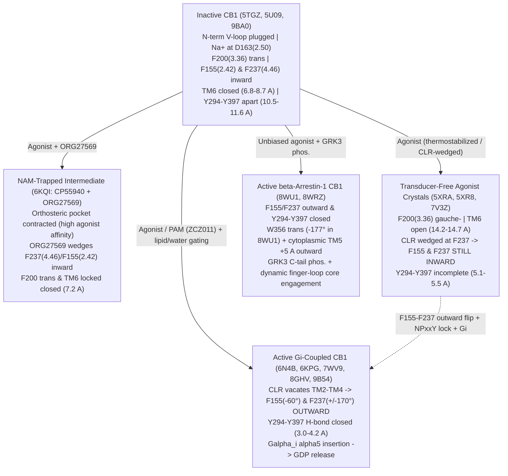

# Literature & Structural Biophysics Review: Predicting Human CB1 Activation from Molecular Dynamics

> **Database & License Attribution Notice**: Protein sequence and domain annotations were retrieved programmatically from **UniProtKB** (`P21554`, `CNR1_HUMAN`; see [UniProt License & Terms](https://www.uniprot.org/help/license) and [API Terms](https://www.uniprot.org/help/api_queries)). Experimental 3D macromolecular metadata and mmCIF atomic coordinates were retrieved from the **RCSB Protein Data Bank** (see [RCSB Usage Policy](https://www.rcsb.org/pages/usage-policy)). Primary-source literature metadata, abstracts, and open-access full texts were verified via **NCBI PubMed / PMC** ([Disclaimer](https://pubmed.ncbi.nlm.nih.gov/disclaimer/), [Policies](https://www.ncbi.nlm.nih.gov/home/about/policies/)), **Europe PMC** ([Terms](https://europepmc.org/)), and **OpenAlex** ([Terms](https://help.openalex.org/)); individual article reuse remains subject to each publisher's license. Machine-readable residue and structural metadata accompanying this review are stored in [`cb1_structures_and_residues.json`](file:///Users/kavi/Documents/artico/cb1-dynamics/data/metadata/cb1_structures_and_residues.json).

---

## Executive Summary: Deconvolving What Is Already Known vs. Genuinely Open

Before designing any computational test of whether coupled molecular coordinates predict future conformational commitment of human cannabinoid receptor 1 (**CB1**, gene `CNR1`, UniProt `P21554`), primary-source structural and simulation literature forces three sharp clarifications:

1. **Provenance of `F155` and `F237` (Known in Cryo-EM/Metadynamics, Absent from CB1 MSMs)**:
   - Residues **`F155` ($\text{Phe155}^{2.42}$)** and **`F237` ($\text{Phe237}^{4.46}$)** are **NOT** newly conjectured features, **nor** do they come from the Shukla Group's Markov State Model (MSM) studies (`https://github.com/ShuklaGroup/Cannabinoid_activation`). Full-text verification across all four Shukla Group CB1 MSM/TRAM publications ([Dutta et al., 2022](https://pubmed.ncbi.nlm.nih.gov/35227761/); [Dutta & Shukla, 2023](https://pubmed.ncbi.nlm.nih.gov/37147497/); [Dutta et al., 2025](https://pubmed.ncbi.nlm.nih.gov/41181929/); [Dutta & Shukla, 2026](https://pubmed.ncbi.nlm.nih.gov/41962866/)) confirms **zero mentions** of `F155`/`2.42` or `F237`/`4.46`.
   - Instead, `F155` and `F237` originate from structural, mutagenesis, and metadynamics studies by **Shao, Yang, Krishna Kumar, Dror, Skiniotis, and Kobilka**: specifically, [Yang et al. (2022, *Nat. Chem. Biol.*, PMID: 35637350)](https://pubmed.ncbi.nlm.nih.gov/35637350/) demonstrated via mutagenesis (`F155W` lowers efficacy; `F155I` raises efficacy) and metadynamics that outward reorientation of $\text{F155}^{2.42}$ *prior* to full TM6 opening constitutes the highest free-energy barrier along CB1 activation, while [Krishna Kumar et al. (2023, *Nat. Commun.*, PMID: 37160876)](https://pubmed.ncbi.nlm.nih.gov/37160876/) explicitly defined the concerted inward-to-outward rotamer flip of **$\text{F155}^{2.42}$–$\text{F237}^{4.46}$** as a CB1-unique intracellular **"activation switch"** that is locked in its inward inactive state by the atypical negative allosteric modulator (NAM) ORG27569 ([Shao et al., 2019, *Nat. Chem. Biol.*, PMID: 31659318](https://pubmed.ncbi.nlm.nih.gov/31659318/)).
2. **Why Shukla's MSM Missed $\text{F155}^{2.42}$–$\text{F237}^{4.46}$ — and What Direct PDB Coordinate Auditing Reveals**:
   - In [`Cannabinoid_activation`](https://github.com/ShuklaGroup/Cannabinoid_activation) ([Dutta & Shukla, 2023, *Commun. Biol.*, PMID: 37147497](https://pubmed.ncbi.nlm.nih.gov/37147497/)), CB1 conformations were featurized **exclusively using $\text{C}\alpha$–$\text{C}\alpha$ backbone distances** (selected via Residue-Residue Contact Score differences between inactive `5TGZ` and agonist crystal `5XRA`) in a **cholesterol-free POPC bilayer**.
   - Direct atomic-coordinate measurement across 16 experimental CB1 structures (Section 2) uncovers a striking structural dichotomy: **in all three transducer-free agonist crystal structures (`5XRA`, `5XR8`, `7V3Z`), TM6 is already fully open ($\text{R214}^{3.50}\text{–D338}^{6.30}\ \text{C}\alpha = 14.18\text{–}14.66\text{ \AA}$) and $\text{F200}^{3.36}$ has flipped ($\chi_1 \approx -77^\circ\text{ to }-82^\circ$), YET $\text{F155}^{2.42}$ ($\chi_1 = +59^\circ\text{ to }+156^\circ$) and $\text{F237}^{4.46}$ ($\chi_1 = -72^\circ\text{ to }-88^\circ$) remain in their INACTIVE inward rotamers** (with crystallographic cholesterol wedged directly against $\text{F237}^{4.46}$ in `5XRA`), and the $\text{Y294}^{5.58}\text{–Y397}^{7.53}$ phenolic H-bond remains unformed ($5.10\text{–}5.45\text{ \AA}$). **Only in genuine transducer-coupled complexes (`6N4B`, `6KPG`, `7WV9`, `8GHV`, `8IKG`, `9B54`, `8WU1`, `8WRZ`)** do $\text{F155}^{2.42}$ ($\chi_1 \approx -60^\circ$) and $\text{F237}^{4.46}$ ($\chi_1 \approx \pm 170^\circ$) flip outward ($\text{F155}$ sidechain COM moving from $9.2\text{ \AA}$ to $14.7\text{–}16.7\text{ \AA}$ relative to $\text{N393}^{7.49}\ \text{C}\alpha$) alongside tight $\text{Y294}^{5.58}\text{–Y397}^{7.53}$ H-bonding ($2.92\text{–}4.17\text{ \AA}$).
3. **Where Genuine Discovery Lies**:
   - Because GPCR orthosteric pockets and intracellular G-protein sites exhibit **"loose allosteric coupling"** ([Dror et al., 2011, PMID: 22031696](https://pubmed.ncbi.nlm.nih.gov/22031696/)), outward TM6 displacement is an incomplete reaction coordinate. However, **no study has ever computed forward committors ($q_+$) on unbiased CB1 trajectories in a combined backbone + sidechain-rotamer + internal-hydration/lipid space**, nor tested whether $\text{F155}^{2.42}$–$\text{F237}^{4.46}$ rotamer frustration, $\text{D163}^{2.50}$–$\text{N393}^{7.49}$ water/$\text{Na}^+$ coordination, and $\text{Y294}^{5.58}$–$\text{Y397}^{7.53}$ locking carry orthogonal committor gradient ($\nabla q_+ \perp \nabla R_{\text{TM6}}$) among matched-TM6 intermediate states, or whether short-time memory ($\Delta \xi$) signals omitted slow sidechain/solvent modes.

---

## 1. Ground-Truth CB1 Sequence & Microswitch Audit (`P21554`)

### 1.1 Canonical Sequence, Topology, and Species Offset Trap

Human CB1 (`CNR1_HUMAN`, UniProt `P21554`, sequence version 1) comprises **472 amino acids**, with an unusually long 116-residue extracellular N-terminus, seven transmembrane helices (TM1–TM7), an intracellular amphipathic Helix 8 (`R400`–`S414`) anchored by S-palmitoylation at `C415` ([Oddi et al., 2017, PMID: 28215712](https://pubmed.ncbi.nlm.nih.gov/28215712/)), and a disordered C-terminal phosphorylation tail (`416–472`).

> [!WARNING]
> **Critical Species Numbering Trap (`+1` Offset in Rodent CB1)**: Rat (`P20272`) and mouse (`P47746`) CB1 contain **473 amino acids** due to a single-residue insertion in the N-terminus (`Ile` insertion prior to TM1). Consequently, **every transmembrane residue in rat/mouse CB1 is shifted by `+1` relative to human `P21554`** despite identical Ballesteros-Weinstein (BW) numbers:
> - Human **`F200` ($\text{Phe}^{3.36}$)** = Rat/Mouse `F201` (e.g., [McAllister et al., 2004, PMID: 15326174](https://pubmed.ncbi.nlm.nih.gov/15326174/))
> - Human **`F237` ($\text{Phe}^{4.46}$)** = Rat/Mouse `F238` (e.g., `F238L` mutant in [Wickert et al., 2018, PMID: 30026687](https://pubmed.ncbi.nlm.nih.gov/30026687/))
> - Human **`W356` ($\text{Trp}^{6.48}$)** = Rat/Mouse `W357` ([McAllister et al., 2004, PMID: 15326174](https://pubmed.ncbi.nlm.nih.gov/15326174/))

### 1.2 Verified Ballesteros-Weinstein Anchors & CB1 Microswitches

All residue identities and BW positions below are verified directly against UniProt `P21554` (anchors: `N134^1.50`, `D163^2.50`, `R214^3.50`, `W241^4.50`, `L286^5.50`, `P358^6.50`, `P394^7.50`, `L404^8.50`):

| Functional Module / Switch | Human CB1 Residue(s) (`P21554`) | BW Numbering | Structural & Biophysical Role in Human CB1 | Primary Citations |
| :--- | :--- | :--- | :--- | :--- |
| **N-terminal V-loop plug & ECL2 lid** | `F102`, `M103`, `F108`; `F189`; `C257`–`C264`, `F268` | N-term; `3.25`; ECL2 | CB1 lacks the canonical Class A $\text{C}^{3.25}$–ECL2 disulfide (`F189^3.25` in CB1), instead carrying an intra-ECL2 disulfide (`C257`–`C264`, $2.03\text{–}2.04\text{ \AA}$). In antagonists (`5TGZ`, `5U09`), the N-terminal V-loop (`F102`–`F108`) plugs deep into the orthosteric pocket; agonists lift the N-terminus out and contract `F268` (ECL2) + TM1/TM2 inward. | [PMID: 27768894](https://pubmed.ncbi.nlm.nih.gov/27768894/), [PMID: 27851727](https://pubmed.ncbi.nlm.nih.gov/27851727/), [PMID: 37147497](https://pubmed.ncbi.nlm.nih.gov/37147497/) |
| **Allosteric $\text{Na}^+$ / internal water pocket** | `D163`, `S167`, `S203`, `W356`, `S390`, `N393` | `2.50`, `2.54`, `3.39`, `6.48`, `7.46`, `7.49` | Coordinates allosteric $\text{Na}^+$ and a conserved internal water wire stabilizing inactive states (`S203^3.39K` acts as a synthetic $\text{Na}^+$ mimic in `6KQI`, `7FEE`, `9BA0`). Collapses upon TM7 inward shift during activation. Occupied via a rare cryptic pocket by peripheral G-protein-biased agonist VIP36 (`9B54`). | [PMID: 24767681](https://pubmed.ncbi.nlm.nih.gov/24767681/), [PMID: 35019279](https://pubmed.ncbi.nlm.nih.gov/35019279/), [PMID: 40044849](https://pubmed.ncbi.nlm.nih.gov/40044849/) |
| **Twin Toggle Switch & `CWGP` hinge** | `F200` / `C355`, `W356`, `G357`, `P358` | `3.36` / `6.47`–`6.50` | Coupled aromatic rotamer/translational switch at the floor of the orthosteric pocket. Inactive: `F200^3.36` adopts *trans* ($\chi_1 \approx \pm 175^\circ$) toward TM6 while `W356^6.48` stacks above it. Agonist activation: `W356^6.48` shifts toward TM5, displacing `F200^3.36` into *gauche-* ($\chi_1 \approx -64^\circ\text{ to }-92^\circ$) toward TM2 and releasing the TM6 `P358^6.50` hinge. | [PMID: 15326174](https://pubmed.ncbi.nlm.nih.gov/15326174/), [PMID: 40866700](https://pubmed.ncbi.nlm.nih.gov/40866700/), [PMID: 37147497](https://pubmed.ncbi.nlm.nih.gov/37147497/) |
| **Non-canonical `PIF`-like core triad** | `V204`, `L286`, `L352` | `3.40`, `5.50`, `6.44` | CB1 diverges sharply from canonical Class A $\text{P}^{5.50}\text{–I}^{3.40}\text{–F}^{6.44}$ (found in $\beta_2\text{AR}$ and $\mu\text{OR}$): absence of $\text{Pro}^{5.50}$ (`L286^5.50`) yields a straighter TM5, and smaller aliphatic `V204^3.40`/`L352^6.44` replace the bulky aromatic transmission ratchet, shifting core gating burden onto `F200^3.36`–`W356^6.48` and `F155^2.42`–`F237^4.46`. | [PMID: 27768894](https://pubmed.ncbi.nlm.nih.gov/27768894/), [PMID: 31855179](https://pubmed.ncbi.nlm.nih.gov/31855179/) |
| **TM2–TM4 intracellular "Activation Switch"** | `H154`, **`F155`**, **`F237`** | `2.41`, **`2.42`**, **`4.46`** | **Unique to CB1** (`L^4.46` in CB2; small aliphatic in $\beta_2\text{AR}$/$\mu\text{OR}$/$\text{M}_2\text{R}$). Inward `F155^2.42` packs against TM3, TM6, and `NPIIY` in inactive states (`5TGZ`, `5U09`), ORG27569-bound `6KQI`, and transducer-free agonist crystals (`5XRA`, `5XR8`). Upon full activation, `F155^2.42` flips to *gauche-* ($\chi_1 \approx -60^\circ$) away from the core, forcing `F237^4.46` to flip from *gauche-* ($\approx -85^\circ$) to *trans* ($\approx \pm 170^\circ$) to avoid steric clash. | [PMID: 35637350](https://pubmed.ncbi.nlm.nih.gov/35637350/), [PMID: 37160876](https://pubmed.ncbi.nlm.nih.gov/37160876/), [PMID: 30026687](https://pubmed.ncbi.nlm.nih.gov/30026687/) |
| **Constitutive rheostat & `DRY` / Ionic Lock** | `T210`; `D213`, `R214`, `Y215`; `D338` | `3.46`; `3.49`–`3.51`; `6.30` | `T210^3.46A` locks CB1 inactive; `T210^3.46I` increases constitutive activity. In inactive CB1, `R214^3.50` forms salt bridges with `D213^3.49` and `D338^6.30` ($\text{C}\alpha\text{–C}\alpha = 6.75\text{–}9.22\text{ \AA}$). Activation breaks the ionic lock ($\text{C}\alpha\text{–C}\alpha = 14.18\text{–}17.13\text{ \AA}$), allowing `R214^3.50` to engage the $\text{G}\alpha_i$ $\alpha 5$ C-hook or $\beta\text{-arrestin-1}$ finger loop. | [PMID: 27851727](https://pubmed.ncbi.nlm.nih.gov/27851727/), [PMID: 30639101](https://pubmed.ncbi.nlm.nih.gov/30639101/), [PMID: 38102480](https://pubmed.ncbi.nlm.nih.gov/38102480/) |
| **TM5 `Y294` & `NPIIY` tyrosine lock** | `Y294`; `N393`, `P394`, `I395`, `I396`, `Y397` | `5.58`; `7.49`–`7.53` | Unlike CB2 (where $\text{Y}^{5.58}$ flips into the membrane in inactive states), CB1 `Y294^5.58` always faces into the bundle. Upon full transducer coupling, TM7 moves inward (`R214–Y397` $\text{C}\alpha$ drops from $\sim 17\text{ \AA}$ to $\sim 12.3\text{ \AA}$) so `Y397^7.53` and `Y294^5.58` form a $2.9\text{–}4.2\text{ \AA}$ H-bond stabilizing the active intracellular cavity. | [PMID: 37147497](https://pubmed.ncbi.nlm.nih.gov/37147497/), [PMID: 30639101](https://pubmed.ncbi.nlm.nih.gov/30639101/), [PMID: 32004463](https://pubmed.ncbi.nlm.nih.gov/32004463/) |
| **Extrahelical cholesterol / NAM / PAM sites & Helix 8** | `S158`, `I169`, `F191`, `C238`, `W241`, `I245`; `V392`–`Y397`–`K402`, `L404`, `F408`, `C415` | `2.45`, `2.56`, `3.27`, `4.47`, `4.50`, `4.54`; `7.48`–`8.54`, C-tail | Inner-leaflet TM2–TM3–TM4 pocket (`H154`, `S158`, `F237`, `C238`, `W241`) binds cholesterol (`5XRA`) and NAM ORG27569 (`6KQI`). Mid-leaflet TM2–TM3–TM4 site (`I169^2.56`, `F191^3.27`, `I245^4.54`) binds PAMs ZCZ011 (`7FEE`/`7WV9`) and biased ago-PAMs (`8IKG`/`8IKH`). TM7/H8 carries a functional `CRAC` cholesterol motif (`V392`–`Y397`–`K402`) and palmitoylated `C415`. | [PMID: 31659318](https://pubmed.ncbi.nlm.nih.gov/31659318/), [PMID: 35637350](https://pubmed.ncbi.nlm.nih.gov/35637350/), [PMID: 21214565](https://pubmed.ncbi.nlm.nih.gov/21214565/), [PMID: 38399369](https://pubmed.ncbi.nlm.nih.gov/38399369/) |

### 1.3 Exact Provenance of `F155^2.42` and `F237^4.46` in Published CB1 Literature

A central task of this review is determining specifically where `F155` and `F237` originate and whether they are already established discoveries in CB1 MSM work:

1. **Early Mutagenesis & Inactive/NAM Crystal Clues (2016–2019)**:
   - [Shao et al. (2016, *Nature*, PMID: 27851727, PDB `5U09`)](https://pubmed.ncbi.nlm.nih.gov/27851727/) resolved high-resolution inactive human CB1, showing $\text{F237}^{4.46}$ pointing inward toward the TM2–TM3 interface and $\text{F155}^{2.42}$ buried against the receptor core.
   - [Wickert et al. (2018, *Front. Mol. Neurosci.*, PMID: 30026687)](https://pubmed.ncbi.nlm.nih.gov/30026687/) showed in rat CB1 that mutating `F238L` (human **`F237^4.46L`**, mimicking CB2's $\text{Leu}^{4.46}$) significantly elevates basal constitutive endocytosis and lipid-raft-associated signaling.
   - [Shao et al. (2019, *Nat. Chem. Biol.*, PMID: 31659318, PDB `6KQI`)](https://pubmed.ncbi.nlm.nih.gov/31659318/) solved the ternary crystal structure of CB1 bound to full agonist CP55,940 and atypical NAM ORG27569, revealing that ORG27569 binds an extrahelical inner-leaflet site overlapping a conserved cholesterol pocket (`H154^2.41`, `S158^2.45`, `F237^4.46`, `C238^4.47`, `W241^4.50`), sterically blocking intracellular TM2/TM4/TM6 activation rearrangements despite agonist-driven contraction of the orthosteric pocket ([Obi & Natesan, 2022, *J. Med. Chem.*, PMID: 36066412](https://pubmed.ncbi.nlm.nih.gov/36066412/)).
2. **Metadynamics Barrier & `F155^2.42` Efficacy Mutagenesis (2022)**:
   - [Yang et al. (2022, *Nat. Chem. Biol.*, PMID: 35637350, PDBs `7FEE`, `7WV9`)](https://pubmed.ncbi.nlm.nih.gov/35637350/) identified that in inactive CB1, core-facing $\text{F155}^{2.42}$ packs simultaneously against TM3, TM6, and the $\text{N}^{7.49}\text{P}^{7.50}\text{xxY}^{7.53}$ motif. Mutating $\text{F155}^{2.42}\text{W}$ (bulkier aromatic) decreased agonist efficacy, whereas $\text{F155}^{2.42}\text{I}$ (smaller aliphatic) increased efficacy. Crucially, their **metadynamics free-energy calculations** indicated that the highest free-energy barrier between TM6-inward and TM6-outward CB1 passes through an intermediate in which **$\text{F155}^{2.42}$ must rotate outward before TM6 can fully open**.
3. **Formulation of the Concerted $\text{F155}^{2.42}$–$\text{F237}^{4.46}$ "Activation Switch" (2023–2025)**:
   - [Krishna Kumar et al. (2023, *Nat. Commun.*, PMID: 37160876, PMCID: PMC10169858, PDB `8GHV`)](https://pubmed.ncbi.nlm.nih.gov/37160876/) (Kobilka, Skiniotis, and Dror groups) solved the AMG315–CB1–$\text{G}_i$ cryo-EM structure and explicitly named **$\text{F155}^{2.42}$–$\text{F237}^{4.46}$** the CB1 **"activation switch"**: agonist interactions with extracellular TM2 (`S173^2.60`, `H178^2.65`) propagate to intracellular TM2 (`H154^2.41` shifting $\sim 4\text{ \AA}$ outward), where outward rotation of $\text{F155}^{2.42}$ would sterically clash with CB1's unique $\text{F237}^{4.46}$ unless $\text{F237}^{4.46}$ concertedly rotates outward toward the membrane—a movement blocked when ORG27569 occupies the TM2–TM4 cleft (and absent in CB2, where position `4.46` is Leu and ORG27569 has no NAM effect). Subsequent mutagenesis and MD studies of PAMs ZCZ011 and GAT229 confirmed `F237^4.46A` and `H154^2.41A` severely impair CP55,940-induced $\text{G}\alpha_{i3}$ dissociation ([Green et al., 2024, *Pharmaceuticals*, PMID: 38399369](https://pubmed.ncbi.nlm.nih.gov/38399369/); [Yadav et al., 2025, *ACS Bio Med Chem Au*, PMID: 41112198](https://pubmed.ncbi.nlm.nih.gov/41112198/)).
4. **Complete Absence from Published CB1 MSMs**:
   - None of the Shukla Group's unbiased MD + MSM/TPT/TRAM studies of CB1 ([Dutta et al., 2022, PMID: 35227761](https://pubmed.ncbi.nlm.nih.gov/35227761/); [Dutta, Selvam & Shukla, 2022, PMID: 35019279](https://pubmed.ncbi.nlm.nih.gov/35019279/); [Dutta & Shukla, 2023, PMID: 37147497](https://pubmed.ncbi.nlm.nih.gov/37147497/); [Dutta et al., 2025, PMID: 41181929](https://pubmed.ncbi.nlm.nih.gov/41181929/); [Dutta & Shukla, 2026, PMID: 41962866](https://pubmed.ncbi.nlm.nih.gov/41962866/)) evaluated $\text{F155}^{2.42}$ or $\text{F237}^{4.46}$. Whether the $\text{F155}^{2.42}$–$\text{F237}^{4.46}$ switch acts as an orthogonal committor determinant in *unbiased* trajectories—as opposed to biased metadynamics along pre-chosen CVs—has **never been tested**.

---

## 2. Experimental Structural Ensemble of Human CB1 (RCSB PDB)

UniProt `P21554` cross-references **34 PDB entries**: **25 X-ray/cryo-EM 7TM receptor structures** (2016–2025), **7 solution-NMR peptide fragment structures** (`1LVQ`, `1LVR`, `2B0Y`, `2KOE`, `2MZ2`, `2MZ3`, `2MZA` — isolated ICL3 or TM7/H8 peptides), and 2 extended/unreleased IDs (`23IV`, `23IW`). All 25 7TM structures are cataloged in [`cb1_structures_and_residues.json`](file:///Users/kavi/Documents/artico/cb1-dynamics/data/metadata/cb1_structures_and_residues.json).

> [!IMPORTANT]
> **Provenance Alert on `5XRA` and `5XR8` (2025 Retraction & Replacement)**: The original 2017 *Nature* article reporting the first agonist-bound CB1 crystal structures `5XRA` (AM11542) and `5XR8` (AM841) ([Hua et al., 2017, PMID: 28678776](https://pubmed.ncbi.nlm.nih.gov/28678776/)) was retracted in September 2025 ([Retraction Note, PMID: 40866714, DOI: 10.1038/s41586-025-09538-2](https://pubmed.ncbi.nlm.nih.gov/40866714/)) due to anomalies in mutant cell-based cAMP accumulation figures, and simultaneously replaced by a peer-reviewed replacement *Nature* article with independently repeated pharmacological assays ([Hua et al., 2025, PMID: 40866700, DOI: 10.1038/s41586-025-09454-5](https://pubmed.ncbi.nlm.nih.gov/40866700/)). The crystallographic atomic coordinates `5XRA` and `5XR8` remain valid in RCSB PDB, **but**—as proven quantitatively below—they carry thermostabilizing mutations (`T210^3.46A`, `E273K`, `T283V`, `R340^6.32E`), an ICL3 flavodoxin fusion, and bound cholesterol that trap an incomplete "active-like" intracellular state!

### 2.1 Direct Atomic-Coordinate Measurements Across 16 Representative CB1 Structures

To eliminate qualitative hand-waving, we parsed the deposited mmCIF coordinates of 16 CB1 structures spanning all functional classes and measured exact inter-residue distances ($\text{\AA}$) and sidechain torsions ($\chi_1$ in degrees; for `5XR8` and `7V3Z`, where ICL3 flavodoxin fusion shifted TM6/TM7 `auth_seq_id` by `+122`, TM6/TM7 residues were aligned via exact `CWGPLL` and `NPIIY` sequence motifs):

| PDB ID | Method (Res.) | Functional State & Bound Ligands | Transducer / Stabilizer | Construct Mutations (7TM) | TM3–TM6 `R214–D338` C$\alpha$ ($\text{\AA}$) | TM3–TM7 `R214–Y397` C$\alpha$ ($\text{\AA}$) | Tyr Lock `Y294–Y397` OH ($\text{\AA}$) | Toggle `F200` $\chi_1$ / `W356` $\chi_1$ ($^\circ$) | **`F155` $\chi_1$ ($^\circ$)** | **`F237` $\chi_1$ ($^\circ$)** | **`F155`sc–`N393`C$\alpha$ ($\text{\AA}$)** | Primary Citation |
| :--- | :--- | :--- | :--- | :--- | :---: | :---: | :---: | :---: | :---: | :---: | :---: | :--- |
| **`5TGZ`** | X-ray (2.80 $\text{\AA}$) | **Inactive** (AM6538 antagonist) | ICL3 Flavodoxin | `T210A,E273K,T283V,R340E` | **8.69** | 18.14 | 10.50 | -177.8 / -85.4 | **+167.4** | **-85.0** | **10.91** | [PMID: 27768894](https://pubmed.ncbi.nlm.nih.gov/27768894/) |
| **`5U09`** | X-ray (2.60 $\text{\AA}$) | **Inactive** (Taranabant inv. agonist) | ICL3 PGS | `T210A` | **6.75** | 16.72 | 11.61 | +178.0 / -64.8 | **+72.2** | **-86.6** | **10.19** | [PMID: 27851727](https://pubmed.ncbi.nlm.nih.gov/27851727/) |
| **`9BA0`** | Cryo-EM (3.13 $\text{\AA}$) | **Inactive** (MRI-1891 biased inv. ago.) | CNb36 + PGS | `S203K,T210A,E273K,T283V,R340E` | **7.03** | 16.44 | 10.86 | -175.3 / -81.6 | **+74.4** | **-86.2** | **10.85** | [PMID: 39695122](https://pubmed.ncbi.nlm.nih.gov/39695122/) |
| **`6KQI`** | X-ray (3.25 $\text{\AA}$) | **NAM-trapped** (CP55,940 + **ORG27569**) | ICL3 PGS | `S203K,T210A,E273K,T283V,R340E` | **7.20** | 16.78 | 11.75 | +162.2 / -83.2 | **+68.3** | **-84.8** | **10.78** | [PMID: 31659318](https://pubmed.ncbi.nlm.nih.gov/31659318/) |
| **`7FEE`** | X-ray (2.70 $\text{\AA}$) | **Mutant-locked PAM** (CP55,940 + **ZCZ011**) | ICL3 PGS | `S203K,T210A,...,N393D` | **9.22** | 18.10 | 10.77 | +176.9 / -82.3 | **+161.0** | **-84.1** | **11.26** | [PMID: 35637350](https://pubmed.ncbi.nlm.nih.gov/35637350/) |
| **`5XRA`** | X-ray (2.80 $\text{\AA}$) | **Active-like, no Gp** (AM11542 + **CLR**) | ICL3 Flavodoxin | `T210A,E273K,T283V,R340E` | **14.18** | 13.24 | **5.10** | -79.4 / -72.0 | **+155.8** | **-82.6** | **9.20** | [PMID: 40866700](https://pubmed.ncbi.nlm.nih.gov/40866700/) |
| **`5XR8`** | X-ray (2.95 $\text{\AA}$) | **Active-like, no Gp** (AM841 + **CLR**) | ICL3 Flavodoxin | `T210A,E273K,T283V,R340E` | **14.43** | 13.22 | **5.24** | -76.6 / -64.1 | **+155.7** | **-88.2** | **9.43** | [PMID: 40866700](https://pubmed.ncbi.nlm.nih.gov/40866700/) |
| **`7V3Z`** | X-ray (3.29 $\text{\AA}$) | **Active-like, no Gp** (CP55,940 + **CLR**) | ICL3 Flavodoxin | `H154L,T210A,E273K,T283V,R340E` | **14.66** | 12.49 | **5.45** | -82.4 / -65.4 | **+59.0** | **-72.2** | **12.29** | [PMID: 34596399](https://pubmed.ncbi.nlm.nih.gov/34596399/) |
| **`6N4B`** | Cryo-EM (3.00 $\text{\AA}$) | **Active $\text{G}_{i1}$** (MDMB-FUBINACA + CLR) | $\text{G}_{i1}$ + scFv16 | **WT** | **14.94** | 12.39 | **3.52** | -64.0 / -59.0 | **-64.0** | **+177.0** | **14.80** | [PMID: 30639101](https://pubmed.ncbi.nlm.nih.gov/30639101/) |
| **`6KPG`** | Cryo-EM (3.00 $\text{\AA}$) | **Active $\text{G}_{i1}$** (AM841) | $\text{G}_{i1}$ + scFv16 | `E273K,T283V,R340E` | **14.45** | 12.12 | **3.41** | -78.4 / -86.8 | **-57.4** | **+159.7** | **15.08** | [PMID: 32004463](https://pubmed.ncbi.nlm.nih.gov/32004463/) |
| **`7WV9`** | Cryo-EM (3.36 $\text{\AA}$) | **Active $\text{G}_{i2}$** (CP55,940 + **ZCZ011**) | $\text{G}_{i2}$ + scFv16 | **WT** | **14.99** | 12.25 | **3.07** | -74.7 / -78.7 | **-59.9** | **-176.0** | **15.26** | [PMID: 35637350](https://pubmed.ncbi.nlm.nih.gov/35637350/) |
| **`8GHV`** | Cryo-EM (2.80 $\text{\AA}$) | **Active $\text{G}_{i1}$** (AMG315 eCB analog) | $\text{G}_{i1}$ + scFv16 | **WT** | **15.53** | 12.26 | **3.92** | -81.4 / -81.3 | **-59.6** | **+161.8** | **14.67** | [PMID: 37160876](https://pubmed.ncbi.nlm.nih.gov/37160876/) |
| **`8IKG`** | Cryo-EM (3.40 $\text{\AA}$) | **Active $\text{G}_{i1}$** (Q2B biased ago-PAM) | $\text{G}_{i1}$ + scFv16 | **WT** | **14.87** | 12.51 | **2.96** | -71.6 / -81.4 | **-86.8** | **-170.5** | **15.65** | [PMID: 38830102](https://pubmed.ncbi.nlm.nih.gov/38830102/) |
| **`9B54`** | Cryo-EM (2.86 $\text{\AA}$) | **Active $\text{G}_{i1}$** (VIP36 biased cryptic ago.) | $\text{G}_{i1}$ + scFv16 | **WT** | **15.38** | 12.81 | **4.17** | -79.6 / -69.0 | **-57.3** | **+171.6** | **14.79** | [PMID: 40044849](https://pubmed.ncbi.nlm.nih.gov/40044849/) |
| **`8WU1`** | Cryo-EM (3.20 $\text{\AA}$) | **Active $\beta\text{-arr1}$** (MDMB-FUBINACA) | $\beta\text{-arrestin-1}$ + Fab30 | `D428E,D430C` + V2Rpp | **15.19** | 12.53 | **2.92** | -92.0 / **-177.4** | **-66.0** | *(stubbed)* | **15.24** | [PMID: 38101408](https://pubmed.ncbi.nlm.nih.gov/38101408/) |
| **`8WRZ`** | Cryo-EM (3.60 $\text{\AA}$) | **Active $\beta\text{-arr1}$** (AM841, GRK3-phos.) | $\beta\text{-arrestin-1}$ + scFv30 | `T210I,E273K,T283V,R340E` | **17.13** | 12.37 | **3.83** | -68.3 / -68.6 | **-74.1** | **+154.2** | **16.72** | [PMID: 38102480](https://pubmed.ncbi.nlm.nih.gov/38102480/) |

*(Additional deposited 7TM structures verified in [`cb1_structures_and_residues.json`](file:///Users/kavi/Documents/artico/cb1-dynamics/data/metadata/cb1_structures_and_residues.json): inactive `9B9Y` & `9B9Z` [PMID: 39695122](https://pubmed.ncbi.nlm.nih.gov/39695122/); active $\text{G}_i$/$\text{G}_{sq}$-coupled `8IKH` [PMID: 38830102](https://pubmed.ncbi.nlm.nih.gov/38830102/), `8K8J` fenofibrate [PMID: 38298116](https://pubmed.ncbi.nlm.nih.gov/38298116/), `9B65` FUB [PMID: 40044849](https://pubmed.ncbi.nlm.nih.gov/40044849/), `9ERX` $\Delta^9\text{-THC}$ analog [PMID: 38826401](https://pubmed.ncbi.nlm.nih.gov/38826401/), `9DGI`/`9EGO` docking agonists [PMID: 40044644](https://pubmed.ncbi.nlm.nih.gov/40044644/), and `8GAG` [PDB released; primary citation pending].)*

### 2.2 Four Structural Insights Crucial for Dynamical Modeling

1. **Direct Experimental Proof That TM6 Opening Does Not Uniquely Define the Active Intracellular State (`5XRA`/`5XR8`/`7V3Z` vs. `6N4B`/`6KPG`)**:
   - Compare AM841-bound `5XR8` (no G-protein) with AM841-bound `6KPG` ($\text{G}_{i1}$-coupled): **their TM3–TM6 $\text{C}\alpha$ distances are virtually identical ($14.43\text{ \AA}$ vs. $14.45\text{ \AA}$)**! Yet in `5XR8` (and `5XRA`), $\text{F155}^{2.42}$ ($\chi_1 = +155.7^\circ$) is buried inward against $\text{N393}^{7.49}$ ($9.43\text{ \AA}$ vs. $15.08\text{ \AA}$ in `6KPG`), $\text{F237}^{4.46}$ ($\chi_1 = -88.2^\circ$) points inward (vs. $+159.7^\circ$ in `6KPG`), and the $\text{Y294}^{5.58}\text{–Y397}^{7.53}$ phenolic hydroxyl distance is $5.24\text{ \AA}$ (vs. a $3.41\text{ \AA}$ H-bond in `6KPG`).
   - **Why did `5XRA` freeze in this decoupled state?** Heavy-atom contact analysis ($<4.2\text{ \AA}$) of crystallographic cholesterol (`CLR`) in `5XRA` shows `CLR` bound directly against **`H154^2.41`, `S158^2.45`, `V161^2.48`, `L165^2.52`, `A198^3.34`, `F237^4.46`, `C238^4.47`, `W241^4.50`, and `I245^4.54`**—sterically occupying the outward rotamer volume of $\text{F237}^{4.46}$! In $\text{G}_{i1}$-coupled `6N4B`, `CLR` vacates this cleft and relocates to the adjacent TM3–TM4–ICL2 surface (`F208`, `I212`, `I216`, `A236`, `L239`, `M240`), permitting $\text{F155}^{2.42}$ and $\text{F237}^{4.46}$ to swing outward.
2. **Allosteric Decoupling by ORG27569 (`6KQI`)**:
   - ORG27569 exhibits paradoxical pharmacology: it **enhances** orthosteric agonist (`[3H]CP55,940`) equilibrium binding while **blocking** $\text{G}_i$ GTP turnover ([Ahn et al., 2012, PMID: 22343625](https://pubmed.ncbi.nlm.nih.gov/22343625/)). `6KQI` explains this structurally: the extracellular orthosteric pocket contracts tightly around CP55,940 (trapping the agonist inside), while ORG27569 replaces cholesterol at the `H154`/`S158`/`F237`/`C238`/`W241` inner-leaflet pocket and pins `F200^3.36` ($\chi_1 = +162.2^\circ$), `F155^2.42` ($+68.3^\circ$), `F237^4.46` ($-84.8^\circ$), and TM6 ($7.20\text{ \AA}$) in an inactive conformation ([Shao et al., 2019, PMID: 31659318](https://pubmed.ncbi.nlm.nih.gov/31659318/)).
3. **PAMs & Biased Allosteric/Cryptic Modulators (`7FEE`/`7WV9`, `8IKG`/`8IKH`, `9B54`)**:
   - PAM ZCZ011 ([Yang et al., 2022, PMID: 35637350](https://pubmed.ncbi.nlm.nih.gov/35637350/)) and G-protein-biased indole ago-PAMs `Q2B`/`Q2L` ([Shen et al., 2024, *PNAS*, PMID: 38830102](https://pubmed.ncbi.nlm.nih.gov/38830102/)) bind the **extracellular/mid-leaflet** TM2–TM3–TM4 pocket (`I169^2.56`, `F191^3.27`, `I245^4.54`), stabilizing upward TM3 shift (`7WV9`, `8IKG`) without blocking intracellular $\text{F155}^{2.42}$–$\text{F237}^{4.46}$ rotation.
   - Conversely, positively charged peripheral agonist **VIP36** (`9B54`, [Rangari et al., 2025, *Nature*, PMID: 40044849](https://pubmed.ncbi.nlm.nih.gov/40044849/)) extends a guanidinium tail into a rarely opening cryptic channel toward **`D163^2.50`**, retaining full $\text{G}_i$ analgesia while strongly dampening $\beta\text{-arrestin}$ recruitment via altered `CWxP`/`NPxxY`/$\text{Na}^+$-pocket allostery.
4. **$\text{G}_i$-Coupled vs. $\beta\text{-Arrestin-1}$-Coupled CB1 (`6N4B`/`6KPG` vs. `8WU1`/`8WRZ`)**:
   - Two cryo-EM structures of CB1 bound to $\beta\text{-arrestin-1}$ now exist in RCSB PDB: FUB-bound `8WU1` ([Liao et al., 2023, *Cell*, PMID: 38101408](https://pubmed.ncbi.nlm.nih.gov/38101408/)) and GRK3-phosphorylated AM841-bound `8WRZ` ([Wang et al., 2024, *Protein & Cell*, PMID: 38102480](https://pubmed.ncbi.nlm.nih.gov/38102480/)).
   - Both `8WU1` and `8WRZ` share outward $\text{F155}^{2.42}$ ($\chi_1 = -66.0^\circ, -74.1^\circ$) and closed $\text{Y294}^{5.58}\text{–Y397}^{7.53}$ ($2.92, 3.83\text{ \AA}$) with $\text{G}_i$ complexes, **but diverge in pathway-specific microswitches**: in FUB–CB1–$\beta\text{arr1}$ (`8WU1`), deeper ligand insertion flips **`W356^6.48` into a distinct *trans* $\chi_1 = -177.4^\circ$ rotamer** (vs. $-59.0^\circ$ in FUB–CB1–$\text{G}_{i1}$ `6N4B`), while in AM841–CB1–$\beta\text{arr1}$ (`8WRZ`), the cytoplasmic tip of TM5 shifts outward by an extra $3.1\text{–}5.2\text{ \AA}$ (`R214–K300` $\text{C}\alpha = 14.57\text{ \AA}$ vs. $11.46\text{ \AA}$ in `6KPG`) to accommodate the $\beta\text{arr1}$ C-loop alongside shallower, more dynamic finger-loop engagement.

---

## 3. Published MD, MSM, Committor & ML Literature on CB1 and Class A GPCRs

### 3.1 Shukla Group's CB1 Adaptive Sampling & MSM Portfolio

Beginning with cloud-based $\beta_2\text{AR}$ MSMs showing that agonists and inverse agonists differentially modulate multiple activation pathways ([Kohlhoff et al., 2014, *Nat. Chem.*, PMID: 24345941](https://pubmed.ncbi.nlm.nih.gov/24345941/)), Diwakar Shukla's group built the primary open MSM body of work on cannabinoid receptors:
- **$\Delta^9\text{-THC}$ Partial Agonism (`THC_binding`, [Dutta et al., 2022, *J. Biol. Chem.*, PMID: 35227761, PMCID: PMC8965160](https://pubmed.ncbi.nlm.nih.gov/35227761/))**: Extensive unbiased MD + MSMs revealed that $\Delta^9\text{-THC}$ adopts bimodal binding poses (both antagonist-like and agonist-like) in CB1; only the agonist-like L-shaped pose induces partial toggle-switch shift and partial outward TM6 movement, with dihedral mutual-information shortest-path graphs connecting $\text{W356}^{6.48}$ to $\text{Y397}^{7.53}$.
- **Allosteric $\text{Na}^+$ Binding ([Dutta, Selvam & Shukla, 2022, *ACS Chem. Neurosci.*, PMID: 35019279](https://pubmed.ncbi.nlm.nih.gov/35019279/))**: MSMs of $\text{Na}^+$ binding in CB1 vs. CB2 identified a CB1-specific secondary $\text{Na}^+$ coordination site and demonstrated that $\text{Na}^+$ can enter the $\text{D163}^{2.50}$ pocket from **both extracellular and intracellular** pathways in CB1.
- **Apo CB1 vs. CB2 Activation (`Cannabinoid_activation`, [Dutta & Shukla, 2023, *Commun. Biol.*, PMID: 37147497, PMCID: PMC10163236](https://pubmed.ncbi.nlm.nih.gov/37147497/))**: Constructed a PyEMMA MSM ($\tau = 25\text{ ns}$ lag time, validated via VAMP-2 10-fold CV and Chapman–Kolmogorov tests) and 6-state VAMPnets model (`Inactive`, `I1`, `I2`, `I3`, `I4`, `Active`) from adaptive sampling started from `5TGZ` and `5XRA` (reverted to WT sequence, ICL3 truncated, pure POPC bilayer). Using Transition Path Theory (TPT), they found CB1 activation is substantially slower than CB2 because CB1 requires slow upward expulsion of the N-terminus (`Inactive`/`I1` $\to$ `I2`, which resembles `6KQI`) and concerted `I1` $\to$ `I3` rearrangement of N-terminus, translational $\text{F200}^{3.36}$–$\text{W356}^{6.48}$ shift, and intracellular TM6/TM7 motion, forming L-shaped sequential free-energy landscapes. However, **featurization used only $\text{C}\alpha$–$\text{C}\alpha$ distances** (RRCS $\Delta > 3$ between `5TGZ` and `5XRA`), omitting sidechain rotamers ($\text{F155}^{2.42}$, $\text{F237}^{4.46}$), cholesterol, and explicit water/$\text{Na}^+$ coordinates, and transition MSMs were built only for **apo** receptors.
- **Synthetic Cannabinoids / NPS & Endocannabinoids ([Dutta et al., 2025, *eLife*, PMID: 41181929](https://pubmed.ncbi.nlm.nih.gov/41181929/); [Dutta & Shukla, 2026, *J. Biol. Chem.*, PMID: 41962866](https://pubmed.ncbi.nlm.nih.gov/41962866/))**: Applied Transition-based Reweighting Analysis Method (TRAM) and MSMs to characterize binding kinetics ($k_{\text{on}}, k_{\text{off}}$) and pocket thermodynamics of synthetic indazole/indole cannabinoids and endocannabinoids (AEA, 2-AG).

### 3.2 Dror, Kobilka, Miao, Vaidehi, and Delemotte on GPCR Allosteric Coupling & ML CVs

- **Loose Allosteric Coupling & Conformational Ensembles (Dror & Kobilka Groups)**: Atomic-level Anton simulations of $\beta_2\text{AR}$ deactivation ([Dror et al., 2011, *PNAS*, PMID: 22031696](https://pubmed.ncbi.nlm.nih.gov/22031696/)) and NMR/DEER/smFRET studies ([Nygaard et al., 2013, *Cell*, PMID: 23374348](https://pubmed.ncbi.nlm.nih.gov/23374348/); [Manglik et al., 2015, *Cell*, PMID: 25981665](https://pubmed.ncbi.nlm.nih.gov/25981665/); [Gregorio et al., 2017, *Nature*, PMID: 28607487](https://pubmed.ncbi.nlm.nih.gov/28607487/); reviewed in [Latorraca, Venkatakrishnan & Dror, 2017, *Chem. Rev.*, PMID: 27622975](https://pubmed.ncbi.nlm.nih.gov/27622975/)) established a foundational principle of Class A GPCR biophysics: **the orthosteric ligand pocket, central connector/microswitch region, and intracellular G-protein-binding site are only *loosely* coupled**. Agonist binding alone rarely locks a Class A GPCR in the fully active conformation; instead, each module fluctuates semi-independently, and intracellular changes often precede or lag extracellular/connector switches. Furthermore, distinct biased ligands stabilize distinct intracellular TM5/TM6/TM7/H8 conformations even among "active" receptors ([Wingler et al., 2019, *Cell*, PMID: 30639099](https://pubmed.ncbi.nlm.nih.gov/30639099/); [Suomivuori et al., 2020, *Science*, PMID: 32079767](https://pubmed.ncbi.nlm.nih.gov/32079767/); [Wingler et al., 2020, *Science*, PMID: 32079768](https://pubmed.ncbi.nlm.nih.gov/32079768/)).
- **Enhanced Sampling & Allosteric Pipelines (Miao & Vaidehi Groups)**: Gaussian accelerated MD (GaMD) studies on $\text{M}_2\text{R}$ and other GPCRs demonstrated graded activation landscapes with multiple intermediate barriers ([Miao & McCammon, 2016, *PNAS*, PMID: 27791003](https://pubmed.ncbi.nlm.nih.gov/27791003/); [Pang et al., 2017, *JCTC*, PMID: 28034310](https://pubmed.ncbi.nlm.nih.gov/28034310/)). Vaidehi and coworkers developed mutual-information dihedral network analysis ("Allosteer") showing that active GPCR states form denser allosteric communication pipelines to the G-protein interface than inactive states ([Bhattacharya & Vaidehi, 2014, *Biophys. J.*, PMID: 25028884](https://pubmed.ncbi.nlm.nih.gov/25028884/); [Vaidehi & Bhattacharya, 2016, PMID: 27497048](https://pubmed.ncbi.nlm.nih.gov/27497048/)) and used Bayesian network models to identify cooperative GPCR:G-protein contact hubs ([Mukhaleva et al., 2024, *J. Biol. Chem.*, PMID: 38735478](https://pubmed.ncbi.nlm.nih.gov/38735478/)).
- **Interpretable Machine Learning on GPCR Ensembles (Delemotte Group)**: [Fleetwood, Kasimova, Westerlund & Delemotte (2020, *Biophys. J.*, PMID: 31952811)](https://pubmed.ncbi.nlm.nih.gov/31952811/) and [Fleetwood, Carlsson & Delemotte (2021, *eLife*, PMID: 33506760)](https://pubmed.ncbi.nlm.nih.gov/33506760/) benchmarked supervised and unsupervised ML methods (PCA, tICA, RBM, random forests, MLP/AE with Layer-wise Relevance Propagation) on $\beta_2\text{AR}$ string-method and equilibrium trajectories, demonstrating that **subtle sidechain microswitches ($\text{NPxxY}$, $\text{CWxP}$) rather than global TM6 displacement best distinguish ligand-specific efficacy states**. However, their classifiers discriminated *equilibrium ligand/state ensembles* rather than solving for the dynamical **forward committor** along reactive trajectories.

### 3.3 Transition Path Theory, Committors & Dynamical Galerkin Approximation (DGA)

- **Reaction Coordinates & Orthogonal Committor Gradients**: In statistical mechanics, the exact reaction coordinate governing whether configuration $\mathbf{x}$ progresses to active basin $B$ before returning to inactive basin $A$ is the **forward committor** $q_+(\mathbf{x}) = \mathbb{P}(\tau_B < \tau_A \mid \mathbf{X}_0 = \mathbf{x})$ ([Berezhkovskii & Szabo, 2005, *J. Chem. Phys.*, PMID: 15638670](https://pubmed.ncbi.nlm.nih.gov/15638670/); [E & Vanden-Eijnden, 2010, *Annu. Rev. Phys. Chem.*, PMID: 18999998](https://pubmed.ncbi.nlm.nih.gov/18999998/)). When a trial coordinate $R_{\text{TM6}}(\mathbf{x})$ omits slow coupled barriers (e.g., aromatic rotamer flips or internal water percolation), its isosurfaces slice across isocommittor surfaces ($\nabla q_+ \nparallel \nabla R_{\text{TM6}}$), producing wide committor variance at fixed $R_{\text{TM6}}$ and non-Markovian memory upon projection.
- **Estimating Committors from Short Unbiased Trajectories (Noé, Roux, Dinner, Hummer)**:
  - Discrete MSMs and VAMPnets estimate slow transfer-operator eigenfunctions and coarse-grained TPT committors ([Prinz et al., 2011, *J. Chem. Phys.*, PMID: 21548671](https://pubmed.ncbi.nlm.nih.gov/21548671/); [Mardt et al., 2018, *Nat. Commun.*, PMID: 29295994](https://pubmed.ncbi.nlm.nih.gov/29295994/)), as applied to c-Src kinase activation ([Meng, Shukla, Pande & Roux, 2016, *PNAS*, PMID: 27482115](https://pubmed.ncbi.nlm.nih.gov/27482115/)).
  - **Dynamical Galerkin Approximation (DGA)** ([Thiede, Giannakis, Dinner & Weare, 2019, *J. Chem. Phys.*, PMID: 31255053](https://pubmed.ncbi.nlm.nih.gov/31255053/); [Strahan et al., 2021, *JCTC*, PMID: 33908762](https://pubmed.ncbi.nlm.nih.gov/33908762/); [Strahan et al., 2023, *J. Comput. Phys.*, PMID: 37332834](https://pubmed.ncbi.nlm.nih.gov/37332834/)) solves the finite-lag backward Kolmogorov boundary-value problem $(\mathcal{K}_\tau - \mathcal{I})q_+ = 0$ directly over continuous basis functions or neural networks from ensembles of short trajectories ($\tau \ll \tau_{\text{MFPT}}$), avoiding cluster-discretization error. Crucially, [Lorpaiboon, Weare & Dinner (2024, *J. Chem. Phys.*, PMID: 38391020)](https://pubmed.ncbi.nlm.nih.gov/38391020/) proved that incorporating short-time history/memory terms into DGA systematically corrects projection error when slow orthogonal degrees of freedom are unobserved!
  - Complementarily, [Jung, Covino, Arjun, Leitold, Dellago, Bolhuis & Hummer (2023, *Nat. Comput. Sci.*, PMID: 38177937)](https://pubmed.ncbi.nlm.nih.gov/38177937/) combined transition-path shooting with symbolic regression on learned committors ("AI for molecular mechanism discovery") to extract human-interpretable physical reaction coordinates—an approach **not yet applied to GPCR activation**.

### 3.4 Explicit Separation: Established Knowledge vs. Open Frontier vs. Transducer Catalysis

#### (a) What Published Research ALREADY Establishes
1. **TM6 opening alone is insufficient**: Loose allosteric coupling across Class A GPCRs ([Dror et al., 2011, PMID: 22031696](https://pubmed.ncbi.nlm.nih.gov/22031696/)) and our 16-PDB CB1 coordinate audit (`5XRA`/`5XR8`/`7V3Z` vs. `6N4B`/`6KPG`) already prove that outward TM6 conformations exist without full intracellular switch completion.
2. **`F200^3.36`–`W356^6.48` and `F155^2.42`–`F237^4.46` are already known CB1 switches**: The twin toggle switch (`F200`/`W356`) has been studied since 2004 ([McAllister et al., 2004, PMID: 15326174](https://pubmed.ncbi.nlm.nih.gov/15326174/)) and in Shukla's MSMs ([Dutta & Shukla, 2023, PMID: 37147497](https://pubmed.ncbi.nlm.nih.gov/37147497/)). Likewise, `F155^2.42`–`F237^4.46` is **already established** as a CB1-specific intracellular activation & NAM switch in cryo-EM, mutagenesis, and metadynamics ([Yang et al., 2022, PMID: 35637350](https://pubmed.ncbi.nlm.nih.gov/35637350/); [Krishna Kumar et al., 2023, PMID: 37160876](https://pubmed.ncbi.nlm.nih.gov/37160876/)). We must never claim "discovering" `F155` or `F237` de novo.
3. **Ligand-specific static & equilibrium ensemble differences are documented**: Partial agonism of $\Delta^9\text{-THC}$ ([Dutta et al., 2022, PMID: 35227761](https://pubmed.ncbi.nlm.nih.gov/35227761/)), NAM trapping by ORG27569 ([Shao et al., 2019, PMID: 31659318](https://pubmed.ncbi.nlm.nih.gov/31659318/)), PAM stabilization by ZCZ011 ([Yang et al., 2022, PMID: 35637350](https://pubmed.ncbi.nlm.nih.gov/35637350/)), and cryptic $\text{D163}^{2.50}$ biased signaling by VIP36 ([Rangari et al., 2025, PMID: 40044849](https://pubmed.ncbi.nlm.nih.gov/40044849/)) are established.

#### (b) What Remains Genuinely Unknown & Scientifically Exciting
1. **Conditional Committor Prediction at Matched TM6 Opening ($\nabla q_+ \perp \nabla R_{\text{TM6}}$)**: Among unbiased CB1 conformations within the *same* intermediate/active-like TM6-opening slice ($R_{\text{TM6}} \in [10, 14.5]\text{ \AA}$), can a sparse, physically interpretable combination of sidechain rotamers ($\text{F155}^{2.42}$–$\text{F237}^{4.46}$, $\text{F200}^{3.36}$–$\text{W356}^{6.48}$), $\text{Y294}^{5.58}$–$\text{Y397}^{7.53}$ locking, and $\text{D163}^{2.50}$–$\text{N393}^{7.49}$ pocket collapse predict forward commitment $q_+$ on held-out trajectories where TM6-only models fail?
2. **Closing the `5XRA` / $\text{C}\alpha$-Only Blind Spot in CB1 MSMs**: Re-analyzing unbiased CB1 trajectories with sidechain torsions + heavy-atom contacts (via DGA or sidechain-resolved MSMs) to test whether `5XRA`-like outward-TM6 / inward-`F155`/`F237` states form a kinetic trap / off-pathway basin versus a productive intermediate, and quantifying the exact kinetic ordering of `F155^2.42`–`F237^4.46` relative to `W356^6.48`, `NPIIY`, and TM6 in unbiased dynamics.
3. **Memory-Kernel Diagnostic of Hidden Solvent/Ion/Lipid Modes**: Testing via Mori-Zwanzig / memory-augmented DGA ([Lorpaiboon et al., 2024, PMID: 38391020](https://pubmed.ncbi.nlm.nih.gov/38391020/)) whether adding short-time displacements $\Delta \xi(t)$ improves prediction over instantaneous protein coordinates $\xi(t)$—and whether that memory disappears once explicit $\text{D163}^{2.50}$ water-wire occupancy, $\text{Na}^+$ position, or TM2–TM4 cholesterol/lipid wedging is included!
4. **Ligand Rewiring of Committor Gradients vs. Simple Population Shifting**: Testing across multi-ligand CB1 trajectories (apo, full agonists, partial agonist $\Delta^9\text{-THC}$, antagonists, NAM ORG27569, PAM ZCZ011) whether ligands merely tilt free energies along a single conserved activation coordinate or rotate the committor gradient $\nabla q_+$ (shifting which microswitch coupling is rate-limiting).

#### (c) Physical Distinction: Receptor Conformation vs. Productive G-Protein Activation vs. $\beta\text{-Arrestin}$ Recruitment

An outward-TM6 or high-$q_+$ receptor conformation ($R^*$) is **necessary but physically insufficient** for downstream signaling:

$$\text{L} + \text{R} \xrightleftharpoons{} \text{LR}^* \xrightarrow{+\,\text{G}_{\alpha\beta\gamma\cdot\text{GDP}}} \text{LR}^*\cdot\text{G}_{\text{GDP}}\ (\text{pre-coupled}) \xrightarrow{k_{\text{cat}}(\text{AHD opening})} \text{LR}^*\cdot\text{G}_{\emptyset} + \text{GDP} \xrightarrow{+\,\text{GTP}} \text{LR}^* + \text{G}\alpha_{\text{GTP}} + \text{G}\beta\gamma$$

1. **Outward TM6 ($R^*$) vs. Pre-Coupled Complex ($\text{LR}^*\cdot\text{G}_{\text{GDP}}$)**: Outward TM6 opening exposes a hydrophobic/electrostatic intracellular cleft, but initial $\text{G}_i$ engagement proceeds via dynamic pre-coupled intermediates involving ICL2 (`L222`), ICL3, TM5, and Helix 8 before deep insertion of the $\text{G}\alpha_i$ C-terminal $\alpha 5$ helix ([Gregorio et al., 2017, PMID: 28607487](https://pubmed.ncbi.nlm.nih.gov/28607487/); [Kato et al., 2019, *Nature*, PMID: 31243364](https://pubmed.ncbi.nlm.nih.gov/31243364/)).
2. **Catalyzing GDP Release ($\text{LR}^*\cdot\text{G}_{\text{GDP}} \to \text{LR}^*\cdot\text{G}_\emptyset$)**: Productive $\text{G}_i$ activation requires allosteric upward translation and rotation ($\sim 6\text{ \AA} / 60^\circ$) of the $\text{G}\alpha_i$ $\alpha 5$ helix into the receptor core (engaging `R214^3.50`, `I218^3.54`, intracellular TM2/TM5/TM6, and requiring outward clearance of `F155^2.42`–`F237^4.46`), which destabilizes the $\beta 6\text{–}\alpha 5$ purine-ring contact loop (`TCAT` motif) and P-loop, triggering separation of the $\text{G}\alpha$ **$\alpha\text{-helical}$ domain (AHD)** from the Ras-like domain so GDP can dissociate ([Dror et al., 2015, *Science*, PMID: 26089515](https://pubmed.ncbi.nlm.nih.gov/26089515/)). Ligands can promote TM6 opening or pre-coupling yet exhibit low $k_{\text{cat}}$ for GDP release if intracellular TM2 (`H154^2.41`–`F155^2.42`) or `NPIIY` fails to stabilize the catalytic $\alpha 5$ register ([Krishna Kumar et al., 2023, PMID: 37160876](https://pubmed.ncbi.nlm.nih.gov/37160876/)).
3. **$\text{G}_i$ vs. $\beta\text{-Arrestin-1}$ Bifurcation**: Whereas $\text{G}_i$ catalysis is driven directly by transmembrane core catalysis of nucleotide exchange, productive $\beta\text{-arrestin-1}$ recruitment is a **two-step kinetic process** requiring (i) GRK3-mediated phosphorylation of the CB1 C-terminus ("tail engagement" releasing arrestin's polar core) and (ii) flexible insertion of the $\beta\text{arr1}$ finger loop into a wider TM5-outward intracellular cavity coupled to distinct $\text{W356}^{6.48}$ / $\text{D163}^{2.50}$–`NPIIY` conformations (`8WU1`, [Liao et al., 2023, PMID: 38101408](https://pubmed.ncbi.nlm.nih.gov/38101408/); `8WRZ`, [Wang et al., 2024, PMID: 38102480](https://pubmed.ncbi.nlm.nih.gov/38102480/); `9B54`, [Rangari et al., 2025, PMID: 40044849](https://pubmed.ncbi.nlm.nih.gov/40044849/)). Therefore, receptor-only MD predicts **conformational commitment to signaling-competent receptor substates**, never full GTP turnover or arrestin signaling directly.

---

## 4. Verified Primary-Source Bibliography

Every reference below was retrieved and verified programmatically via NCBI PubMed, Europe PMC, RCSB PDB, and OpenAlex:

1. **Ahn KH, Mahmoud MM, Kendall DA** (2012). Allosteric modulator ORG27569 induces CB1 cannabinoid receptor high affinity agonist binding state, receptor internalization, and Gi protein-independent ERK1/2 kinase activation. *J. Biol. Chem.* 287:12070–12082. PMID: `22343625` | PMCID: `PMC3320953` | DOI: `10.1074/jbc.M111.316463` | https://pubmed.ncbi.nlm.nih.gov/22343625/
2. **Obi P, Natesan S** (2022). Membrane Lipids Are an Integral Part of Transmembrane Allosteric Sites in GPCRs: A Case Study of Cannabinoid CB1 Receptor Bound to a Negative Allosteric Modulator, ORG27569, and Analogs. *J. Med. Chem.* 65:12240–12255. PMID: `36066412` | PMCID: `PMC9512009` | DOI: `10.1021/acs.jmedchem.2c00946` | https://pubmed.ncbi.nlm.nih.gov/36066412/
3. **Berezhkovskii A, Szabo A** (2005). One-dimensional reaction coordinates for diffusive activated rate processes in many dimensions. *J. Chem. Phys.* 122:014503. PMID: `15638670` | DOI: `10.1063/1.1818091` | https://pubmed.ncbi.nlm.nih.gov/15638670/
4. **Bhattacharya S, Vaidehi N** (2014). Differences in allosteric communication pipelines in the inactive and active states of a GPCR. *Biophys. J.* 107:422–434. PMID: `25028884` | DOI: `10.1016/j.bpj.2014.06.015` | https://pubmed.ncbi.nlm.nih.gov/25028884/
5. **Dror RO, Arlow DH, Maragakis P, Mildorf TJ, Pan AC, Xu H, Borhani DW, Shaw DE** (2011). Activation mechanism of the $\beta_2$-adrenergic receptor. *PNAS* 108:18684–18689. PMID: `22031696` | DOI: `10.1073/pnas.1110499108` | https://pubmed.ncbi.nlm.nih.gov/22031696/
6. **Dror RO, Mildorf TJ, Hilger D, Manglik A, Borhani DW, Arlow DH, et al., Kobilka BK, Sunahara RK, Shaw DE** (2015). Structural basis for nucleotide exchange in heterotrimeric G proteins. *Science* 348:1361–1365. PMID: `26089515` | DOI: `10.1126/science.aaa5264` | https://pubmed.ncbi.nlm.nih.gov/26089515/
7. **Dutta S, Selvam B, Shukla D** (2022). Distinct Binding Mechanisms for Allosteric Sodium Ion in Cannabinoid Receptors. *ACS Chem. Neurosci.* 13:379–389. PMID: `35019279` | DOI: `10.1021/acschemneuro.1c00760` | https://pubmed.ncbi.nlm.nih.gov/35019279/
8. **Dutta S, Selvam B, Das A, Shukla D** (2022). Mechanistic origin of partial agonism of tetrahydrocannabinol for cannabinoid receptors. *J. Biol. Chem.* 298:101764. PMID: `35227761` | PMCID: `PMC8965160` | DOI: `10.1016/j.jbc.2022.101764` | https://pubmed.ncbi.nlm.nih.gov/35227761/
9. **Dutta S, Shukla D** (2023). Distinct activation mechanisms regulate subtype selectivity of Cannabinoid receptors. *Commun. Biol.* 6:485. PMID: `37147497` | PMCID: `PMC10163236` | DOI: `10.1038/s42003-023-04868-1` | https://pubmed.ncbi.nlm.nih.gov/37147497/
10. **Dutta S, et al., Shukla D** (2025). Characterization of binding kinetics and intracellular signaling of new psychoactive substances targeting cannabinoid receptor using transition-based reweighting method. *eLife* 13:RP98798. PMID: `41181929` | PMCID: `PMC12582568` | DOI: `10.7554/eLife.98798` | https://pubmed.ncbi.nlm.nih.gov/41181929/
11. **Dutta S, Shukla D** (2026). Dynamic mechanism for subtype selectivity of endocannabinoids. *J. Biol. Chem.* 302:111434. PMID: `41962866` | PMCID: `PMC13157215` | DOI: `10.1016/j.jbc.2026.111434` | https://pubmed.ncbi.nlm.nih.gov/41962866/
12. **E W, Vanden-Eijnden E** (2010). Transition-path theory and path-finding algorithms for the study of rare events. *Annu. Rev. Phys. Chem.* 61:391–420. PMID: `18999998` | DOI: `10.1146/annurev.physchem.040808.090412` | https://pubmed.ncbi.nlm.nih.gov/18999998/
13. **Fleetwood O, Kasimova MA, Westerlund AM, Delemotte L** (2020). Molecular Insights from Conformational Ensembles via Machine Learning. *Biophys. J.* 118:765–780. PMID: `31952811` | DOI: `10.1016/j.bpj.2019.12.016` | https://pubmed.ncbi.nlm.nih.gov/31952811/
14. **Fleetwood O, Carlsson J, Delemotte L** (2021). Identification of ligand-specific G protein-coupled receptor states and prediction of downstream efficacy via data-driven modeling. *eLife* 10:e60715. PMID: `33506760` | DOI: `10.7554/eLife.60715` | https://pubmed.ncbi.nlm.nih.gov/33506760/
15. **Green HM, et al.** (2024). Determination of the Cannabinoid CB1 Receptor's Positive Allosteric Modulator Binding Site through Mutagenesis Studies. *Pharmaceuticals* 17:154. PMID: `38399369` | PMCID: `PMC10892375` | DOI: `10.3390/ph17020154` | https://pubmed.ncbi.nlm.nih.gov/38399369/
16. **Gregorio GG, Masureel M, Hilger D, et al., Kobilka BK, Blanchard SC** (2017). Single-molecule analysis of ligand efficacy in $\beta_2\text{AR}$-G-protein activation. *Nature* 547:68–73. PMID: `28607487` | DOI: `10.1038/nature22354` | https://pubmed.ncbi.nlm.nih.gov/28607487/
17. **Hua T, Vemuri K, Pu M, et al., Makriyannis A, Stevens RC, Liu ZJ** (2016). Crystal Structure of the Human Cannabinoid Receptor CB1 (`5TGZ`). *Cell* 167:750–762.e14. PMID: `27768894` | DOI: `10.1016/j.cell.2016.10.004` | https://pubmed.ncbi.nlm.nih.gov/27768894/
18. **Hua T, Vemuri K, Nikas SP, et al., Stevens RC, Liu ZJ** (2017 / Retracted & Replaced 2025). Crystal structures of agonist-bound human cannabinoid receptor CB1 (`5XRA`, `5XR8`). Original *Nature* 547:468–471 (`PMID: 28678776`, `DOI: 10.1038/nature23272`; Retraction `PMID: 40866714`, `DOI: 10.1038/s41586-025-09538-2`); Replacement *Nature* (2025) PMID: `40866700` | DOI: `10.1038/s41586-025-09454-5` | https://pubmed.ncbi.nlm.nih.gov/40866700/
19. **Hua T, Li X, Wu L, et al., Makriyannis A, Liu ZJ** (2020). Activation and Signaling Mechanism Revealed by Cannabinoid Receptor-Gi Complex Structures (`6KPG`). *Cell* 180:655–665.e18. PMID: `32004463` | PMCID: `PMC7898353` | DOI: `10.1016/j.cell.2020.01.008` | https://pubmed.ncbi.nlm.nih.gov/32004463/
20. **Jung H, Covino R, Arjun A, Leitold C, Dellago C, Bolhuis PG, Hummer G** (2023). Machine-guided path sampling to discover mechanisms of molecular self-organization. *Nat. Comput. Sci.* 3:334–345. PMID: `38177937` | DOI: `10.1038/s43588-023-00428-z` | https://pubmed.ncbi.nlm.nih.gov/38177937/
21. **Kato HE, Zhang Y, Hu H, Suomivuori CM, Kadji FMN, Aoki J, Krishna Kumar K, Fonseca R, Hilger D, Huang W, Latorraca NR, Inoue A, Dror RO, Kobilka BK, Skiniotis G** (2019). Conformational transitions of a neurotensin receptor 1-Gi1 complex. *Nature* 572:80–85. PMID: `31243364` | DOI: `10.1038/s41586-019-1337-6` | https://pubmed.ncbi.nlm.nih.gov/31243364/
22. **Katritch V, Fenalti G, Abola EE, Roth BL, Cherezov V, Stevens RC** (2014). Allosteric sodium in class A GPCR signaling. *Trends Biochem. Sci.* 39:233–244. PMID: `24767681` | DOI: `10.1016/j.tibs.2014.03.002` | https://pubmed.ncbi.nlm.nih.gov/24767681/
23. **Kohlhoff KJ, Shukla D, Lawrenz M, Bowman GR, Konerding DE, Belov D, Altman RB, Pande VS** (2014). Cloud-based simulations on Google Exacycle reveal ligand modulation of GPCR activation pathways. *Nat. Chem.* 6:15–21. PMID: `24345941` | DOI: `10.1038/nchem.1821` | https://pubmed.ncbi.nlm.nih.gov/24345941/
24. **Krishna Kumar K, Shalev-Benami M, Robertson MJ, et al., Dror RO, Malhotra SV, Kobilka BK, Skiniotis G** (2019). Structure of a Signaling Cannabinoid Receptor 1-G Protein Complex (`6N4B`). *Cell* 176:448–458.e12. PMID: `30639101` | DOI: `10.1016/j.cell.2018.11.040` | https://pubmed.ncbi.nlm.nih.gov/30639101/
25. **Krishna Kumar K, Robertson MJ, Thadhani E, Wang H, Suomivuori CM, Powers AS, Ji L, Nikas SP, Dror RO, Inoue A, Makriyannis A, Skiniotis G, Kobilka B** (2023). Structural basis for activation of CB1 by an endocannabinoid analog (`8GHV`). *Nat. Commun.* 14:2672. PMID: `37160876` | PMCID: `PMC10169858` | DOI: `10.1038/s41467-023-37864-4` | https://pubmed.ncbi.nlm.nih.gov/37160876/
26. **Kumari P, et al., Rosenbaum DM** (2024). Structural mechanism of CB1R binding to peripheral and biased inverse agonists (`9B9Y`, `9B9Z`, `9BA0`). *Nat. Commun.* 15:10694. PMID: `39695122` | DOI: `10.1038/s41467-024-54206-0` | https://pubmed.ncbi.nlm.nih.gov/39695122/
27. **Latorraca NR, Venkatakrishnan AJ, Dror RO** (2017). GPCR Dynamics: Structures in Motion. *Chem. Rev.* 117:139–155. PMID: `27622975` | DOI: `10.1021/acs.chemrev.6b00177` | https://pubmed.ncbi.nlm.nih.gov/27622975/
28. **Liao YY, Zhang H, Shen Q, et al., Zhang Y, Li XM** (2023). Snapshot of the cannabinoid receptor 1-arrestin complex unravels the biased signaling mechanism (`8WU1`). *Cell* 186:5784–5797.e17. PMID: `38101408` | DOI: `10.1016/j.cell.2023.11.017` | https://pubmed.ncbi.nlm.nih.gov/38101408/
29. **Lorpaiboon C, Weare J, Dinner AR** (2024). Accurate estimates of dynamical statistics using memory. *J. Chem. Phys.* 160:084108. PMID: `38391020` | DOI: `10.1063/5.0187145` | https://pubmed.ncbi.nlm.nih.gov/38391020/
30. **Manglik A, Kim TH, Masureel M, et al., Prosser RS, Kobilka BK** (2015). Structural Insights into the Dynamic Process of $\beta_2$-Adrenergic Receptor Signaling. *Cell* 161:1101–1111. PMID: `25981665` | DOI: `10.1016/j.cell.2015.04.043` | https://pubmed.ncbi.nlm.nih.gov/25981665/
31. **Mardt A, Pasquali L, Wu H, Noé F** (2018). VAMPnets for deep learning of molecular kinetics. *Nat. Commun.* 9:5. PMID: `29295994` | DOI: `10.1038/s41467-017-02388-1` | https://pubmed.ncbi.nlm.nih.gov/29295994/
32. **McAllister SD, Hurst DP, Barnett-Norris J, Lynch D, Reggio PH, Abood ME** (2004). Structural mimicry in class A GPCR rotamer toggle switches: the importance of the F3.36(201)/W6.48(357) interaction in cannabinoid CB1 receptor activation. *J. Biol. Chem.* 279:48024–48037. PMID: `15326174` | DOI: `10.1074/jbc.M406648200` | https://pubmed.ncbi.nlm.nih.gov/15326174/
33. **Meng Y, Shukla D, Pande VS, Roux B** (2016). Transition path theory analysis of c-Src kinase activation. *PNAS* 113:9193–9198. PMID: `27482115` | PMCID: `PMC4995974` | DOI: `10.1073/pnas.1602790113` | https://pubmed.ncbi.nlm.nih.gov/27482115/
34. **Miao Y, McCammon JA** (2016). Graded activation and free energy landscapes of a muscarinic G-protein-coupled receptor. *PNAS* 113:12162–12167. PMID: `27791003` | https://pubmed.ncbi.nlm.nih.gov/27791003/
35. **Pang YT, Miao Y, Wang Y, McCammon JA** (2017). Gaussian Accelerated Molecular Dynamics in NAMD. *J. Chem. Theory Comput.* 13:9–19. PMID: `28034310` | DOI: `10.1021/acs.jctc.6b00931` | https://pubmed.ncbi.nlm.nih.gov/28034310/
36. **Yadav TC, Swaminathan LI, Chirasani VR, et al., Yadav-Samudrala BJ** (2025). Allosteric Modulation of Cannabinoid Type 1 Receptor by ZCZ011: Integration of In Vitro Pharmacology and Molecular Dynamics Simulation. *ACS Bio Med Chem Au* 5:906–919. PMID: `41112198` | PMCID: `PMC12531869` | DOI: `10.1021/acsbiomedchemau.5c00169` | https://pubmed.ncbi.nlm.nih.gov/41112198/
37. **Nygaard R, Zou Y, Dror RO, Mildorf TJ, Arlow DH, Manglik A, Pan AC, Liu CW, Fung JJ, Bokoch MP, Thian FS, Kobilka TS, Shaw DE, Mueller L, Prosser RS, Kobilka BK** (2013). The dynamic process of $\beta_2$-adrenergic receptor activation. *Cell* 152:532–542. PMID: `23374348` | DOI: `10.1016/j.cell.2013.01.008` | https://pubmed.ncbi.nlm.nih.gov/23374348/
38. **Oddi S, Dainese E, Fezza F, Lanuti M, Barcaroli D, De Laurenzi V, Centonze D, Maccarrone M** (2011). Functional characterization of putative cholesterol binding sequence (CRAC) in human type-1 cannabinoid receptor. *J. Neurochem.* 116:858–865. PMID: `21214565` | DOI: `10.1111/j.1471-4159.2010.07041.x` | https://pubmed.ncbi.nlm.nih.gov/21214565/
39. **Oddi S, Stepniewski TM, Totaro A, Selent J, Scipioni L, Dufrusine B, Fezza F, Dainese E, Maccarrone M** (2017). Palmitoylation of cysteine 415 of CB1 receptor affects ligand-stimulated internalization and signaling. *BBA Mol. Cell Biol. Lipids* 1862:523–532. PMID: `28215712` | DOI: `10.1016/j.bbalip.2017.02.004` | https://pubmed.ncbi.nlm.nih.gov/28215712/
40. **Prinz JH, Wu H, Sarich M, Keller B, Senne M, Held M, Chodera JD, Schütte C, Noé F** (2011). Markov models of molecular kinetics: Generation and validation. *J. Chem. Phys.* 134:174105. PMID: `21548671` | DOI: `10.1063/1.3565032` | https://pubmed.ncbi.nlm.nih.gov/21548671/
41. **Rangari VA, O'Brien ES, Powers AS, et al., Kobilka BK, Kumar KK, Dror RO, Gereau RW, Majumdar S** (2025). A cryptic pocket in CB1 drives peripheral and functional selectivity (`9B54`, `9B65`). *Nature* 640:265–273. PMID: `40044849` | DOI: `10.1038/s41586-025-08618-7` | https://pubmed.ncbi.nlm.nih.gov/40044849/
42. **Mukhaleva E, Ma N, van der Velden WJC, Gogoshin G, Branciamore S, Bhattacharya S, Rodin AS, Vaidehi N** (2024). Bayesian network models identify cooperative GPCR:G protein interactions that contribute to G protein coupling. *J. Biol. Chem.* 300:107362. PMID: `38735478` | DOI: `10.1016/j.jbc.2024.107362` | https://pubmed.ncbi.nlm.nih.gov/38735478/
43. **Shao Z, Yin J, Chapman K, Grzemska M, Clark L, Wang J, Rosenbaum DM** (2016). High-resolution crystal structure of the human CB1 cannabinoid receptor (`5U09`). *Nature* 540:602–606. PMID: `27851727` | PMCID: `PMC5433929` | DOI: `10.1038/nature20613` | https://pubmed.ncbi.nlm.nih.gov/27851727/
44. **Shao Z, Yan W, Chapman K, Ramesh K, Ferrell AJ, Yin J, Wang X, Xu Q, Rosenbaum DM** (2019). Structure of an allosteric modulator bound to the CB1 cannabinoid receptor (`6KQI`). *Nat. Chem. Biol.* 15:1199–1205. PMID: `31659318` | DOI: `10.1038/s41589-019-0387-2` | https://pubmed.ncbi.nlm.nih.gov/31659318/
45. **Shen S, Wu C, Lin G, Yang X, et al., Shao Z** (2024). Structure-based identification of a G protein-biased allosteric modulator of cannabinoid receptor CB1 (`8IKG`, `8IKH`). *PNAS* 121:e2321532121. PMID: `38830102` | DOI: `10.1073/pnas.2321532121` | https://pubmed.ncbi.nlm.nih.gov/38830102/
46. **Strahan J, Antoszewski A, Lorpaiboon C, Vani BP, Weare J, Dinner AR** (2021). Long-Time-Scale Predictions from Short-Trajectory Data: A Benchmark Analysis of the Trp-Cage Miniprotein. *J. Chem. Theory Comput.* 17:2948–2963. PMID: `33908762` | PMCID: `PMC8903024` | DOI: `10.1021/acs.jctc.0c00933` | https://pubmed.ncbi.nlm.nih.gov/33908762/
47. **Strahan J, Finkel J, Dinner AR, Weare J** (2023). Predicting rare events using neural networks and short-trajectory data. *J. Comput. Phys.* 488:112152. PMID: `37332834` | PMCID: `PMC10270692` | DOI: `10.1016/j.jcp.2023.112152` | https://pubmed.ncbi.nlm.nih.gov/37332834/
48. **Suomivuori CM, Latorraca NR, Wingler LM, Eismann S, King MC, Kleinhenz ALW, Skiba MA, Staus DP, Kruse AC, Lefkowitz RJ, Dror RO** (2020). Molecular mechanism of biased signaling in a prototypical G protein-coupled receptor. *Science* 367:881–887. PMID: `32079767` | DOI: `10.1126/science.aaz0326` | https://pubmed.ncbi.nlm.nih.gov/32079767/
49. **Thiede EH, Giannakis D, Dinner AR, Weare J** (2019). Galerkin approximation of dynamical quantities using trajectory data. *J. Chem. Phys.* 150:244111. PMID: `31255053` | PMCID: `PMC6824902` | DOI: `10.1063/1.5063730` | https://pubmed.ncbi.nlm.nih.gov/31255053/
50. **Vaidehi N, Bhattacharya S** (2016). Allosteric communication pipelines in G-protein-coupled receptors. *Curr. Opin. Pharmacol.* 30:76–83. PMID: `27497048` | DOI: `10.1016/j.coph.2016.07.010` | https://pubmed.ncbi.nlm.nih.gov/27497048/
51. **Wang Y, Wu L, Wang T, et al., Hua T, Liu ZJ** (2024). Cryo-EM structure of cannabinoid receptor CB1-$\beta$-arrestin complex (`8WRZ`). *Protein & Cell* 15:230–234. PMID: `38102480` | PMCID: `PMC10903984` | DOI: `10.1093/procel/pwad055` | https://pubmed.ncbi.nlm.nih.gov/38102480/
52. **Wickert M, Hildick KL, Baillie GL, et al., Ross RA, Henley JM, Lutz B** (2018). The F238L Point Mutation in the Cannabinoid Type 1 Receptor Enhances Basal Endocytosis via Lipid Rafts. *Front. Mol. Neurosci.* 11:230. PMID: `30026687` | PMCID: `PMC6041392` | DOI: `10.3389/fnmol.2018.00230` | https://pubmed.ncbi.nlm.nih.gov/30026687/
53. **Wingler LM, Elgeti M, Hilger D, Latorraca NR, Lerch MT, Staus DP, Dror RO, Kobilka BK, Hubbell WL, Lefkowitz RJ** (2019). Angiotensin Analogs with Divergent Bias Stabilize Distinct Receptor Conformations. *Cell* 176:468–478.e11. PMID: `30639099` | DOI: `10.1016/j.cell.2018.12.005` | https://pubmed.ncbi.nlm.nih.gov/30639099/
54. **Yang X, Wang X, Xu Z, et al., Shao Z, Yang S** (2022). Molecular mechanism of allosteric modulation for the cannabinoid receptor CB1 (`7FEE`, `7WV9`). *Nat. Chem. Biol.* 18:831–840. PMID: `35637350` | DOI: `10.1038/s41589-022-01038-y` | https://pubmed.ncbi.nlm.nih.gov/35637350/
55. **Zhou Q, Yang D, Wu M, Guo Y, Guo W, Zhong L, Cai X, Dai A, Jang W, Shakhnovich EI, Liu ZJ, Stevens RC, Lambert NA, Babu MM, Wang MW, Zhao S** (2019). Common activation mechanism of class A GPCRs. *eLife* 8:e50279. PMID: `31855179` | DOI: `10.7554/eLife.50279` | https://pubmed.ncbi.nlm.nih.gov/31855179/
56. **Wang X, Liu D, Shen L, et al., Makriyannis A, Liu X, Hua T, Liu ZJ, Wang J** (2021). A Genetically Encoded F-19 NMR Probe Reveals the Allosteric Modulation Mechanism of Cannabinoid Receptor 1 (`7V3Z`). *J. Am. Chem. Soc.* 143:16320–16325. PMID: `34596399` | DOI: `10.1021/jacs.1c06847` | https://pubmed.ncbi.nlm.nih.gov/34596399/
57. **Wang T, Tang W, Zhao Z, et al., Zhang K, Li F, Wang J** (2024). Fenofibrate Recognition and $\text{G}_q$ Protein Coupling Mechanisms of the Human Cannabinoid Receptor CB1 (`8K8J`). *Adv. Sci.* 11:e2306311. PMID: `38298116` | DOI: `10.1002/advs.202306311` | https://pubmed.ncbi.nlm.nih.gov/38298116/
58. **Gloriam D, Thorsen T, Kulkarni Y, et al., Makriyannis A, Nissen P, Gajhede M, Veprintsev D, Boesen T, Kastrup J** (2024). Structural basis of $\Delta^9$-THC analog activity at the Cannabinoid 1 receptor (`9ERX`). *Research Square* (preprint). PMID: `38826401` | DOI: `10.21203/rs.3.rs-4277209/v1` | https://pubmed.ncbi.nlm.nih.gov/38826401/
59. **Tummino TA, Iliopoulos-Tsoutsouvas C, Braz JM, et al., Kumar KK, Makriyannis A, Basbaum AI, Shoichet BK** (2025). Virtual library docking for cannabinoid-1 receptor agonists with reduced side effects (`9DGI`, `9EGO`). *Nat. Commun.* 16:2237. PMID: `40044644` | DOI: `10.1038/s41467-025-57136-7` | https://pubmed.ncbi.nlm.nih.gov/40044644/
60. **Wingler LM, Skiba MA, McMahon C, Staus DP, Kleinhenz ALW, Suomivuori CM, Latorraca NR, Dror RO, Lefkowitz RJ, Kruse AC** (2020). Angiotensin and biased analogs induce structurally distinct active conformations within a GPCR. *Science* 367:888–892. PMID: `32079768` | DOI: `10.1126/science.aay9813` | https://pubmed.ncbi.nlm.nih.gov/32079768/
