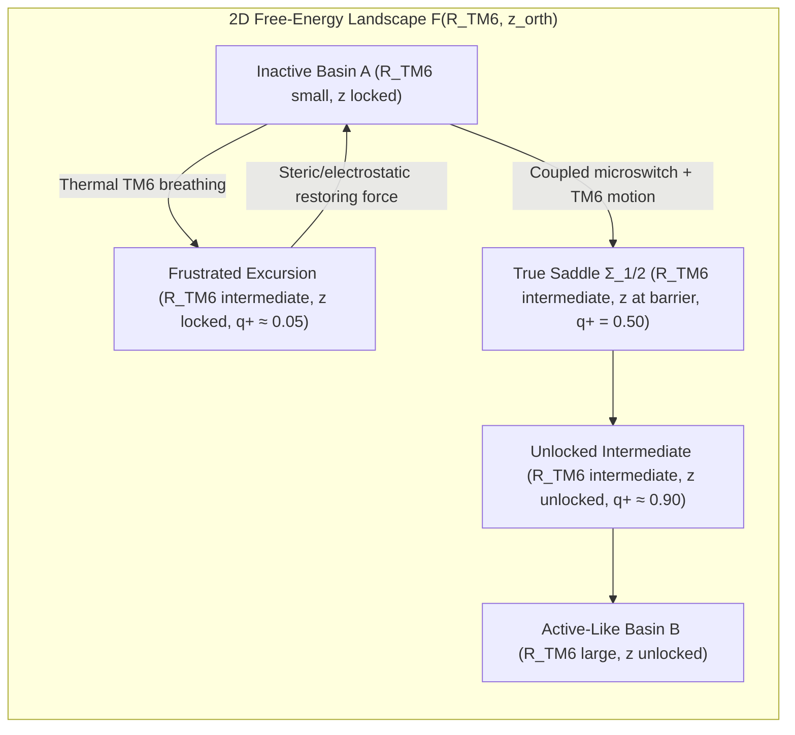
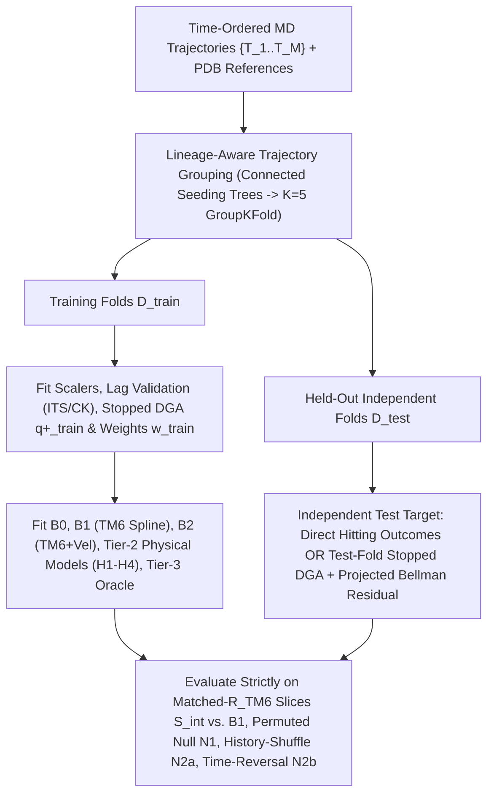

# 03. First-Principles Formulation, Methodological Critique, and Competing Physical Hypotheses for Predicting CB1 Activation from Molecular Dynamics

**Target System:** Human Cannabinoid Receptor 1 (`CNR1`, UniProt `P21554`, Class A GPCR)  
**Core Scientific Question:** *Can we infer a protein's future functional behavior from its present molecular configuration and short-time dynamics—and explain that predictability through physical principles rather than black-box statistical correlation?*

---

## Executive Overview

At first glance, asking whether present molecular dynamics (MD) snapshots can "predict" whether human CB1 progresses toward an active conformation or returns to an inactive one appears to collide with a foundational obstruction: **microscopic molecular trajectories are deterministically chaotic on picosecond timescales and driven by stochastic thermal collisions**. Yet statistical mechanics resolves this apparent paradox cleanly. While the *individual future path* $\mathbf{X}_{t+\tau}$ of a single trajectory replica is fundamentally unpredictable beyond picoseconds, the *conditional probability of future commitment*—formalized by the **Koopman (backward transfer) operator** $\mathcal{K}_\tau$ and the **forward committor** $q_+(\mathbf{x})$ of Transition Path Theory (TPT)—is an exact, deterministic physical field governed entirely by the equilibrium free-energy surface $F(\mathbf{x})$ and position-dependent diffusivity tensor $\mathbf{D}(\mathbf{x})$.

Within this operator framework, every piece of the user's scientific intuition translates into a sharp, testable mathematical statement:
1. **"Two states with identical TM6 opening have different probabilities of activating"** means that the committor gradient $\nabla q_+(\mathbf{x})$ possesses large components $\nabla_{\perp} q_+(\mathbf{x})$ **orthogonal** to the TM6 opening gradient $\nabla R_{\text{TM6}}(\mathbf{x})$—the signature of orthogonal steric/electrostatic free-energy barriers, kinetic hysteresis, and frustrated microswitch gating.
2. **"Short-time movements $\Delta \boldsymbol{\xi}(t)$ add predictive power over static coordinates $\boldsymbol{\xi}(t)$"** is formalized via **Mori–Zwanzig projection operator theory**: in an overdamped biomolecular system, dynamics along a complete reaction coordinate is Markovian (memoryless). Non-zero conditional predictive gain from trajectory history is therefore **not** polypeptide inertia—it is a **quantitative diagnostic detector of omitted slow orthogonal degrees of freedom** (such as internal water-wire percolation, allosteric $\text{Na}^+$ pocket reorganization, or membrane cholesterol wedging). As those hidden coordinates $\mathbf{z}(t)$ are explicitly identified and added to the state vector, static predictability rises while residual memory collapses toward zero.
3. **"Active-like receptor conformation $\neq$ productive G-protein signaling"** reflects the coupled thermodynamics and kinetics of ternary complex formation and **loose allosteric coupling**: ligands such as the CB1 negative allosteric modulator ORG27569 (PDB `6KQI`) contract the orthosteric agonist pocket while sterically clamping the intracellular TM2–TM4/TM6 gate, decoupling ligand binding from $G_i$ catalysis.

Below, Section 1 derives this first-principles theoretical framework; Section 2 audits five fatal methodological pitfalls in MD/ML studies and prescribes exact remedies; Section 3 separates already-published CB1 discoveries from genuinely open questions to formulate four competing physical hypotheses (`H1`–`H4`) against an explicit null (`H0`); and Section 4 specifies leakage-free trajectory-grouped validation protocols, non-tautological basin definitions, null models, and pre-registered falsification criteria executable on a laptop and Google Colab Pro.

---

## 1. First-Principles Formulation: Predicting Future Behavior from Present State

### 1.1 Deterministic Chaos vs. Probabilistic Kinetic Predictability (Koopman & Committor Theory)

Consider an all-atom solvated membrane simulation of human CB1 containing $N \sim 5 \times 10^4\text{--}1.5 \times 10^5$ atoms (receptor, orthosteric/allosteric ligand, POPC/cholesterol bilayer, explicit water, and $\text{Na}^+/\text{Cl}^-$ ions), with microscopic phase-space state $\mathbf{\Gamma} = (\mathbf{r}, \mathbf{p}) \in \mathbb{R}^{6N}$.

#### Why Deterministic Point Prediction Beyond Picoseconds Is Physically Impossible
Even under strictly deterministic Newtonian (NVE) equations of motion, anharmonic Lennard-Jones steric collisions and rapidly rearranging aqueous hydrogen-bond networks render biomolecular phase space strongly chaotic, with maximal Lyapunov exponents $\lambda_{\max} \sim 1\text{--}5\text{ ps}^{-1}$. Any infinitesimal perturbation $\delta \mathbf{\Gamma}_0$—such as IEEE-754 single-precision GPU rounding ($\sim 10^{-7}\text{ \AA}$) or non-associative parallel force summation—amplifies exponentially as:
$$\|\delta \mathbf{\Gamma}(t)\| \sim \|\delta \mathbf{\Gamma}_0\| \exp(\lambda_{\max} t),$$
growing to thermal atomic displacement scales ($\sim 1\text{ \AA}$) within the **Lyapunov horizon** $t_{\text{Lyap}} \approx \lambda_{\max}^{-1} \ln(10^7) \approx 3\text{--}15\text{ ps}$. Furthermore, canonical ensemble (NVT/NPT) MD simulations employ stochastic Langevin thermostats or stochastic velocity-rescaling thermostats:
$$m_i \ddot{\mathbf{r}}_i = -\nabla_i U(\mathbf{r}) - \gamma m_i \dot{\mathbf{r}}_i + \sqrt{2 \gamma m_i k_B T}\,\boldsymbol{\eta}_i(t), \qquad \langle \eta_{i,\alpha}(t)\,\eta_{j,\beta}(t') \rangle = \delta_{ij}\delta_{\alpha\beta}\delta(t - t'),$$
which continuously inject independent realizations of Gaussian white noise $\boldsymbol{\eta}(t)$. Consequently, two replicas initialized from the *exact same* atomic coordinates and velocities $(\mathbf{r}_0, \mathbf{p}_0)$ with different random seeds diverge into uncorrelated microstates within tens of picoseconds—five to eight orders of magnitude shorter than the microsecond-to-millisecond timescales of GPCR activation. **Predicting the exact future structure $\mathbf{X}_{t+\tau}$ of an individual trajectory at $\tau \gtrsim 10\text{ ns}$ is physically ill-posed.**

#### Why Conditional Ensemble Expectations Are Fundamental Physical Invariants
Although an individual sample path $\omega \mapsto \mathbf{X}_{t+\tau}(\omega)$ is stochastic, the **transition probability kernel** $p_\tau(\mathbf{x}, d\mathbf{x}') \equiv \mathbb{P}(\mathbf{X}_{t+\tau} \in d\mathbf{x}' \mid \mathbf{X}_t = \mathbf{x})$ is uniquely and deterministically fixed by the molecular Hamiltonian, temperature $T$, and pressure $P$. Its action on bounded observables $f: \Omega \to \mathbb{R}$ defines the **Koopman (backward transfer) semigroup** $\{\mathcal{K}_\tau\}_{\tau \ge 0}$ ([Prinz et al., 2011](https://doi.org/10.1063/1.3565032); [Wu & Noé, 2020](https://doi.org/10.1007/s00332-019-09567-y)):
$$(\mathcal{K}_\tau f)(\mathbf{x}) \equiv \mathbb{E}\!\left[f(\mathbf{X}_{t+\tau}) \;\middle|\; \mathbf{X}_t = \mathbf{x}\right] = \int_{\Omega} f(\mathbf{x}')\, p_\tau(\mathbf{x}, d\mathbf{x}').$$

On timescales $\tau$ much longer than the atomic velocity autocorrelation time $\tau_v = m/\zeta \sim 0.05\text{--}0.5\text{ ps}$, momenta thermalize locally and configuration-space evolution on $\mathbf{x} \in \Omega$ is governed by the overdamped Kramers–Smoluchowski diffusion generator $\mathcal{L}$ ($\mathcal{K}_\tau = e^{\tau \mathcal{L}}$):
$$(\mathcal{L} f)(\mathbf{x}) = -\beta \nabla F(\mathbf{x})^\top \mathbf{D}(\mathbf{x}) \nabla f(\mathbf{x}) + \nabla \cdot \big(\mathbf{D}(\mathbf{x}) \nabla f(\mathbf{x})\big) = \frac{1}{\pi(\mathbf{x})} \nabla \cdot \Big(\pi(\mathbf{x}) \mathbf{D}(\mathbf{x}) \nabla f(\mathbf{x})\Big),$$
where $\beta = (k_B T)^{-1}$, $F(\mathbf{x}) = -k_B T \ln \pi(\mathbf{x})$ is the equilibrium potential of mean force (PMF) associated with the Boltzmann stationary density $\pi(\mathbf{x}) = Z^{-1} e^{-\beta F(\mathbf{x})}$, and $\mathbf{D}(\mathbf{x})$ is the symmetric positive-definite diffusivity tensor ($\mathbf{D}(\mathbf{x}) = k_B T \boldsymbol{\zeta}(\mathbf{x})^{-1}$ by Einstein's relation). Under microscopic detailed balance, $\mathcal{L}$ is self-adjoint and negative semi-definite in the $\pi$-weighted Hilbert space $L^2_\pi(\Omega)$ with inner product $\langle u, v \rangle_\pi = \int_\Omega u(\mathbf{x}) v(\mathbf{x}) \pi(\mathbf{x})\, d\mathbf{x}$.

#### The Forward Committor $q_+(\mathbf{x})$ as the Exact Reaction Coordinate
Partition configuration space $\Omega$ into two disjoint core metastable states—the **inactive receptor basin** $A \subset \Omega$ and the **active-like receptor basin** $B \subset \Omega$ ($A \cap B = \emptyset$)—separated by the intermediate/transition region $I = \Omega \setminus (A \cup B)$. Defining the first-hitting time of any set $S \subset \Omega$ as $\tau_S = \inf\{t \ge 0 : \mathbf{X}_t \in S\}$, **Transition Path Theory (TPT)** ([Du et al., 1998](https://doi.org/10.1063/1.475393); [E & Vanden-Eijnden, 2006](https://doi.org/10.1007/s10955-005-9003-9); [E & Vanden-Eijnden, 2010](https://doi.org/10.1146/annurev.physchem.040808.090412)) defines the **forward committor** $q_+(\mathbf{x})$ as the probability of reaching $B$ before returning to $A$:
$$q_+(\mathbf{x}) \equiv \mathbb{P}\!\left(\tau_B < \tau_A \;\middle|\; \mathbf{X}_0 = \mathbf{x}\right).$$

By the strong Markov property and optional stopping, $q_+(\mathbf{x}) = (\mathcal{K}_{\tau \wedge \tau_{A \cup B}} q_+)(\mathbf{x})$ satisfies the exact elliptic **backward Kolmogorov Dirichlet boundary-value problem**:
$$\begin{cases} (\mathcal{L} q_+)(\mathbf{x}) = \dfrac{1}{\pi(\mathbf{x})} \nabla \cdot \Big(\pi(\mathbf{x}) \mathbf{D}(\mathbf{x}) \nabla q_+(\mathbf{x})\Big) = 0, & \mathbf{x} \in I = \Omega \setminus (A \cup B), \\[8pt] q_+(\mathbf{x}) = 0, & \mathbf{x} \in A, \\[4pt] q_+(\mathbf{x}) = 1, & \mathbf{x} \in B. \end{cases}$$

Equivalently, $q_+$ is the unique minimizer of the **Dirichlet reactive-flux functional** over functions satisfying $u|_A = 0, u|_B = 1$:
$$\mathcal{J}[u] = \int_{I} \pi(\mathbf{x})\, \nabla u(\mathbf{x})^\top \mathbf{D}(\mathbf{x}) \nabla u(\mathbf{x})\, d\mathbf{x}, \qquad \min_{\substack{u|_A = 0 \\ u|_B = 1}} \mathcal{J}[u] = \mathcal{J}[q_+] = \nu_{AB},$$
where $\nu_{AB}$ is the exact equilibrium reactive transition rate (reactive $A \to B$ trajectories per unit time). Under overdamped microscopic reversibility, the backward committor (probability that the trajectory *last came* from $A$ rather than $B$) satisfies $q_-(\mathbf{x}) = 1 - q_+(\mathbf{x})$ *(note: in full underdamped phase space $\mathbf{\Gamma} = (\mathbf{r}, \mathbf{p})$, time-reversal flips momenta so $q_-(\mathbf{r}, \mathbf{p}) = 1 - q_+(\mathbf{r}, -\mathbf{p})$)*, and the reactive probability current of productive $A \to B$ transition paths on $I$ is:
$$\mathbf{J}_{AB}(\mathbf{x}) = \pi(\mathbf{x}) \mathbf{D}(\mathbf{x}) \nabla q_+(\mathbf{x}).$$

> **Physical Takeaway:** $q_+(\mathbf{x})$ is the **ideal 1D reaction coordinate** ([Best & Hummer, 2005](https://doi.org/10.1073/pnas.0408098102); [Berezhkovskii & Szabo, 2005](https://doi.org/10.1063/1.1818091); [Peters, 2016](https://doi.org/10.1146/annurev-physchem-040215-112215)). Every configuration on the **isocommittor surface** $\Sigma_p = \{\mathbf{x} \in \Omega : q_+(\mathbf{x}) = p\}$ shares the exact same kinetic fate probability $p$, and $\Sigma_{1/2} = \{\mathbf{x} : q_+(\mathbf{x}) = 0.5\}$ defines the rigorous **stochastic separatrix (Transition State Ensemble, TSE)**. Inferring CB1's future functional fate from its present state is therefore mathematically equivalent to learning a sparse, physically interpretable approximation to $q_+(\mathbf{x})$ and its reactive current $\mathbf{J}_{AB}(\mathbf{x})$.

---

### 1.2 Formalizing the TM6 Hypothesis: Orthogonal Committor Gradients and Kinetic Hysteresis

Conventional GPCR structural analysis tracks activation via a single geometric order parameter $R_{\text{TM6}}(\mathbf{x})$ measuring the outward swing of cytoplasmic Transmembrane Helix 6 relative to TM3. In human CB1 (`P21554`), our primary coordinate $R_{\text{TM6}}(\mathbf{x}) \equiv d(\text{C}_\alpha[R214^{3.50}], \text{C}_\alpha[D338^{6.30}])$ expands from `6.75 Å` (`5U09`), `7.20 Å` (`6KQI`), and `8.69 Å` (`5TGZ`, [Hua et al., 2016](https://doi.org/10.1016/j.cell.2016.10.004)) in inactive/NAM states to `14.18 Å` (`5XRA`) and `14.94 Å` (`6N4B` chain R, [Krishna Kumar et al., 2019](https://doi.org/10.1016/j.cell.2018.11.040)) in active/$G_i$-coupled states. *(Note: the alternative one-turn-deeper metric $R_{\text{TM6}}^{(6.33)}(\mathbf{x}) \equiv d(\text{C}_\alpha[R214^{3.50}], \text{C}_\alpha[L341^{6.33}])$ has a narrower lever-arm dynamic range—expanding only from `7.92–8.89 Å` in `6KQI`/`5U09`/`5TGZ` to `11.83–11.88 Å` in `5XRA`/`6N4B`—and therefore requires its own calibrated thresholds whenever used as a secondary robustness check.)*

Consider the level hypersurface of configurations sharing an **identical intermediate TM6 opening** $r \in [r_{\text{low}}, r_{\text{high}}]$:
$$\mathcal{M}_r = \left\{\mathbf{x} \in I \;:\; R_{\text{TM6}}(\mathbf{x}) = r\right\}, \qquad \hat{\mathbf{n}}_{\text{TM6}}(\mathbf{x}) = \frac{\nabla R_{\text{TM6}}(\mathbf{x})}{\|\nabla R_{\text{TM6}}(\mathbf{x})\|}.$$

At every point $\mathbf{x} \in \mathcal{M}_r$, we decompose the committor gradient $\nabla q_+(\mathbf{x})$ into components parallel and orthogonal to $\hat{\mathbf{n}}_{\text{TM6}}(\mathbf{x})$ (or, in diffusion-weighted coordinates, with respect to the Riemannian inner product $\langle \mathbf{u}, \mathbf{v} \rangle_{\mathbf{D}} = \mathbf{u}^\top \mathbf{D}(\mathbf{x}) \mathbf{v}$):
$$\nabla q_+(\mathbf{x}) = \underbrace{\big(\hat{\mathbf{n}}_{\text{TM6}}(\mathbf{x})^\top \nabla q_+(\mathbf{x})\big)\, \hat{\mathbf{n}}_{\text{TM6}}(\mathbf{x})}_{\nabla_{\parallel} q_+(\mathbf{x})} \;+\; \underbrace{\Big(\mathbf{I} - \hat{\mathbf{n}}_{\text{TM6}}(\mathbf{x})\hat{\mathbf{n}}_{\text{TM6}}(\mathbf{x})^\top\Big) \nabla q_+(\mathbf{x})}_{\nabla_{\perp} q_+(\mathbf{x})}.$$

This decomposition yields an exact equivalence:
1. **Sufficiency Condition ($R_{\text{TM6}}$ alone predicts fate):** $q_+(\mathbf{x}) = \tilde{q}(R_{\text{TM6}}(\mathbf{x}))$ holds if and only if $\nabla_{\perp} q_+(\mathbf{x}) \equiv \mathbf{0}$ everywhere on $I$, which is equivalent to zero conditional committor variance on every fixed-$R_{\text{TM6}}$ slice:
   $$\operatorname{Var}_{\pi}\!\left(q_+(\mathbf{X}) \;\middle|\; R_{\text{TM6}}(\mathbf{X}) = r\right) = 0.$$
2. **User's Central Hypothesis (Orthogonal Gating):** Saying *"two CB1 configurations with the same intermediate TM6 opening have systematically different probabilities of progressing to active vs. returning to inactive"* is **mathematically identical** to:
   $$\operatorname{Var}_{\pi}\!\left(q_+(\mathbf{X}) \;\middle|\; R_{\text{TM6}}(\mathbf{X}) = r\right) > 0 \quad \Longleftrightarrow \quad \int_{\mathcal{M}_r} \|\nabla_{\perp} q_+(\mathbf{x})\|^2\, d\sigma_\pi(\mathbf{x}) > 0.$$

#### Physical Mechanism of $\nabla_{\perp} q_+ \neq \mathbf{0}$ (Barrier Hiding & Recrossing)
Why does projecting onto $R_{\text{TM6}}$ fail when internal microswitches $z_{\text{orth}}$ (e.g., aromatic core packing or polar hydrogen-bond networks) relax slowly? As proven by [Berezhkovskii & Szabo (2005)](https://doi.org/10.1063/1.1818091):
- **Kinetic Hysteresis / Overlap of Basins:** On a 2D switchback surface $F(R_{\text{TM6}}, z_{\text{orth}})$, spontaneous thermal fluctuations can transiently pry cytoplasmic TM6 outward to $r \approx 11.5\text{ \AA}$ while the internal core remains sterically/electrostatically locked ($z_{\text{orth}} = z_{\text{locked}}$). Because the steric wall ahead is steep, these configurations lie entirely on the $A$-side of the true separatrix ($q_+ \approx 0.05$) and snap elastically back to $A$. Conversely, configurations at the *same* $r \approx 11.5\text{ \AA}$ whose internal core has already switched ($z_{\text{orth}} = z_{\text{unlocked}}$) sit past the saddle ($q_+ \approx 0.90$) and relax downhill into $B$.
- **Bimodal Committor Histogram at the Apparent 1D Barrier:** Integrating out $z_{\text{orth}}$ into the 1D potential of mean force $F_{\text{1D}}(r) = -k_B T \ln \int e^{-\beta F(r, z)}\, dz$ mixes these two disconnected channels, hiding the orthogonal barrier and causing the committor distribution $P(q_+ \mid R_{\text{TM6}} = r^\ddagger)$ at the 1D PMF peak $r^\ddagger$ to split **bimodally near $0$ and $1$** instead of peaking unimodally at $q_+ = 0.5$ ([Du et al., 1998](https://doi.org/10.1063/1.475393); [Peters, 2016](https://doi.org/10.1146/annurev-physchem-040215-112215)).

---

### 1.3 Mori–Zwanzig Projection Operator Theory: When Do Recent Movements $\Delta \boldsymbol{\xi}(t)$ Add Predictive Power?

The user poses a deep dynamical question: *Does knowing how CB1 is moving right now—via finite-difference displacements $\Delta \boldsymbol{\xi}(t) = \boldsymbol{\xi}(t) - \boldsymbol{\xi}(t - \delta t)$ or short trajectory history $\boldsymbol{\xi}(t - m\delta t : t)$—improve commitment prediction beyond the instantaneous configuration $\boldsymbol{\xi}(t)$?*

Statistical mechanics gives a decisive, three-part answer depending on **timescale** and **coordinate completeness**:

#### Regime I: Instantaneous Atomic Momenta $\mathbf{p}$ ($\delta t \lesssim 1\text{ ps}$) Carry Negligible Commitment Information
In explicit membrane/water MD, atomic velocities decorrelate via solvent and lipid collisions on $\tau_v \sim 0.05\text{--}0.5\text{ ps}$. Crossing a GPCR activation barrier takes $\tau_{\text{TP}} \sim 10\text{ ns}\text{--}10\text{ }\mu\text{s}$ ($\tau_{\text{TP}} / \tau_v > 10^4$). Thus, the transition path is deeply **overdamped (diffusive)**: momenta randomize tens of thousands of times during a single barrier crossing, restricting momentum dependence of $q_+(\mathbf{r}, \mathbf{p})$ to a sub-picosecond thermal boundary layer of width $\ell_v \sim \sqrt{D \tau_v} \lesssim 0.1\text{ \AA}$ around $\Sigma_{1/2}$. **Picosecond ballistic velocities cannot predict microsecond conformational transitions.**

#### Regime II: Complete Collective Variables $\boldsymbol{\xi}^*(\mathbf{r})$ Are Markovian (Zero History Gain)
Suppose a low-dimensional collective variable vector $\boldsymbol{\xi}^*(\mathbf{r}) \in \mathbb{R}^d$ resolves **all** slow degrees of freedom whose relaxation times exceed a coarse lag $\tau_M$ (say, $\tau_M \sim 1\text{--}10\text{ ns}$), so all remaining orthogonal coordinates equilibrate adiabatically within $\tau_{\text{orth}} \ll \tau_M$. Then $\boldsymbol{\xi}^*(t)$ is a **Markov process** at resolution $\delta t \ge \tau_M$, and its present value completely screens off the past from the future:
$$\mathbb{P}\!\left(\tau_B < \tau_A \;\middle|\; \boldsymbol{\xi}^*(t),\, \boldsymbol{\xi}^*(t - \delta t),\, \dots\right) = \mathbb{P}\!\left(\tau_B < \tau_A \;\middle|\; \boldsymbol{\xi}^*(t)\right).$$
*(Subtle TPT insight: in a stationary reversible Markov process, observing $\Delta \boldsymbol{\xi}^*(t) = \boldsymbol{\xi}^*(t) - \boldsymbol{\xi}^*(t - \delta t) > 0$ increases the backward likelihood that the trajectory **recently came from $A$**, i.e., alters conditional backward provenance, while leaving forward commitment probability $q_+(\boldsymbol{\xi}^*(t))$ strictly invariant!)*

#### Regime III: Incomplete Collective Variables $\boldsymbol{\xi}(\mathbf{r})$ Acquire Memory via Mori–Zwanzig Projection
Now suppose our observed coordinate vector $\boldsymbol{\xi}(\mathbf{r}) \in \mathbb{R}^k$ (for instance, $R_{\text{TM6}}$ alone, or protein-only backbone distances) **omits** a slow coupled degree of freedom $\mathbf{z}(\mathbf{r})$ whose relaxation timescale satisfies $\tau_z \gtrsim \delta t$. Define the conditional expectation **Zwanzig projection operator** $\mathcal{P}$ onto functions of $\boldsymbol{\xi}$ and its orthogonal complement $\mathcal{Q} = \mathcal{I} - \mathcal{P}$ ([Mori, 1965](https://doi.org/10.1143/ptp.33.423); [Zwanzig, 1973](https://doi.org/10.1007/bf01008729); [Chorin, Hald & Kupferman, 2000](https://doi.org/10.1073/pnas.97.7.2968); [Ayaz et al., 2021](https://doi.org/10.1073/pnas.2023856118)):
$$(\mathcal{P} g)(\mathbf{\Gamma}) \equiv \mathbb{E}_{\pi}\!\left[g(\mathbf{\Gamma}') \;\middle|\; \boldsymbol{\xi}(\mathbf{\Gamma}') = \boldsymbol{\xi}(\mathbf{\Gamma})\right], \qquad \mathcal{Q} = \mathcal{I} - \mathcal{P}.$$

Applying the exact decomposition $\mathcal{L}\boldsymbol{\xi} = \mathcal{P}\mathcal{L}\boldsymbol{\xi} + \mathcal{Q}\mathcal{L}\boldsymbol{\xi}$ to the microscopic phase-space Liouville evolution $\dot{\boldsymbol{\xi}}(t) = e^{t\mathcal{L}}\mathcal{L}\boldsymbol{\xi}(0)$ and expanding the orthogonal evolution $e^{t\mathcal{L}}\mathcal{Q}\mathcal{L}\boldsymbol{\xi}(0)$ via Dyson's operator identity $e^{t\mathcal{L}} = e^{t\mathcal{Q}\mathcal{L}} + \int_0^t e^{(t-s)\mathcal{L}} \mathcal{P}\mathcal{L} e^{s\mathcal{Q}\mathcal{L}}\, ds$ (or its stochastic Fokker–Planck/hybrid projection counterpart; [Zwanzig, 1973](https://doi.org/10.1007/bf01008729); [Ayaz et al., 2021](https://doi.org/10.1073/pnas.2023856118)) yields the exact **Generalized Langevin Equation (GLE)** (shown in overdamped projected form):
$$\dot{\boldsymbol{\xi}}(t) = \underbrace{\mathbf{v}_{\text{PMF}}\!\big(\boldsymbol{\xi}(t)\big)}_{\text{Markovian PMF drift}} \;-\; \underbrace{\int_0^t \mathbf{K}\!\big(\boldsymbol{\xi}(s),\, t - s\big)\,\dot{\boldsymbol{\xi}}(s)\, ds}_{\text{Non-Markovian history / memory integral}} \;+\; \underbrace{\mathbf{F}_{\mathcal{Q}}(t)}_{\text{Orthogonal force in }\mathcal{Q}},$$
where $\mathbf{F}_{\mathcal{Q}}(t) = e^{t\mathcal{Q}\mathcal{L}} \mathcal{Q}\mathcal{L} \boldsymbol{\xi}(0)$ evolves inside the **unresolved orthogonal subspace $\mathcal{Q}$** (which contains the omitted slow coordinates $\mathbf{z}$!), and the memory kernel $\mathbf{K}(\cdot, t - s)$ scales with the temporal autocorrelation $\langle \mathbf{F}_{\mathcal{Q}}(t)\mathbf{F}_{\mathcal{Q}}(s)^\top \rangle$ via the Second Fluctuation–Dissipation Theorem.

> [!IMPORTANT]
> **The Memory-to-Mechanism Discovery Principle:**  
> Because an omitted slow mode $\mathbf{z}(t) \in \mathcal{Q}$ (e.g., an internal water wire, allosteric $\text{Na}^+$ ion, unmeasured aromatic rotamer, or wedged cholesterol molecule) exerts a persistent force $\mathbf{F}_{\mathcal{Q}}(t)$ over lag $\delta t \lesssim \tau_z$, recent trajectory history $\boldsymbol{\xi}(t - m\delta t : t)$ acts as a **Bayesian state filter (stochastic Takens delay embedding)** that partially infers the hidden state $\mathbf{z}(t)$:
> $$p\!\left(\mathbf{z}(t) \;\middle|\; \boldsymbol{\xi}(t),\, \Delta \boldsymbol{\xi}(t)\right) \neq p\!\left(\mathbf{z}(t) \;\middle|\; \boldsymbol{\xi}(t)\right).$$
> Consequently, a positive conditional mutual information gain from history,
> $$\Delta \mathcal{I}_{\text{mem}}(\boldsymbol{\xi}; \delta t) \equiv I\!\left(Y_{\text{commit}} \,;\, \boldsymbol{\xi}(t - m\delta t : t - \delta t) \;\middle|\; \boldsymbol{\xi}(t)\right) > 0,$$
> is an **exact mathematical signature of omitted slow orthogonal coordinates $\mathbf{z}$**. Even better, when the true missing physical coordinates $\mathbf{z}$ are identified and appended to form $\tilde{\boldsymbol{\xi}} = (\boldsymbol{\xi}, \mathbf{z})$, instantaneous predictive information $I(Y_{\text{commit}} ; \tilde{\boldsymbol{\xi}}(t))$ **must rise** while the residual memory term $\Delta \mathcal{I}_{\text{mem}}(\tilde{\boldsymbol{\xi}}; \delta t)$ **must collapse toward zero**!

---

## 2. Critical Evaluation of Flawed Assumptions and Methodological Pitfalls

Before touching MD data, we must inoculate the experimental design against five pervasive failure modes in biomolecular machine learning.

### Pitfall 1: Autocorrelation and Temporal/Lineage Leakage
- **The Trap:** Slow GPCR coordinates exhibit autocorrelation times $\tau_{\text{corr}} \sim 50\text{--}500\text{ ns}$, whereas trajectories save frames every $\Delta t_{\text{save}} = 0.01\text{--}0.2\text{ ns}$. Two distinct pathologies arise:
  1. *Regression Persistence Illusion:* Training a sequence model (LSTM, Transformer, TCN) to minimize MSE $\|\hat{\boldsymbol{\xi}}(t+\tau) - \boldsymbol{\xi}(t+\tau)\|^2$ for $\tau \ll \tau_{\text{corr}}$ rewards the trivial identity predictor $\hat{\boldsymbol{\xi}}(t+\tau) = \boldsymbol{\xi}(t)$, which achieves $R^2 \approx e^{-2\tau/\tau_{\text{corr}}} > 0.95$ while having **zero skill** at predicting rare barrier commitment.
  2. *Frame-Level Split Leakage ("Trajectory Fingerprinting"):* Randomly splitting frames across train and test sets places $\mathbf{X}_t$ in train and $\mathbf{X}_{t + \Delta t_{\text{save}}}$ in test. High-capacity classifiers memorize replica-specific slow noise (e.g., unordered loop conformations or slow lipid contacts) to identify *which trajectory* a frame came from, yielding illusory $>99\%$ accuracy that fails completely on unseen trajectories.
- **Mandatory Remedy:** Never split by frame. Enforce **strict trajectory-grouped (and adaptive-seeding lineage-grouped) cross-validation**, where every trajectory replica (and all child trajectories spawned from a shared adaptive seed cluster) belongs exclusively to a single fold, and benchmark every model against an explicit persistence baseline.

### Pitfall 2: Basin Classification Masquerading as Transition Prediction
- **The Trap:** Because transition paths occupy a tiny equilibrium fraction $\epsilon_{\text{TSE}} \ll 1$ of conformational space relative to deep inactive ($A$, $q_+ \approx 0$) and deep active ($B$, $q_+ \approx 1$) basins, global loss decomposes as:
  $$\mathcal{L}_{\text{global}} = (1 - \epsilon_{\text{TSE}})\,\mathcal{L}_{A \cup B} + \epsilon_{\text{TSE}}\,\mathcal{L}_{\text{TSE}}.$$
  Any static structural classifier (even a 1-parameter threshold on $R_{\text{TM6}}$) trivially separates deep $A$ from deep $B$ ($\mathcal{L}_{A \cup B} \approx 0$), achieving global AUROC $> 0.98$ even when its predictions inside the undecided transition region are pure coin-flips ($\text{AUROC}_{\text{TSE}} = 0.50$).
- **Mandatory Remedy:** Restrict primary evaluation strictly to the **undecided intermediate region** $\mathcal{S}_{\text{int}} = \{\mathbf{x} \in I : r_{\text{low}} \le R_{\text{TM6}}(\mathbf{x}) \le r_{\text{high}}\}$, and further evaluate **within narrow matched-$R_{\text{TM6}}$ strata** $[r_b, r_b + \delta r]$ ($\delta r = 0.5\text{ \AA}$) where $R_{\text{TM6}}$ itself carries near-zero variance.

### Pitfall 3: Short-Trajectory Right-Censoring and Adaptive Sampling Bias
- **The Trap:** Macroscopic GPCR activation occurs on $10\text{ }\mu\text{s}\text{--}10\text{ ms}$ timescales, whereas public datasets comprise either (a) thousands of short adaptive-sampling trajectories ($T_{\text{traj}} \sim 50\text{--}500\text{ ns}$ per round, e.g., [Dutta & Shukla, 2023](https://doi.org/10.1038/s42003-023-04868-1)) or (b) $3 \times 500\text{ ns}$ equilibrium replicates (GPCRmd). Labeling frame $t_i$ naively by whether its trajectory hits $B$ before file termination $T_{\text{traj}}$, $\tilde{y}_i = \mathbb{I}(\tau_B \le T_{\text{traj}} - t_i)$, estimates the *horizon-censored probability* $\mathbb{P}(\tau_B \le T_{\text{rem}} \mid \mathbf{x}) \neq q_+(\mathbf{x})$, severely mislabeling genuine committed intermediates ($q_+ = 0.8$) whose transit time exceeds $T_{\text{rem}}$ as "inactive" ($\tilde{y}_i = 0$). Furthermore, adaptive seeding samples initial states from a non-Boltzmann distribution $\rho_{\text{data}}(\mathbf{x}) \neq \pi(\mathbf{x})$.
- **Mandatory Remedy (Two Rigorous Estimator Regimes):**
  1. **Operator Solution via Stopped Dynamical Galerkin Approximation (DGA) / Reversible MSM (for Global $A \to B$ Committors on Adaptive Ensembles):** Because the Koopman operator acts *conditionally* on $\mathbf{X}_t = \mathbf{x}$, short trajectory pairs $(\mathbf{X}_t, \mathbf{X}_{t+\tau})$ are unbiased draws from $p_\tau(\mathbf{x}, d\mathbf{x}')$ regardless of non-Boltzmann seeding $\rho_{\text{data}}(\mathbf{x})$, provided $\tau \ge \tau_M$. Following [Thiede et al. (2019)](https://doi.org/10.1063/1.5063730) and [Strahan et al. (2021)](https://doi.org/10.1021/acs.jctc.0c00933), to prevent trajectory-end survivorship bias of order $\tau / T_{\text{traj}}$, we strictly restrict candidate interior starting frames across trajectories $m = 1,\dots,M$ to the horizon-safe index set:
     $$\mathcal{I}(\tau) \equiv \Big\{(m, t_n) \;:\; 0 \le t_n \le T_{\text{traj}}^{(m)} - \tau \;\text{ and }\; \mathbf{X}_{t_n}^{(m)} \in I\Big\}, \qquad N_{\text{int}}(\tau) = |\mathcal{I}(\tau)|.$$
     For each $(m, t_n) \in \mathcal{I}(\tau)$, let $\tau_{A \cup B}^{(m,n)} = \inf\{s \ge 0 : \mathbf{X}_{t_n + s}^{(m)} \in A \cup B\}$ be the forward first-entry stopping lag into $A \cup B$ (guaranteed observable on $[t_n, t_n + \tau] \subseteq [0, T_{\text{traj}}^{(m)}]$), choose a boundary-satisfying guess $g(\mathbf{x})$ ($g|_A = 0, g|_B = 1$) and interior basis functions $\{\phi_j\}_{j=1}^M$ vanishing on $A \cup B$ ($\phi_j|_{A \cup B} = 0$), and solve the **stopped finite-lag Galerkin system**:
     $$q_+^{\text{DGA}}(\mathbf{x}) = g(\mathbf{x}) + \sum_{j=1}^M c_j \phi_j(\mathbf{x}), \qquad \mathbf{A}(\tau)\,\mathbf{c} = -\mathbf{b}(\tau),$$
     $$A_{ij}(\tau) = \frac{1}{N_{\text{int}}(\tau)} \sum_{(m, t_n) \in \mathcal{I}(\tau)} \phi_i(\mathbf{X}_{t_n}^{(m)})\Big[\phi_j\!\big(\mathbf{X}_{t_n + (\tau \wedge \tau_{A \cup B}^{(m,n)})}^{(m)}\big) - \phi_j(\mathbf{X}_{t_n}^{(m)})\Big],$$
     $$b_i(\tau) = \frac{1}{N_{\text{int}}(\tau)} \sum_{(m, t_n) \in \mathcal{I}(\tau)} \phi_i(\mathbf{X}_{t_n}^{(m)})\Big[g\!\big(\mathbf{X}_{t_n + (\tau \wedge \tau_{A \cup B}^{(m,n)})}^{(m)}\big) - g(\mathbf{X}_{t_n}^{(m)})\Big].$$
     *(Both the horizon restriction $t_n \le T_{\text{traj}}^{(m)} - \tau$ and stopping at $\tau \wedge \tau_{A \cup B}^{(m,n)}$ are essential: omitting $t_n \le T_{\text{traj}}^{(m)} - \tau$ biases toward fast-hitting paths near trajectory ends, while using unstopped $\mathbf{X}_{t_n + \tau}^{(m)}$ introduces boundary recrossing bias at finite lag $\tau$!)* Equilibrium weights $w(\mathbf{x}) = \pi(\mathbf{x}) / \rho_{\text{data}}(\mathbf{x})$ are recovered via the adjoint DGA stationary equation or reversible MLE MSM ([Prinz et al., 2011](https://doi.org/10.1063/1.3565032); [Metzner, Schütte & Vanden-Eijnden, 2009](https://doi.org/10.1137/070699500)), validated by implied timescale (ITS) plateaus and Chapman–Kolmogorov (CK) tests.
  2. **Direct Empirical Hitting Outcomes Only for Fast Local Microswitch Mesostates (on $500\text{ ns}$ Replicates):** On shorter multi-ligand equilibrium trajectories that do not sample global $A \leftrightarrow B$ transitions, never claim to estimate the millisecond global committor directly; instead, evaluate local microswitch committors $q_+^{\text{loc}}(\mathbf{x}) = \mathbb{P}(\tau_{B_{\text{loc}}} < \tau_{A_{\text{loc}}} \mid \mathbf{x})$ strictly when empirical commitment times satisfy $\tau_{\text{commit}} \ll T_{\text{rem}}$ (enforcing $<5\%$ right-censoring within a fixed forward window $\tau_{\max}$, with worst-case censoring bounds reported explicitly).

### Pitfall 4: Receptor Active-Like Conformation $\neq$ Productive G-Protein Activation
- **The Trap:** Equating outward TM6 displacement in an isolated, $G_i$-free receptor simulation with cellular agonist efficacy ($E_{\max}$ or GTP$\gamma$S turnover).
- **Thermodynamic & Kinetic Formalization:** Extending the ternary complex framework ([De Lean, Stadel & Lefkowitz, 1980](https://pubmed.ncbi.nlm.nih.gov/6248546/)) with GPCR **loose allosteric coupling** ([Dror et al., 2011](https://doi.org/10.1073/pnas.1110499108); [Nygaard et al., 2013](https://doi.org/10.1016/j.cell.2013.01.008); [Latorraca, Venkatakrishnan & Dror, 2017](https://doi.org/10.1021/acs.chemrev.6b00177)), cellular $G_i$ catalysis proceeds across a multi-step reaction cycle:
  $$L + R_{\text{inact}} \underset{k_{-L}}{\overset{k_{+L}}{\rightleftharpoons}} L R_{\text{inact}} \underset{k_{ba}(L)}{\overset{k_{ab}(L)}{\rightleftharpoons}} L R^*_{\text{Gi-comp}} \underset{k_{\text{off},G}(L)}{\overset{k_{\text{on},G}[G_{\text{GDP}}]}{\rightleftharpoons}} L R^*_{\text{Gi-comp}} G_{\text{GDP}} \overset{k_{\text{cat}}(L)}{\longrightarrow} L R^* G_{\emptyset} + \text{GDP}.$$
  Receptor-only MD probes *only* the intramolecular isomerization $L R_{\text{inact}} \rightleftharpoons L R^*_{\text{Gi-comp}}$ (rates $k_{ab}(L), k_{ba}(L)$, equilibrium constant $K_{\text{act}}(L) = k_{ab}/k_{ba} = e^{-\beta \Delta G_{R \to R^*}(L)}$). Three physical decouplings break naive structural extrapolation:
  1. **Loose Orthosteric–Intracellular Coupling:** Orthosteric agonist occupancy lowers $\Delta G_{R \to R^*}(L)$ but often leaves inactive or intermediate receptor states heavily populated until heterotrimeric $G_i$ binds and supplies cooperative stabilization $\Delta\Delta G_{\text{coop}}$ (`6N4B`, [Krishna Kumar et al., 2019](https://doi.org/10.1016/j.cell.2018.11.040)). *(Note also that the $G_i$-free agonist crystal structure `5XRA` carries stabilizing engineering constructs/mutations; note its 2025 peer-reviewed replacement [Hua et al., 2025](https://doi.org/10.1038/s41586-025-09454-5) of original `10.1038/nature23272`, where mutant cAMP assays were repeated while crystal coordinates remained valid.)*
  2. **Allosteric Decoupling by ORG27569 (`6KQI`):** In CB1, the negative allosteric modulator ORG27569 binds an extrahelical cholesterol-overlapping site across TM2–TM3–TM4 ([Shao et al., 2019](https://doi.org/10.1038/s41589-019-0387-2), PDB `6KQI`). ORG27569 **increases** binding affinity of orthosteric agonist CP55,940 (promoting an agonist-contracted orthosteric pocket!) while sterically blocking $F237^{4.46}/F155^{2.42}$ and clamping cytoplasmic TM6 shut ($k_{ab} \to 0$). Any predictor relying on orthosteric pocket contraction predicts activation *backwards* for ORG27569!
  3. **Cavity Opening vs. Catalytic Sidechain Geometry ($k_{\text{cat}}$ & Signaling Bias):** Outward TM6 movement creates steric room for the $G_{\alpha i}$ $\alpha 5$ helix, but productive GDP release requires specific intracellular sidechain coordination—extended $R214^{3.50}$ (broken $R214^{3.50}\text{--}D338^{6.30}$ ionic lock), inward-shifted TM7 $N393^{7.49}P394^{7.50}\text{xx}Y397^{7.53}$ hydrogen-bonded/water-bridged to $Y294^{5.58}$, and permissive ICL2/Helix 8 geometry. Open-TM6 conformations lacking $Y294^{5.58}\text{--}Y397^{7.53}$ alignment can form non-productive complexes ($k_{\text{cat}} \approx 0$) or favor $\beta$-arrestin over $G_i$.
- **Mandatory Remedy:** Explicitly distinguish **TM6-open receptor conformations** ($B_{\text{TM6}}$) from **full $G_i$-competent receptor microswitch conformations** ($B_{\text{core}}$, defined by the receptor transmembrane core of `6N4B`), and never claim receptor-only MD directly measures $k_{\text{cat}}$ without $G_i$ present.

### Pitfall 5: Gratuitous Deep Generative Architectures vs. Physics-Driven Discovery
- **The Trap:** Deploying million-parameter 3D equivariant diffusion models, flow-matching networks, or graph transformers on MD ensembles whose **effective independent sample size** is $N_{\text{eff}} \approx T_{\text{total}} / (2 \tau_{\text{corr}}) \sim 10^2\text{--}10^3$ (and actual barrier-crossing events $N_{\text{rxn}} \sim 5\text{--}50$). Static Boltzmann/flow generators discard the diffusivity tensor $\mathbf{D}(\mathbf{x})$ and kinetic committor entirely, while deep black-box propagators entangle thousands of irrelevant thermal loop/lipid fluctuations with the 3–5 gating coordinates, defeating mechanistic interpretability ([Fleetwood et al., 2020](https://doi.org/10.1016/j.bpj.2019.12.016)).
- **Mandatory Remedy (Three-Tier Physics-First Hierarchy):**

| Tier | Method Class | Role in Discovery Pipeline | Compute Footprint |
| :--- | :--- | :--- | :--- |
| **Tier 1 (Operator Ground Truth)** | Stopped DGA & Reversible MLE-MSM Committors; VAMP-2 / TICA spectral embeddings ([Wu & Noé, 2020](https://doi.org/10.1007/s00332-019-09567-y); [Strahan et al., 2021](https://doi.org/10.1021/acs.jctc.0c00933)) | Unbiased estimation of $q_+(\mathbf{x})$, stationary weights $\pi(\mathbf{x})$, reactive currents $\mathbf{J}_{AB}$, and implied timescales | Laptop CPU / Colab CPU (minutes) |
| **Tier 2 (Mechanistic Hypothesis Models)** | $L_1$ / subset-sparse **Peters–Trout committor likelihood maximization** ([Peters & Trout, 2006](https://doi.org/10.1063/1.2234477)) with bilinear epistasis $\sigma(w_0 + \sum_i w_i \xi_i + \sum_{i<j} w_{ij}\xi_i\xi_j)$ on dimensionless physical coordinates | Discovers minimal ($k \le 5$) closed-form reaction coordinates aligned with $\nabla q_+(\mathbf{x})$ and tests cooperative gating | Laptop CPU (seconds to minutes) |
| **Tier 3 (Nonparametric Oracle Bound)** | Regularized Gradient-Boosted Trees / shallow MLP / VAMPnet | Strictly measures the **completeness gap** $\Delta \ell_{\text{oracle}} = \ell_{\text{Tier 3}} - \ell_{\text{Tier 2}}$ to reveal if nonlinear/unmodeled features remain | Laptop / single Colab T4 GPU (minutes) |

---

## 3. Candidate Physical Mechanisms and Competing Hypotheses

### 3.1 Separating Published CB1 Knowledge from Genuinely Open Questions

Intellectual honesty requires clearly delineating what prior structural and MD/MSM studies of human CB1 (`P21554`) have **already established** versus what our study tests for the **first time**:

- **Already Established in Literature:**
  - *Canonical Class A Microswitches in CB1:* Twin toggle switch $F200^{3.36}\text{--}W356^{6.48}$ aromatic $\pi\text{-}\pi$ stacking in inactive CB1 (`5TGZ`) and concerted rotamer switch upon agonist/Gi activation (`5XRA`, `6N4B`); DRY ionic lock $R214^{3.50}\text{--}D338^{6.30}$ (`D213^{3.49}R214^{3.50}Y215^{3.51}`); intracellular tyrosine/NPxxY motif $Y294^{5.58}$ and $N393^{7.49}P394^{7.50}\text{II}Y397^{7.53}$; and allosteric sodium pocket $D163^{2.50}$ ([Hua et al., 2016](https://doi.org/10.1016/j.cell.2016.10.004); [Krishna Kumar et al., 2019](https://doi.org/10.1016/j.cell.2018.11.040); [Dutta, Selvam & Shukla, 2022](https://doi.org/10.1021/acschemneuro.1c00760)).
  - *CB1-Specific TM2–TM4 Switch ($F155^{2.42}\text{--}F237^{4.46}$) vs. Backbone-Only MSMs:* Structural, mutagenesis, and metadynamics studies ([Shao et al., 2019](https://doi.org/10.1038/s41589-019-0387-2); [Yang et al., 2022](https://doi.org/10.1038/s41589-022-01038-y); [Krishna Kumar et al., 2023](https://doi.org/10.1038/s41467-023-37864-4)) **already established** concerted inward-to-outward reorientation of $F155^{2.42}$ and $F237^{4.46}$ as a CB1-selective aromatic activation conduit (disrupted in human CB2, `P34972`, which retains $F72^{2.42}$ but substitutes non-aromatic $L154^{4.46}$ at `4.46`, and sterically locked by NAM ORG27569 in `6KQI`). Notably, even in transducer-free agonist crystal `5XRA` where TM6 is open (`14.18 Å`), $F155^{2.42}$/$F237^{4.46}$ remain inward and $Y294^{5.58}\text{--}Y397^{7.53}$ remains unformed, flipping only in transducer-bound complexes (`6N4B`, `8GHV`). Crucially, however, published unbiased adaptive-MD MSMs of CB1 ([Dutta & Shukla, 2023](https://doi.org/10.1038/s42003-023-04868-1), `Cannabinoid_activation`) featurized the receptor solely via $\text{C}_\alpha\text{--}\text{C}_\alpha$ distances in POPC without cholesterol and did **not** resolve $F155^{2.42}/F237^{4.46}$ sidechain rotamer gating!

- **Genuinely Open & Untested Mechanistic Questions (Our Contribution):**
  1. **Quantitative Orthogonal Committor Variance at Matched TM6 Opening:** Prior MSM work projected equilibrium free energies (TICA PMFs) and macrostate TPT fluxes, but did **not** test whether configurations sharing *identical* intermediate $R_{\text{TM6}}$ exhibit large out-of-trajectory committor variance $\operatorname{Var}(q_+ \mid R_{\text{TM6}} = r)$, nor isolate the minimal sparse reaction coordinate ($k \le 5$) that predicts *subsequent TM6 completion itself* without label circularity.
  2. **Mori–Zwanzig Memory Collapse for Solvent, Ion, and Lipid Hidden Gates:** Whether short-time protein movements $\Delta \boldsymbol{\xi}_{\text{prot}}(t)$ carry non-Markovian predictive skill specifically because omitted non-backbone/environmental slow modes—internal transmembrane water-wire percolation, $D163^{2.50}$ $\text{Na}^+$/hydration collapse, or extrahelical cholesterol wedging—act as hidden slow gates.
  3. **Ligand Rotation of the Committor Gradient $\nabla q_+^{(L)}(\mathbf{x})$:** Whether full agonists, partial agonists ($\Delta^9$-THC), inverse agonists, and NAMs (ORG27569) merely shift equilibrium populations along an *invariant* reaction coordinate (1D MWC-like shift) or **rotate the direction of $\nabla q_+^{(L)}(\mathbf{x})$**, changing which physical microswitch is rate-limiting.

---

### 3.2 Competing Physical Hypotheses (`H0` vs. `H1`–`H4`)

#### Null Hypothesis `H0`: 1D TM6 Sufficiency and Protein Markovianity
- **Physical Claim:** Cytoplasmic TM6 opening $R_{\text{TM6}}(\mathbf{x}) = d(\text{C}_\alpha[R214^{3.50}], \text{C}_\alpha[D338^{6.30}])$ (with a separately thresholded robustness check on $R_{\text{TM6}}^{(6.33)}(\mathbf{x}) = d(\text{C}_\alpha[R214^{3.50}], \text{C}_\alpha[L341^{6.33}])$) already aligns closely with the committor gradient ($\nabla_{\perp} q_+(\mathbf{x}) \approx \mathbf{0}$). Within narrow intermediate $R_{\text{TM6}}$ slices, neither orthogonal internal coordinates nor recent trajectory displacements $\Delta \boldsymbol{\xi}(t)$ yield statistically significant improvements in out-of-trajectory commitment prediction over a flexible 1D monotone/spline baseline $\hat{q}_+^{\text{TM6}}(R_{\text{TM6}})$.

#### Hypothesis `H1`: Orthogonal Allosteric Gating and Cooperative Microswitch Epistasis
- **Physical Claim:** Outward cytoplasmic TM6 fluctuations into the intermediate zone ($R_{\text{TM6}} \in [10.2, 12.8]\text{ \AA}$) experience strong elastic/electrostatic restoring forces back toward $A$ ($q_+ \ll 0.5$) **unless** internal steric and polar frustration has been coordinately released across orthogonal microswitches:
  1. **Twin Toggle Switch (`3.36–6.48`):** Aromatic unstacking and $(\chi_1, \chi_2)$ rotamer transition of $F200^{3.36}$ and $W356^{6.48}$;
  2. **CB1-Unique TM2–TM4 Conduit (`2.42–4.46`):** Concerted sidechain reorientation and packing swap of $F155^{2.42}$ and $F237^{4.46}$ relative to $W241^{4.50}$ / TM3 core;
  3. **Intracellular Polar Latch (`3.50–6.30` & `5.58–7.53`):** Breakage of the $R214^{3.50}\text{--}D338^{6.30}$ ionic lock coupled with inward shift of TM7 $N393^{7.49}P394^{7.50}\text{II}Y397^{7.53}$ to engage $Y294^{5.58}$;
  4. **Orthosteric V-Loop / ECL2 Plug Packing:** Downward/inward compaction of the N-terminal V-loop / ECL2 and TM1–TM7 extracellular segment.
- **Mathematical Prediction:** A sparse ($k \le 5$) Peters–Trout logistic committor model on dimensionless physical features—specifically requiring **positive cooperative interaction terms** $w_{ij} \xi_i \xi_j \neq 0$ (e.g., TM6 opening $\times$ toggle/NPxxY unlocking)—significantly outperforms `B1` ($\hat{q}_+^{\text{TM6}}$) on matched-$R_{\text{TM6}}$ slices **even when the target committor $q_+^{\text{TM6-only}}$ is defined purely by future TM6 completion**, and transforms the predicted $\hat{\Sigma}_{1/2}$ committor distribution from bimodal/broad to unimodal around $q_+ = 0.5$.

#### Hypothesis `H2`: Hidden Solvent, Sodium, and Lipid Slow Modes Revealed by Mori–Zwanzig Memory Collapse
- **Physical Claim:** When CB1 is featurized solely by protein backbone/sidechain coordinates $\boldsymbol{\xi}_{\text{prot}}(t)$ (or $R_{\text{TM6}}(t)$ alone), multi-lag displacements $\Delta \boldsymbol{\xi}_{\text{prot}}(t; \delta t) = \boldsymbol{\xi}_{\text{prot}}(t) - \boldsymbol{\xi}_{\text{prot}}(t - \delta t)$ at mesoscopic lags $\delta t \in [0.5, 20]\text{ ns}$ provide positive conditional mutual information $\Delta \mathcal{I}_{\text{mem}}(\boldsymbol{\xi}_{\text{prot}}; \delta t) > 0$. By Mori–Zwanzig theory (Section 1.3), this apparent memory arises from omitted slow environmental coordinates $\mathbf{z}_{\text{env}}(t)$:
  1. **Transmembrane Water-Wire Percolation:** Formation vs. dewetting of a continuous hydrogen-bonded water chain bridging $D163^{2.50} \leftrightarrow W356^{6.48} \leftrightarrow N393^{7.49}/Y397^{7.53}$ (quantified via water-oxygen graph shortest-path connectivity and internal pore hydration count);
  2. **Allosteric $\text{Na}^+$ Pocket State:** $\text{Na}^+$ coordination distance to $D163^{2.50}$ carboxyl oxygens (when $\text{Na}^+$ is present) and $D163^{2.50}\text{--}N393^{7.49}$ polar pocket collapse;
  3. **Extrahelical Cholesterol / Lipid Wedging:** Heavy-atom occupancy of cholesterol or phospholipid acyl chains inside the extrahelical TM2–TM3–TM4 cleft (the `6KQI` ORG27569 pocket flanking $F237^{4.46}/F155^{2.42}$) and the intracellular TM6–TM7 crevice.
- **Mathematical Prediction (Two-Step Memory Collapse Test):**
  1. *Step A (Detection):* On stripped or protein-only features $\boldsymbol{\xi}_{\text{prot}}(t)$, history $\Delta \boldsymbol{\xi}_{\text{prot}}(t; \delta t)$ yields statistically significant out-of-fold log-likelihood gain $\Delta \ell_{\text{mem}}(\boldsymbol{\xi}_{\text{prot}}) > 0$ peaking at $\delta t \approx \tau_z$ (and vanishing at picosecond ballistic lags $\delta t \to 0$).
  2. *Step B (Closure on Explicit-Solvent/Membrane Trajectories):* Appending static $\mathbf{z}_{\text{env}}(t)$ increases static predictive skill $\ell([\boldsymbol{\xi}_{\text{prot}}(t), \mathbf{z}_{\text{env}}(t)]) > \ell(\boldsymbol{\xi}_{\text{prot}}(t))$ while reducing residual history gain $\Delta \ell_{\text{mem}}([\boldsymbol{\xi}_{\text{prot}}, \mathbf{z}_{\text{env}}])$ by $\ge 50\%$! *(Where public adaptive ensembles strip solvent/lipids, internal polar-aperture and cavity-volume proxies $\hat{\mathbf{z}}_{\text{cav}}(\mathbf{x}_{\text{prot}})$ are tested alongside full explicit $\mathbf{z}_{\text{env}}$ on all-atom GPCRmd replicates.)*

#### Hypothesis `H3`: Ligand-Induced Committor Gradient Rotation & Allosteric Decoupling (vs. `H3_null`: Invariant-Pathway Population Shift)
- **Competing Claims:**
  - **`H3_null` (1D MWC Population Shift):** Different ligands $L$ shift the intercept $w_0^{(L)}$ (thermodynamic bias $\Delta G_{AB}(L)$) while leaving the normalized committor gradient direction $\hat{\mathbf{w}}^{(L)}$ invariant across ligands ($\mathcal{S}_{\cos}(L_1, L_2) \approx 1$).
  - **`H3` (Kinetic Bottleneck Rotation & Allosteric Decoupling):** Distinct ligand classes reshape the transition saddle and **rotate $\nabla q_+^{(L)}(\mathbf{x})$** ($\mathcal{S}_{\cos}(L_1, L_2) < 1$ significantly below within-ligand bootstrap confidence bounds):
    - *Full agonists (e.g., AM11542, CP55,940, MDMB-Fubinaca):* Pre-stabilize orthosteric plug compaction and destabilize $F200^{3.36}\text{--}W356^{6.48}$, rotating $\nabla q_+$ onto downstream intracellular gating ($Y294^{5.58}\text{--}Y397^{7.53}$ and $R214^{3.50}\text{--}D338^{6.30}$).
    - *Partial agonist ($\Delta^9$-THC):* Weakly perturbs $W356^{6.48}$, leaving the twin toggle switch as the dominant component of $\nabla q_+$.
    - *NAM ORG27569 (`6KQI`):* Induces **sign-inverted or orthogonal decoupling** between orthosteric pocket contraction and intracellular commitment by sterically clamping $F237^{4.46}/F155^{2.42}$.

#### Hypothesis `H4`: Conserved Class A GPCR Core Transferability with Built-In CB2 `4.46` Evolutionary Ablation
- **Physical Claim:** Expressing microswitches in receptor-standardized dimensionless coordinates $\tilde{\xi}_{\text{BW}} \in [0, 1]$ anchored to each receptor's inactive and active reference structures:
  1. A **5-feature conserved Class A core committor model** (`3.50–6.30` TM3–TM6, `3.36–6.48` toggle, `3.49–3.50` DRY, `5.58–7.53` Tyr-NPxxY latch, `2.50–7.49` $\text{Na}^+$ pocket) trained on CB1 transfers **zero-shot** (up to a 1-parameter prior-odds intercept calibration $w_0$) to CB2 (`CNR2`, `P34972`) and canonical Class A GPCRs ($\beta_2\text{AR}$, $\mu\text{OR}$), beating their respective $R_{\text{TM6}}$-only baselines on matched-$R_{\text{TM6}}$ slices.
  2. Conversely, the CB1-specific `2.42–4.46` aromatic pair ($F155^{2.42}\text{--}F237^{4.46}$) yields positive out-of-fold log-likelihood gain $\Delta \ell_{2.42\text{--}4.46} > 0$ in **CB1** ($F155^{2.42}/F237^{4.46}$) while yielding $\Delta \ell_{2.42\text{--}4.46} \approx 0$ in **CB2** ($F72^{2.42}/L154^{4.46}$, where the aromatic partner at `4.46` is replaced by Leu), providing a clean evolutionary specificity control.

---

## 4. Exact Mathematical Tests, Leakage-Free Validation, Null Models, and Falsification Criteria

### 4.1 Non-Tautological Basin Definitions ($A$, $B$, and Matched-$R_{\text{TM6}}$ Interior $I$)

A subtle methodological flaw in reaction-coordinate studies is **boundary circularity**: if basin $B$ is defined using feature $\xi_2$, and $\hat{q}_+$ is evaluated right next to the boundary of $B$ at short lag, $\xi_2$ appears predictive merely because it defines the label boundary! We eliminate tautology via two strict safeguards:

1. **Dual Committor Targets (Strictly Non-Circular Target 1 + Biophysical Target 2):**
   - **Target 1 — Pure-TM6 Progression Committor ($q_+^{\text{TM6-only}}$):** Define core endpoints using **only** $R_{\text{TM6}}(\mathbf{x}) = d(\text{C}_\alpha[R214^{3.50}], \text{C}_\alpha[D338^{6.30}])$ (with dwell filter $\tau_{\text{dwell}} \ge 2\text{ ns}$ to suppress sub-nanosecond thermal jitter):
     $$A_{\text{TM6}} = \{\mathbf{x} : R_{\text{TM6}}(\mathbf{x}) \le r_A\}, \qquad B_{\text{TM6}} = \{\mathbf{x} : R_{\text{TM6}}(\mathbf{x}) \ge r_B\},$$
     where $r_A \approx 9.2\text{ \AA}$ and $r_B \approx 13.8\text{ \AA}$ are anchored to the 90th percentile of inactive (`5U09` `6.75 Å`, `6KQI` `7.20 Å`, `5TGZ` `8.69 Å`) and 10th percentile of active (`5XRA` `14.18 Å`, `6N4B` `14.94 Å`) fluctuations. *(When running the secondary robustness check with $R_{\text{TM6}}^{(6.33)} = d(\text{C}_\alpha[R214^{3.50}], \text{C}_\alpha[L341^{6.33}])$, whose PDB range spans `7.92–8.89 Å` inactive to `11.83–11.88 Å` active, dedicated cutoffs $r_A^{(6.33)} \approx 9.1\text{ \AA}$, $r_B^{(6.33)} \approx 11.5\text{ \AA}$, and intermediate slice $[9.6, 11.0]\text{ \AA}$ with $0.5\text{ \AA}$ boundary buffers are used rather than `13.8 Å`.)* **Crucially, zero orthogonal features ($F200^{3.36}, W356^{6.48}, F155^{2.42}, F237^{4.46}, Y397^{7.53}$, water, ions, lipids) appear in $A_{\text{TM6}}$ or $B_{\text{TM6}}$.** Any improvement over $\hat{q}_+^{\text{TM6}}(R_{\text{TM6}})$ inside matched-$R_{\text{TM6}}$ slices $[r_b, r_b + 0.5\text{ \AA}] \subset [r_A + 1.0\text{ \AA}, r_B - 1.0\text{ \AA}] = [10.2, 12.8]\text{ \AA}$ (with a mandatory $\ge 1.0\text{ \AA}$ buffer away from both boundaries!) proves genuine physical causality on future TM6 motion without possibility of label circularity.
   - **Target 2 — Full $G_i$-Competent Core Committor ($q_+^{\text{core}}$):** Define $A_{\text{core}}$ and $B_{\text{core}}$ by heavy-atom transmembrane core RMSD ($\le 1.5\text{ \AA}$) to `5TGZ` vs. `6N4B` receptor core. Comparing the divergence $\Delta q_{\text{decouple}}(\mathbf{x}) \equiv q_+^{\text{TM6-only}}(\mathbf{x}) - q_+^{\text{core}}(\mathbf{x})$ directly quantifies **non-productive TM6 opening** (Pitfall 4)!

### 4.2 Zero-Leakage Trajectory-Lineage Cross-Validation Protocol

1. **Atomic Trajectory & Seeding-Lineage Grouping:** Let $\{\mathcal{T}_1, \dots, \mathcal{T}_M\}$ denote all trajectory files. Construct a lineage graph $\mathcal{G}$ connecting $\mathcal{T}_m$ and $\mathcal{T}_{m'}$ whenever $\mathcal{T}_{m'}$ was seeded from $\mathcal{T}_m$ (or, if adaptive parent metadata is unavailable, whenever initial transmembrane heavy-atom $\text{RMSD}(\mathbf{X}_0^{(m)}, \mathbf{X}_0^{(m')}) < 1.0\text{ \AA}$). Connected components $\{\mathcal{C}_g\}$ of $\mathcal{G}$ are assigned as indivisible groups in $K = 5$ stratified group cross-validation (`StratifiedGroupKFold`, stratified by initial state basin/ligand).
2. **Strict Fold Isolation of Operator & Feature Fitting:** Every empirical mean/variance scaler, VAMP/TICA basis, MSM clustering, and training DGA operator $(\mathbf{A}_{\text{train}}(\tau), \mathbf{b}_{\text{train}}(\tau))$ is fit **exclusively on $\mathcal{D}_{\text{train}}$**.
3. **Out-of-Sample Test Evaluation (Zero Label Leakage & Zero Double-Sampling Bias):**
   - *Direct Hitting Regime (complete transitions or fast local microswitch committors with $<5\%$ censoring):* Evaluate directly against true binary hitting outcomes $y_n = \mathbb{I}(\tau_B < \tau_A) \in \{0, 1\}$ on $\mathcal{D}_{\text{test}} \cap \mathcal{S}_{\text{int}}$.
   - *Short-Trajectory Adaptive Regime (where single trajectories are shorter than global $\tau_{A \cup B}$):* Evaluate $\hat{q}_+$ trained solely on $\mathcal{D}_{\text{train}}$ over the horizon-safe test interior set $\mathcal{I}_{\text{test}}(\tau) = \{(m, t_n) \in \mathcal{D}_{\text{test}} : 0 \le t_n \le T_{\text{traj}}^{(m)} - \tau,\; \mathbf{X}_{t_n}^{(m)} \in I\}$ against (i) an **independently solved test-fold stopped-DGA committor** $q_+^{\text{DGA,test}}$ estimated solely from $\mathcal{D}_{\text{test}}$, AND (ii) the **out-of-sample Projected Bellman Residual ($\mathcal{E}_{\text{PBR}}$)** over a regularized low-dimensional interior witness space $\mathcal{V}_L = \operatorname{span}\{\psi_1, \dots, \psi_L\}$ ($L \ll |\mathcal{I}_{\text{test}}(\tau)|$, e.g., $L = 50$ fixed interior RBF/indicator basis functions with $\psi_l|_{A \cup B} = 0$):
     $$\mathcal{E}_{\text{PBR}}(\hat{q}_+; \mathcal{D}_{\text{test}}) = \sup_{v \in \mathcal{V}_L,\; \|v\|_{L^2(\mathcal{I}_{\text{test}}(\tau))} \le 1} \left| \frac{1}{|\mathcal{I}_{\text{test}}(\tau)|} \sum_{(m, t_n) \in \mathcal{I}_{\text{test}}(\tau)} v(\mathbf{X}_{t_n}^{(m)})\Big[\hat{q}_+\!\big(\mathbf{X}_{t_n + (\tau \wedge \tau_{A \cup B}^{(m,n)})}^{(m)}\big) - \hat{q}_+(\mathbf{X}_{t_n}^{(m)})\Big] \right| = \sqrt{\mathbf{r}^\top (\mathbf{G}_{\text{test}} + \lambda_{\text{reg}}\mathbf{I})^{-1} \mathbf{r}},$$
     where $r_l = \frac{1}{|\mathcal{I}_{\text{test}}(\tau)|} \sum_{(m, t_n) \in \mathcal{I}_{\text{test}}(\tau)} \psi_l(\mathbf{X}_{t_n}^{(m)})\big[\hat{q}_+(\mathbf{X}_{t_n + (\tau \wedge \tau_{A \cup B}^{(m,n)})}^{(m)}) - \hat{q}_+(\mathbf{X}_{t_n}^{(m)})\big]$ and $(G_{\text{test}})_{ll'} = \frac{1}{|\mathcal{I}_{\text{test}}(\tau)|} \sum \psi_l(\mathbf{X}_{t_n}^{(m)})\psi_{l'}(\mathbf{X}_{t_n}^{(m)})$ ($\lambda_{\text{reg}} = 10^{-6}$). *(Restricting $v \in \mathcal{V}_L$ with $L \ll |\mathcal{I}_{\text{test}}(\tau)|$—or equivalently a U-statistic Kernel Bellman Residual in an RKHS unit ball $\|v\|_{\mathcal{H}_k} \le 1$—is essential: an unrestricted $L^2(\mathcal{D}_{\text{test}})$ supremum collapses pointwise on distinct continuous frames to the unprojected single-path quadratic variation, injecting conditional diffusion variance $\mathbb{E}[\operatorname{Var}(\hat{q}_+(\mathbf{X}') \mid \mathbf{X})]$ so even the exact committor $q_+^*$ would not minimize it!)*

### 4.3 Mandatory Baselines and Physical Null Models

Every candidate hypothesis model is benchmarked against five explicit baselines and null controls:
- **`B0` (Per-Bin Constant Marginal Baseline):** $\hat{q}_+^{\text{B0}}(\mathbf{x}) = \bar{q}_+(r_b)$ within each $0.5\text{ \AA}$ $R_{\text{TM6}}$ bin $r_b$ (defines zero skill inside each matched-$R_{\text{TM6}}$ slice).
- **`B1` ($R_{\text{TM6}}$-Only Nonlinear Spline Baseline):** Monotone natural cubic spline $\hat{q}_+^{\text{TM6}}(\mathbf{x}) = \sigma(s(R_{\text{TM6}}(\mathbf{x})))$ (4 degrees of freedom), capturing *all* static nonlinear information contained in TM6 opening alone.
- **`B2` (1D $R_{\text{TM6}}$ + Persistence/Velocity Baseline):** $\hat{q}_+^{\text{B2}}(\mathbf{x}_t, \mathbf{x}_{t-\delta t}) = \sigma(s(R_{\text{TM6}}(t)) + \beta_1 \Delta R_{\text{TM6}}(t; \delta t))$, testing whether 1D drift along TM6 suffices without orthogonal features.
- **`N1` (Matched-$R_{\text{TM6}}$ Trajectory-Block Permutation Null):** Keep $R_{\text{TM6}}(t)$ and targets intact, but permute orthogonal feature blocks $\boldsymbol{\xi}_{\perp}(t)$ across independent trajectories within the same $R_{\text{TM6}}$ stratum ($B = 500$ permutations). Preserves exact feature marginals and temporal autocorrelation while destroying physical coupling; establishes exact empirical $p$-values free of autocorrelation inflation.
- **`N2` (History-Shuffle & Time-Reversal Symmetry Controls):**
  - *`N2a` (Within-Cell History Shuffle):* Permute $\Delta \boldsymbol{\xi}(t; \delta t)$ across frames sharing the same fine static bin of $\boldsymbol{\xi}(t)$ to calibrate finite-sample overfitting in `H2`.
  - *`N2b` (Microscopic Time-Reversal Diagnostic):* Following [Thiede et al. (2019, Eqs. 20–24)](https://doi.org/10.1063/1.5063730) and [Strahan et al. (2021, Eq. 8)](https://doi.org/10.1021/acs.jctc.0c00933), solve the backward committor $q_-^{\text{DGA}}(\mathbf{x}) = g_-(\mathbf{x}) + \sum_{j=1}^M c_j^- \phi_j(\mathbf{x})$ ($g_-|_A = 1, g_-|_B = 0, \phi_j|_{A\cup B}=0$) over horizon-safe forward segments $\mathcal{I}_-(\tau) = \{(m, t_0) : 0 \le t_0 \le T_{\text{traj}}^{(m)} - \tau,\; \mathbf{X}_{t_0+\tau}^{(m)} \in I\}$ by reweighting each segment at its **forward-initial** state $w(\mathbf{X}_{t_0}^{(m)}) = \pi(\mathbf{X}_{t_0}^{(m)}) / \rho_{\text{data}}(\mathbf{X}_{t_0}^{(m)})$—the exact Radon–Nikodym derivative converting the entire path segment $\mathbf{X}_{[t_0, t_0+\tau]}^{(m)}$ to the stationary equilibrium path measure:
    $$A_{ij}^-(\tau) = \frac{1}{\sum w(\mathbf{X}_{t_0}^{(m)})} \sum_{(m, t_0) \in \mathcal{I}_-(\tau)} w(\mathbf{X}_{t_0}^{(m)})\, \phi_i(\mathbf{X}_{t_0+\tau}^{(m)})\Big[\phi_j\!\big(\mathbf{X}_{(t_0+\tau) - (\tau \wedge \tau_{A \cup B}^{-(m,0)})}^{(m)}\big) - \phi_j(\mathbf{X}_{t_0+\tau}^{(m)})\Big],$$
    $$b_{i}^-(\tau) = \frac{1}{\sum w(\mathbf{X}_{t_0}^{(m)})} \sum_{(m, t_0) \in \mathcal{I}_-(\tau)} w(\mathbf{X}_{t_0}^{(m)})\, \phi_i(\mathbf{X}_{t_0+\tau}^{(m)})\Big[g_-\!\big(\mathbf{X}_{(t_0+\tau) - (\tau \wedge \tau_{A \cup B}^{-(m,0)})}^{(m)}\big) - g_-(\mathbf{X}_{t_0+\tau}^{(m)})\Big],$$
    where $\tau_{A \cup B}^{-(m,0)} = \inf\{s \ge 0 : \mathbf{X}_{(t_0+\tau)-s}^{(m)} \in A \cup B\}$ defines the forward last-exit time $(t_0+\tau) - (\tau \wedge \tau_{A \cup B}^{-(m,0)})$ from $A \cup B$ in $[t_0, t_0+\tau]$. Under true microscopic detailed balance, $q_+^{\text{DGA}}(\mathbf{x}) + q_-^{\text{DGA}}(\mathbf{x}) = 1$; any lag $\tau$ exhibiting root-mean-square reversibility violation $\|q_+^{\text{DGA}} + q_-^{\text{DGA}} - 1\|_{L^2(\mathcal{S}_{\text{int}})} > 0.10$ is flagged as non-Markovian or driven out of equilibrium!

### 4.4 Quantitative Metrics and Pre-Registered Falsification Criteria

1. **Matched-$R_{\text{TM6}}$ Brier Skill Score ($\text{BSS}_{\text{int}}$):**
   $$\text{BSS}_{\text{int}}(\hat{q}_+) = 1 - \frac{\sum_{n \in \mathcal{S}_{\text{int,test}}} w_n \big(\hat{q}_+(\mathbf{x}_n) - q_+^{\text{ref}}(\mathbf{x}_n)\big)^2}{\sum_{n \in \mathcal{S}_{\text{int,test}}} w_n \big(\hat{q}_+^{\text{TM6}}(\mathbf{x}_n) - q_+^{\text{ref}}(\mathbf{x}_n)\big)^2},$$
   evaluated both unweighted ($w_n = 1$) and Boltzmann-reweighted ($w_n = \hat{\pi}(\mathbf{x}_n)/\rho_{\text{data}}(\mathbf{x}_n)$), with trajectory-cluster bootstrap 95% confidence intervals ($1,000$ resamples of trajectory groups $\mathcal{C}_g$).
2. **Cross-Entropy / Peters Committor Log-Likelihood Gain ($\Delta \bar{\ell}_{\text{int}}$, nats/sample):**
   $$\Delta \bar{\ell}_{\text{int}}(\hat{q}_+) = \frac{1}{\sum_{n \in \mathcal{S}_{\text{int,test}}} w_n} \sum_{n \in \mathcal{S}_{\text{int,test}}} w_n \Big[\ell_{\text{CE}}\big(q_+^{\text{ref}}(\mathbf{x}_n),\, \hat{q}_+(\mathbf{x}_n)\big) - \ell_{\text{CE}}\big(q_+^{\text{ref}}(\mathbf{x}_n),\, \hat{q}_+^{\text{TM6}}(\mathbf{x}_n)\big)\Big],$$
   where $\ell_{\text{CE}}(p, \hat{p}) = p \ln \hat{p} + (1 - p) \ln(1 - \hat{p})$ reduces to the exact [Peters & Trout (2006)](https://doi.org/10.1063/1.2234477) binomial shooting log-likelihood when $q_+^{\text{ref}} = y_n \in \{0, 1\}$.
3. **Separatrix ($\hat{\Sigma}_{1/2}$) Committor Purity Test:** On held-out configurations predicted to lie on the transition state surface $\hat{\Sigma}_{1/2} = \{\mathbf{x} \in \mathcal{D}_{\text{test}} : \hat{q}_+(\mathbf{x}) \in [0.45, 0.55]\}$, compute mean bias $|\mu_{q|\hat{\Sigma}_{1/2}} - 0.5|$, spread $\sigma_{q|\hat{\Sigma}_{1/2}}$, and Hartigan's dip test for unimodality.
4. **Scale-Invariant Committor Gradient Cosine (`H3`):** Using the pooled intermediate covariance matrix $\boldsymbol{\Sigma}_{\text{pool}} = \operatorname{Cov}_{\mathcal{S}_{\text{int}}}(\boldsymbol{\xi})$ so the angle is **strictly invariant under arbitrary affine rescaling of coordinate units**:
   $$\mathcal{S}_{\cos}(L_1, L_2) = \frac{\mathbf{w}^{(L_1)\top} \boldsymbol{\Sigma}_{\text{pool}} \mathbf{w}^{(L_2)}}{\sqrt{\mathbf{w}^{(L_1)\top} \boldsymbol{\Sigma}_{\text{pool}} \mathbf{w}^{(L_1)}} \sqrt{\mathbf{w}^{(L_2)\top} \boldsymbol{\Sigma}_{\text{pool}} \mathbf{w}^{(L_2)}}}.$$

| Hypothesis | Primary Test Statistic (on Held-Out Trajectory Groups in $\mathcal{S}_{\text{int}}$) | Confirmation Threshold | Explicit Falsification Criterion |
| :--- | :--- | :--- | :--- |
| **`H1` (Orthogonal Microswitch Gating)** | $\text{BSS}_{\text{int}}$ & $\Delta \bar{\ell}_{\text{int}}$ of sparse ($k \le 5$) physical model vs. `B1` ($\hat{q}_+^{\text{TM6}}$) on **both** $q_+^{\text{TM6-only}}$ and $q_+^{\text{core}}$; $\hat{\Sigma}_{1/2}$ spread $\sigma_{q|\hat{\Sigma}_{1/2}}$ | $\text{BSS}_{\text{int}} \ge 0.15$, $\Delta \bar{\ell}_{\text{int}} > 0$ ($p < 0.01$ vs. `N1`), and $\sigma_{q|\hat{\Sigma}_{1/2}} < 0.20$ (unimodal) | **Falsified** in favor of `H0` if trajectory-grouped 95% CI of $\text{BSS}_{\text{int}}$ includes $\le 0.05$ on $q_+^{\text{TM6-only}}$, OR if bilinear epistasis terms $w_{ij}\xi_i\xi_j$ add $\Delta \text{BSS}_{\text{int}} \le 0$ (falsifying cooperative sub-claim). |
| **`H2` (Hidden Solvent/Ion/Lipid Memory)** | Step A: $\Delta \bar{\ell}_{\text{mem}}(\boldsymbol{\xi}_{\text{prot}}; \delta t)$ vs. `N2a`; Step B: Fractional memory reduction $\rho_{\text{mem}}$ upon adding static $\mathbf{z}_{\text{env}}(t)$ | Step A: $\Delta \bar{\ell}_{\text{mem}} > 0$ ($p < 0.01$ vs. `N2a`); Step B: static $\Delta \bar{\ell}(+\mathbf{z}_{\text{env}}) > 0$ AND $\rho_{\text{mem}} \ge 0.50$ | **Falsified** if (a) $\Delta \bar{\ell}_{\text{mem}}(\boldsymbol{\xi}_{\text{prot}}) \le 0$ across all $\delta t \in [0.5, 20]\text{ ns}$ (protein coordinates already Markovian), OR (b) adding explicit water/ion/lipid $\mathbf{z}_{\text{env}}(t)$ reduces $\Delta \bar{\ell}_{\text{mem}}$ by $< 20\%$ (hidden slow mode lies elsewhere). |
| **`H3` (Ligand Bottleneck Rotation)** | Scale-invariant cosine $\mathcal{S}_{\cos}(L_1, L_2)$ across agonist, partial agonist, inverse agonist, and ORG27569; orthosteric–intracellular correlation under ORG27569 | $\mathcal{S}_{\cos}(L_1, L_2)$ significantly below within-ligand bootstrap split-half floor ($\Delta \mathcal{S}_{\cos} \ge 0.20, p < 0.01$); negative/zero coupling under ORG27569 | **Falsified** in favor of `H3_null` (1D population shift) if cross-ligand $\mathcal{S}_{\cos}(L_1, L_2) \ge 0.90$ (indistinguishable from replicate split-half reliability) so a single shared $\mathbf{w}$ + ligand-specific $w_0^{(L)}$ matches per-ligand models within 95% CI. |
| **`H4` (Class A Core Transfer & CB2 Control)** | Zero-shot $\text{BSS}_{\text{int}}$ of CB1-trained 5-BW core model on CB2 / $\beta_2\text{AR}$; incremental $\Delta \bar{\ell}_{2.42\text{--}4.46}$ in CB1 vs. CB2 | Zero-shot $\text{BSS}_{\text{int}} > 0.10$ ($p < 0.01$) on CB2/$\beta_2\text{AR}$; $\Delta \bar{\ell}_{2.42\text{--}4.46}(\text{CB1}) > 0$ while $\Delta \bar{\ell}_{2.42\text{--}4.46}(\text{CB2}) \approx 0$ | **Falsified** if zero-shot core transfer yields $\text{BSS}_{\text{int}} \le 0$ on held-out receptors (idiosyncratic mechanics), OR if `2.42–4.46` provides equal gain in CB2 as CB1 (refuting aromatic specificity). |

---

## 5. Pragmatic Execution Architecture (Laptop + Google Colab Pro)

To honor our resource constraints and scientific priorities, the entire workflow separates **one-time trajectory reduction** from **rapid iterative statistical mechanics**:

1. **Compact Dimensionless Physical Feature Table (`< 50 MB` `.parquet` / `.npz`):** Stream raw `.xtc`/`.dcd` trajectories once via `MDAnalysis` or `mdtraj` to extract ~25 physically motivated, translation/rotation-invariant internal coordinates:
   - *Helical macro-gates:* $R_{\text{TM6}} = d(\text{C}_\alpha[R214^{3.50}], \text{C}_\alpha[D338^{6.30}])$, $d(\text{C}_\alpha[R214^{3.50}], \text{C}_\alpha[L341^{6.33}])$, TM7 inward shift $d(\text{C}_\alpha[D163^{2.50}], \text{C}_\alpha[N393^{7.49}])$, extracellular TM1–TM7 & V-loop/ECL2 plug insertion depth.
   - *Conserved & CB1-selective microswitches:* Minimum heavy-atom distances and $(\sin\chi_1, \cos\chi_1, \sin\chi_2, \cos\chi_2)$ circular torsions for $F200^{3.36}$, $W356^{6.48}$, $F155^{2.42}$, $F237^{4.46}$, $R214^{3.50}\text{--}D338^{6.30}$, $Y294^{5.58}\text{--}Y397^{7.53}$, and $N393^{7.49}$.
   - *Environmental slow modes (`H2`, where solvent/membrane atoms are saved):* Internal transmembrane water count ($z \in [-12, +12]\text{ \AA}$ inside receptor bundle), shortest hydrogen-bonded water-wire path length $D163^{2.50} \leftrightarrow Y397^{7.53}$, minimum $\text{Na}^+\text{--}D163^{2.50}$ distance, and minimum cholesterol/lipid heavy-atom distance to the `6KQI` TM2–TM3–TM4 pocket ($F237^{4.46}/F155^{2.42}$).
2. **CPU-Native Operator & Sparse Committor Solvers:** Stopped-DGA (`scipy.sparse.linalg.spsolve` on $M \sim 200\text{--}1,000$ delay/RBF/MSM basis functions), reversible MSM TPT (`deeptime`), and $L_1$-regularized Peters–Trout logistic regression (`scikit-learn` / custom Newton-Raphson with trajectory-group bootstrap) execute in **seconds to minutes on a laptop CPU**, reserving Google Colab Pro exclusively for bulk `.xtc` streaming or optional Tier-3 VAMPnet upper-bound checks.

---

## Verified References

1. **Ayaz, C., Tepper, L., Brünig, F. N., Kappler, J., Daldrop, J. O., & Netz, R. R.** (2021). Non-Markovian modeling of protein folding. *Proceedings of the National Academy of Sciences*, 118(31), e2023856118. DOI: [`10.1073/pnas.2023856118`](https://doi.org/10.1073/pnas.2023856118)
2. **Berezhkovskii, A., & Szabo, A.** (2005). One-dimensional reaction coordinates for diffusive activated rate processes in many dimensions. *The Journal of Chemical Physics*, 122(1), 014503. DOI: [`10.1063/1.1818091`](https://doi.org/10.1063/1.1818091)
3. **Best, R. B., & Hummer, G.** (2005). Reaction coordinates and rates from transition paths. *Proceedings of the National Academy of Sciences*, 102(19), 6732–6737. DOI: [`10.1073/pnas.0408098102`](https://doi.org/10.1073/pnas.0408098102)
4. **Chorin, A. J., Hald, O. H., & Kupferman, R.** (2000). Optimal prediction and the Mori–Zwanzig representation of irreversible processes. *Proceedings of the National Academy of Sciences*, 97(7), 2968–2973. DOI: [`10.1073/pnas.97.7.2968`](https://doi.org/10.1073/pnas.97.7.2968)
5. **De Lean, A., Stadel, J. M., & Lefkowitz, R. J.** (1980). A ternary complex model explains the agonist-specific binding properties of the adenylate cyclase-coupled beta-adrenergic receptor. *Journal of Biological Chemistry*, 255(15), 7108–7117. PMID: [`6248546`](https://pubmed.ncbi.nlm.nih.gov/6248546/)
6. **Dror, R. O., Arlow, D. H., Maragakis, P., Mildorf, T. J., Pan, A. C., Xu, H., Borhani, D. W., & Shaw, D. E.** (2011). Activation mechanism of the $\beta_2$-adrenergic receptor. *Proceedings of the National Academy of Sciences*, 108(46), 18684–18689. DOI: [`10.1073/pnas.1110499108`](https://doi.org/10.1073/pnas.1110499108)
7. **Du, R., Pande, V. S., Grosberg, A. Y., Tanaka, T., & Shakhnovich, E. S.** (1998). On the transition coordinate for protein folding. *The Journal of Chemical Physics*, 108(1), 334–350. DOI: [`10.1063/1.475393`](https://doi.org/10.1063/1.475393)
8. **Dutta, S., Selvam, B., & Shukla, D.** (2022). Distinct binding mechanisms for allosteric sodium ion in cannabinoid receptors. *ACS Chemical Neuroscience*, 13(3), 379–389. DOI: [`10.1021/acschemneuro.1c00760`](https://doi.org/10.1021/acschemneuro.1c00760)
9. **Dutta, S., & Shukla, D.** (2023). Distinct activation mechanisms regulate subtype selectivity of cannabinoid receptors. *Communications Biology*, 6, 485. DOI: [`10.1038/s42003-023-04868-1`](https://doi.org/10.1038/s42003-023-04868-1)
10. **E, W., & Vanden-Eijnden, E.** (2006). Towards a theory of transition paths. *Journal of Statistical Physics*, 123(3), 503–523. DOI: [`10.1007/s10955-005-9003-9`](https://doi.org/10.1007/s10955-005-9003-9)
11. **E, W., & Vanden-Eijnden, E.** (2010). Transition-path theory and path-finding algorithms for the study of rare events. *Annual Review of Physical Chemistry*, 61, 391–420. DOI: [`10.1146/annurev.physchem.040808.090412`](https://doi.org/10.1146/annurev.physchem.040808.090412)
12. **Fleetwood, O., Kasimova, M. A., Westerlund, A. M., & Delemotte, L.** (2020). Molecular insights from conformational ensembles via machine learning. *Biophysical Journal*, 118(3), 765–780. DOI: [`10.1016/j.bpj.2019.12.016`](https://doi.org/10.1016/j.bpj.2019.12.016)
13. **Hua, T., Vemuri, K., Pu, M., et al.** (2016). Crystal structure of the human cannabinoid receptor CB1. *Cell*, 167(3), 750–762.e14. DOI: [`10.1016/j.cell.2016.10.004`](https://doi.org/10.1016/j.cell.2016.10.004)
14. **Hua, T., Vemuri, K., Nikas, S. P., et al.** (2025; revised replacement of 2017 *Nature* `10.1038/nature23272`). Crystal structures of agonist-bound human cannabinoid receptor CB1. *Nature*. DOI: [`10.1038/s41586-025-09454-5`](https://doi.org/10.1038/s41586-025-09454-5)
15. **Krishna Kumar, K., Shalev-Benami, M., Robertson, M. J., et al.** (2019). Structure of a signaling cannabinoid receptor 1–G protein complex. *Cell*, 176(3), 448–458.e12. DOI: [`10.1016/j.cell.2018.11.040`](https://doi.org/10.1016/j.cell.2018.11.040)
16. **Krishna Kumar, K., Robertson, M. J., Thadhani, E., et al.** (2023). Structural basis for activation of CB1 by an endocannabinoid analog. *Nature Communications*, 14, 2672. DOI: [`10.1038/s41467-023-37864-4`](https://doi.org/10.1038/s41467-023-37864-4)
17. **Latorraca, N. R., Venkatakrishnan, A. J., & Dror, R. O.** (2017). GPCR dynamics: Structures in motion. *Chemical Reviews*, 117(1), 139–155. DOI: [`10.1021/acs.chemrev.6b00177`](https://doi.org/10.1021/acs.chemrev.6b00177)
18. **Metzner, P., Schütte, C., & Vanden-Eijnden, E.** (2009). Transition path theory for Markov jump processes. *Multiscale Modeling & Simulation*, 7(3), 1192–1219. DOI: [`10.1137/070699500`](https://doi.org/10.1137/070699500)
19. **Mori, H.** (1965). Transport, collective motion, and Brownian motion. *Progress of Theoretical Physics*, 33(3), 423–455. DOI: [`10.1143/ptp.33.423`](https://doi.org/10.1143/ptp.33.423)
20. **Nygaard, R., Zou, Y., Dror, R. O., et al.** (2013). The dynamic process of $\beta_2$-adrenergic receptor activation. *Cell*, 152(3), 532–542. DOI: [`10.1016/j.cell.2013.01.008`](https://doi.org/10.1016/j.cell.2013.01.008)
21. **Peters, B., & Trout, B. L.** (2006). Obtaining reaction coordinates by likelihood maximization. *The Journal of Chemical Physics*, 125(5), 054108. DOI: [`10.1063/1.2234477`](https://doi.org/10.1063/1.2234477)
22. **Peters, B.** (2016). Reaction coordinates and mechanistic hypothesis tests. *Annual Review of Physical Chemistry*, 67, 669–690. DOI: [`10.1146/annurev-physchem-040215-112215`](https://doi.org/10.1146/annurev-physchem-040215-112215)
23. **Prinz, J.-H., Wu, H., Sarich, M., et al.** (2011). Markov models of molecular kinetics: Generation and validation. *The Journal of Chemical Physics*, 134(17), 174105. DOI: [`10.1063/1.3565032`](https://doi.org/10.1063/1.3565032)
24. **Shao, Z., Yan, W., Chapman, K., et al.** (2019). Structure of an allosteric modulator bound to the CB1 cannabinoid receptor. *Nature Chemical Biology*, 15(12), 1199–1205. DOI: [`10.1038/s41589-019-0387-2`](https://doi.org/10.1038/s41589-019-0387-2)
25. **Strahan, J., Antoszewski, A., Lorpaiboon, C., Vani, B. P., Weare, J., & Dinner, A. R.** (2021). Long-time-scale predictions from short-trajectory data: A benchmark analysis of the trp-cage miniprotein. *Journal of Chemical Theory and Computation*, 17(5), 2948–2963. DOI: [`10.1021/acs.jctc.0c00933`](https://doi.org/10.1021/acs.jctc.0c00933)
26. **Thiede, E. H., Giannakis, D., Dinner, A. R., & Weare, J.** (2019). Galerkin approximation of dynamical quantities using trajectory data. *The Journal of Chemical Physics*, 150(24), 244111. DOI: [`10.1063/1.5063730`](https://doi.org/10.1063/1.5063730)
27. **Wu, H., & Noé, F.** (2020). Variational approach for learning Markov processes from time series data. *Journal of Nonlinear Science*, 30(1), 23–66. DOI: [`10.1007/s00332-019-09567-y`](https://doi.org/10.1007/s00332-019-09567-y)
28. **Yang, X., Wang, X., Xu, Z., et al.** (2022). Molecular mechanism of allosteric modulation for the cannabinoid receptor CB1. *Nature Chemical Biology*, 18(8), 831–840. DOI: [`10.1038/s41589-022-01038-y`](https://doi.org/10.1038/s41589-022-01038-y)
29. **Zwanzig, R.** (1973). Nonlinear generalized Langevin equations. *Journal of Statistical Physics*, 9(3), 215–220. DOI: [`10.1007/bf01008729`](https://doi.org/10.1007/bf01008729)
