# 04. Phase 1 Independent Verification Audit & Phase 2 Experimental Readiness Blueprint

**Auditor:** `verifier` (Skeptical Biophysics, Statistical Mechanics & Data Rigor Verifier)  
**Target Receptor:** Human Cannabinoid Receptor 1 (`CNR1`, UniProt `P21554`, 472 aa)  
**Phase 1 Sign-Off Status:** **ALL THREE PHASE 1 DELIVERABLES INDEPENDENTLY VERIFIED & PASSED (`0` Remaining Defects)**

---

## Executive Audit Verdict

All Phase 1 deliverables have undergone independent programmatic verification against primary databases (UniProt REST API, GPCRdb REST API, NCBI PubMed / Europe PMC full-text XML, Crossref REST API, RCSB PDB mmCIF atomic coordinates) and live network/binary inspection (`HTTP Range` probes, `DCD CORD` and `XTC magic=1995` header unpacking, `.pkl`/`.npy` array auditing):

| Phase 1 Deliverable | Owner | Audited Files | Audit Cycles & Defects Caught / Resolved | Final Status |
| :--- | :--- | :--- | :--- | :---: |
| **Literature & Structural Biophysics Review** | `lit-review` | [01_literature_review.md](file:///Users/kavi/Documents/artico/cb1-dynamics/docs/01_literature_review.md) [cb1_structures_and_residues.json](file:///Users/kavi/Documents/artico/cb1-dynamics/data/metadata/cb1_structures_and_residues.json) | **2 cycles** (`#8` $\to$ `#10` $\to$ `#12`): Verified all 47 residue/BW mappings, 60 PMIDs, EuropePMC full texts, and 16 PDB coordinate rows. Caught & resolved 6 misattributed author lists, 3 page/article typos, and `+122` flavodoxin-offset bug on `S173–S383` (`5XR8`, `7V3Z`). | **PASSED** |
| **Open Trajectory & Structure Data Audit** | `data-scout` | [02_data_and_structures_audit.md](file:///Users/kavi/Documents/artico/cb1-dynamics/docs/02_data_and_structures_audit.md) [datasets_manifest.json](file:///Users/kavi/Documents/artico/cb1-dynamics/data/inventory/datasets_manifest.json) | **2 cycles** (`#11` $\to$ `#13` $\to$ `#14`): Verified all live Box/GPCRmd `HTTP 200/206` binary headers, dead `404`/`401`/`403` endpoints, and local `.pkl`/`.npy`/`.pdb` files. Caught & resolved 10 mislabeled PDB ligand CCD codes/names/resolutions (`8K8J`, `7V3Z`, `9ERX`, `5XRA`/`5XR8`, `6KQI`, `7FEE`, `7WV9`, `8GHV`, `8WRZ`, `8WU1`), `CB1_assym-strip.pdb` span (`323` aa `89–411`), and `M103` label. | **PASSED** |
| **First-Principles Theory & Hypotheses** | `theory-critic` | [03_first_principles_and_hypotheses.md](file:///Users/kavi/Documents/artico/cb1-dynamics/docs/03_first_principles_and_hypotheses.md) | **2 cycles** (`#6` $\to$ `#7` $\to$ `#9`): Verified all 29 DOIs/PMIDs, human CB1/CB2 BW positions, and operator derivations. Caught & resolved unrestricted Bellman supremum diffusion bias ($\to \mathcal{E}_{\text{PBR}}$), backward-committor `N2b` endpoint-vs-initial weight error, missing horizon filter $t_n \le T_{\text{traj}}^{(m)} - \tau$, and `R214–L341` vs `R214–D338` range conflation. | **PASSED** |

---

## 1. Verified Ground-Truth Biophysics & Literature Novelty Assessment

### 1.1 Sequence, Numbering Traps, and Structural Microswitches (`P21554`)

1. **Canonical Human vs. Rodent Numbering Trap (`+1` Offset):**
   - Human CB1 (`CNR1_HUMAN`, UniProt `P21554`, `472` aa) verified residue-for-residue against UniProt and GPCRdb (`N134^1.50`, `D163^2.50`, `R214^3.50`, `W241^4.50`, `L286^5.50`, `P358^6.50`, `P394^7.50`, `L404^8.50`).
   - Rat (`P20272`) and mouse (`P47746`) CB1 have **`473` aa** due to a single N-terminal insertion prior to TM1, shifting every transmembrane residue by **`+1`** (`human F200^3.36 / F237^4.46 / W356^6.48` = `rodent F201 / F238 / W357`).
   - Human CB2 (`CNR2_HUMAN`, `P34972`, `360` aa) conserves **`F72^2.42`** (homolog of CB1 `F155^2.42`) **but substitutes aliphatic `L154^4.46`** in place of CB1's aromatic **`F237^4.46`**, providing a clean evolutionary specificity control.

2. **Construct & Trajectory Re-Indexing Traps Caught Across Datasets (Mandatory Lookup Table for Phase 2 Code):**

| Dataset / Structure Source | Construct Modification | Verified Residue-Index Mapping to Human CB1 (`P21554`) |
| :--- | :--- | :--- |
| **RCSB X-ray `5XR8` & `7V3Z`** (Chain `A`) | ICL3 flavodoxin fusion numbered continuously into TM6–H8 | TM1–TM5: `UniProt = auth_seq_id` **TM6–H8: `UniProt = auth_seq_id - 122`** (`D338 = 460`, `W356 = 478`, `Y397 = 519`) |
| **RCSB X-ray `5TGZ`, `5U09`, `6KQI`, `7FEE`, `5XRA`** | Chain `A` (`T210A` + fusion in `1000+` block) | TM1–H8: `UniProt = auth_seq_id` (`offset = 0`) |
| **RCSB Cryo-EM `6N4B`, `6KPG`, `7WV9`, `8K8J`, `8WRZ`, `8WU1`, `9ERX`** (`8GHV` uses Chain `D`) | Chain `R` (`D` in `8GHV`); note **`T210I`** in `8K8J` & `8WRZ` | TM1–H8: `UniProt = auth_seq_id` (`offset = 0`) |
| **Shukla 2025/2026 Box (`CB1_assym-strip.pdb`)** | `323` aa (`F89–M411`), **full WT ICL3 retained** | **Uniform across all 323 aa: `UniProt = resSeq + 88`** (`F155 = 67`, `D163 = 75`, `F200 = 112`, `R214 = 126`, `F237 = 149`, `D338 = 250`, `W356 = 268`, `Y397 = 309`) |
| **`Cannabinoid_activation/Main_Figure_5/*.pdb`** | N-term `1–97` truncated + `26` ICL3 residues deleted | **Split offset:** TM1–TM5 `UniProt = resSeq + 97` (`F155 = 58`, `R214 = 117`, `F237 = 140`); **TM6–H8 `UniProt = resSeq + 123`** (`D338 = 215`, `W356 = 233`, `Y397 = 274`) |

3. **Quantitative 16-PDB Proof That Outward TM6 Opening Is Insufficient for Active CB1:**
   - Independent coordinate verification across 16 experimental CB1 structures ([01_literature_review.md](file:///Users/kavi/Documents/artico/cb1-dynamics/docs/01_literature_review.md#L77-L95) & [02_data_and_structures_audit.md](file:///Users/kavi/Documents/artico/cb1-dynamics/docs/02_data_and_structures_audit.md#L162-L179)) proves a decisive structural dichotomy:
     - **Transducer-free agonist crystals (`5XRA`, `5XR8`, `7V3Z`)**: Cytoplasmic TM6 is already wide open ($d(\text{R214}^{3.50}\text{–D338}^{6.30}) = 14.18\text{–}14.66\text{ \AA}$, matching $\text{G}_{i1}$-coupled `6KPG` at $14.45\text{ \AA}$) and `F200^3.36` has flipped to *gauche-* ($\chi_1 = -76.6^\circ\text{ to }-82.4^\circ$), **YET `F155^2.42` ($\chi_1 = +59.0^\circ\text{ to }+155.8^\circ$) and `F237^4.46` ($\chi_1 = -72.2^\circ\text{ to }-88.2^\circ$) remain trapped INWARD** (wedged by crystallographic cholesterol `CLR` in `5XRA`), `F155–F237` C$\alpha$ remains uncompacted ($8.17\text{–}8.32\text{ \AA}$), and the `Y294^5.58–Y397^7.53` phenolic H-bond remains unformed ($5.10\text{–}5.45\text{ \AA}$). *(Note: Hua et al. 2017 `PMID: 28678776` was retracted [`PMID: 40866714`] and replaced in Sept 2025 [`PMID: 40866700`, `DOI: 10.1038/s41586-025-09454-5`] with repeated mutant cAMP assays; crystal coordinates are unchanged.)*
     - **Transducer-coupled active complexes (`6N4B`, `6KPG`, `7WV9`, `8GHV`, `8IKG`, `9B54`, `8WU1`, `8WRZ`)**: `CLR` vacates the TM2–TM4 inner-leaflet cleft, **`F155^2.42` flips outward to *gauche-* ($\chi_1 = -57.3^\circ\text{ to }-86.8^\circ$; sidechain–`N393` C$\alpha$ jumps from $9.2\text{ \AA}$ to $14.7\text{–}16.7\text{ \AA}$)**, **`F237^4.46` flips concertedly to *trans* ($\chi_1 = +154.2^\circ\text{ to }-170.5^\circ$)**, and **`Y294^5.58–Y397^7.53` closes into a tight H-bond ($2.92\text{–}4.17\text{ \AA}$)**.
     - **Matched-Ligand $\text{G}_{i1}$ (`6N4B`) vs. $\beta\text{-Arrestin-1}$ (`8WU1`) Bifurcation (Both WT `T210` + `MDMB-FUBINACA`)**: Identical TM6 opening ($14.94\text{ \AA}$ vs. $15.19\text{ \AA}$), **but** `W356^6.48` flips from $\chi_1 = -59.0^\circ$ (`6N4B`) to *trans* $-177.4^\circ$ (`8WU1`) and `D163^2.50–W356^6.48` C$\alpha$ contracts by $1.93\text{ \AA}$ ($15.29\text{ \AA}$ vs. $13.36\text{ \AA}$).

### 1.2 Honest Literature Novelty Assessment (Published vs. Genuinely Open)

> [!IMPORTANT]
> **Strict Scientific Integrity Boundary on `F155^2.42` and `F237^4.46`:**
> - **Already Published (DO NOT claim de novo discovery of the residues):** `F155^2.42` and `F237^4.46` were established by mutagenesis, NAM/PAM crystallography, cryo-EM, and biased metadynamics in **Wickert et al. 2018 (`PMID: 30026687`)**, **Shao et al. 2019 (`PMID: 31659318`, `6KQI` ORG27569)**, **Yang et al. 2022 (`PMID: 35637350`, `F155W`/`F155I` + metadynamics barrier)**, and **Krishna Kumar, Dror, Skiniotis & Kobilka 2023 (`PMID: 37160876`, `8GHV`, explicitly coining the CB1 "$\text{F155}^{2.42}\text{–F237}^{4.46}$ activation switch")**.
> - **Completely Absent from All Shukla CB1 MSMs:** Programmatic full-text search of Europe PMC XML (`PMC10163236` Dutta & Shukla 2023 *Commun. Biol.*; `PMC8965160` Dutta et al. 2022 *JBC*) and repository code (`Cannabinoid_activation`) confirms **zero mentions** of `F155`/`2.42` or `F237`/`4.46`, because prior CB1 MSMs featurized conformations exclusively via C$\alpha$–C$\alpha$ backbone distances in cholesterol-free POPC.
> - **Genuinely Novel Contributions Open to Phase 2:**
>   1. **Out-of-trajectory forward committor ($q_+$) prediction at matched progress slices** ($\nabla_\perp q_+ \neq \mathbf{0}$), testing cooperative microswitch epistasis (`H1`) under strict lineage-grouped CV without boundary circularity.
>   2. **Mori–Zwanzig Two-Step Memory Collapse (`H2`):** Testing whether finite-lag trajectory displacements $\Delta \boldsymbol{\xi}(t; \delta t)$ carry positive conditional predictive skill ($\Delta \bar{\ell}_{\text{mem}} > 0$) specifically as a detector of omitted slow environmental/sidechain modes—and proving mechanistic closure when explicit lipid/sterol wedging, ligand coordinates, internal water wires, or $\text{Na}^+$ coordination are added ($\rho_{\text{mem}} \ge 0.50$).
>   3. **Scale-invariant committor-gradient rotation across ligands (`H3`, $\mathcal{S}_{\cos}$):** Quantifying whether partial agonist $\Delta^9\text{-THC}$ vs. full agonist rotates $\nabla q_+$ toward the `W356^6.48–D163^2.50` toggle/$\text{Na}^+$-pocket bottleneck rather than merely shifting a 1D MWC intercept.

---

## 2. Verified Accessible CB1 Trajectory & Feature Datasets Ready for Immediate Execution

Independent `curl`/`urllib` `Range: bytes=0-127` probes and local binary inspections established the exact availability and physical scope of every candidate repository ([02_data_and_structures_audit.md](file:///Users/kavi/Documents/artico/cb1-dynamics/docs/02_data_and_structures_audit.md), [datasets_manifest.json](file:///Users/kavi/Documents/artico/cb1-dynamics/data/inventory/datasets_manifest.json)):

### 2.1 Immediately Downloadable / Local Open Datasets (`HTTP 200/206`, Zero Auth)

| Tier & ID | Dataset & Direct Endpoint | Verified Binary Reality & Size | Saved Molecular Coordinates | Verified Physical Scope & Mandatory Guardrails |
| :--- | :--- | :--- | :--- | :--- |
| **Tier 1A** `shukla_box_2025` | **ShuklaGroup Live Box (Dutta & Shukla 2026 *JBC*, `10.1016/j.jbc.2026.111434`)** `https://uofi.app.box.com/index.php?rm=box_download_shared_file&shared_name=q9w1f99mybxo6hrgo8sfr3sbm3l8xrmu&file_id=f_<ID>` | **`HTTP 206` Verified**: • `CB1_assym-strip.{pdb,prmtop}` + `CB1_frame_cluster_indices.pkl` (`19.49 MB`) + `CB1_micro_to_macro_index.pkl` **already local** • `CB1_assym_MSM.pkl` (`f_1399682267779`, `34.85 MB`) • `CB1_msm_weight.pkl` (`f_1371313667747`, `38.81 MB`) • `CB1_lig_com_cor.pkl` (`f_1371313547127`, `116.11 MB`) • **5,000 `.dcd` runs** (`67.3–84.1 MB` each; `CORD` header verified, `800–1,000` frames, `100 ps`/frame = **`4,829,682` frames / `482.97 µs`**) | `7,005` atoms: **Full heavy-atom CB1 (`89–411`, `323` aa, all sidechains + intact ICL3)** + **Anandamide (`LIG`)** + **asymmetric neuronal lipid/sterol shell (`ER1, GAL, GLC, LPI, NE5, OSM, PPS`)** *(bulk water/ions stripped)* | **Scope Limit:** Samples AEA lipid-portal (`TM1–TM7`) entry & pre-activation orthosteric coupling around pre-active CB1 ($R_{3.50\text{–}6.30} \approx 9.7\text{–}11.1\text{ \AA}$), **NOT** full `15 Å` TM6 opening. **Guardrail:** Pull raw `.dcd`s ONLY from `CB1_anandamide_binding` (`folder_id=236736306087`), NEVER `macrostate_rep_dcd` (shuffled frames); group CV folds by `pr_<round>` lineage! |
| **Tier 1B** `gpcrmd_open_6` | **GPCRmd Open All-Atom Bilayer Trajectories (`IDs 1201, 2067, 22, 164, 162, 163`)** `https://www.gpcrmd.org/dynadb/files/Dynamics/.../*.xtc` | **`HTTP 206` & `XTC magic=1995` Verified on all 6**: • `1201`: `6N4B`+FUB+`Gi1` (`3.80 GB`, `5,001` f, `1.0 µs`, `200 ps`) • `2067`: `6N4B` apo+`Gs` (`2.12 GB`, `6,000` f, `6.0 µs`, `1.0 ns`) • `22` & `164`: `5U09`+taranabant (`639.5 MB` ×2, `2,500` f ×2, `0.5 µs` ×2) • `162` (`5TGZ` apo, `574.1 MB`, `~0.47 µs`) & `163` (`5U09` apo, `639.4 MB`, `0.5 µs`) | `69,092–203,557` atoms: **Full heavy-atom CB1 + explicit `TIP3P` water + explicit `Na+/K+/Cl-` + explicit `POPC` + heterotrimeric `Gi1` (`1201`) / `Gs` (`2067`)** | **Scope Limit:** Single-basin equilibrium trajectories (`0.47–6.0 µs`) — use for explicit water-wire / $\text{Na}^+$ (`D163^2.50`) / sidechain memory closure (`H2`), local microswitch committors (`<5%` censoring), and cognate `Gi1` vs `Gs` catalytic coupling (`Pitfall 4`). **Guardrail:** Assert `magic == 1995` (Reps 2–3 return `22.75 KB` HTML login page); note `1201` uses `KCl` (no `Na+`). |
| **Tier 1C** `thc_binding_fig8` | **Shukla `THC_binding/Figure_8/*.npy` (Dutta et al. 2022 *JBC*, `PMID: 35227761`)** **Already on local disk** (`data/inventory/THC_binding/Figure_8/`, `8.9 MB`) | **Verified Locally (`float64`)**: • Full agonist: **`173,860` frames** (`TM6` + `NPxxY` paired arrays, `col0 max |diff| = 0.0`, `ac1 = 0.852–0.922`) • $\Delta^9\text{-THC}$ partial agonist: **`104,336` frames** (`ac1 = 0.896–0.943`) | Exact 3-CV time-ordered matrix: $\big[d(\text{W356}^{6.48}\text{–D163}^{2.50}),$ $d(\text{R214}^{3.50}\text{–K343}^{6.35}),$ $d(\text{NPxxY})\big]$ in $\text{nm}$ | **Full Global Activation Span:** Covers $d(\text{R214–K343}) \in [8.97, 19.89]\text{ \AA}$ across **`278,196` frames**! **Guardrail:** Concatenated without boundary indices (`1,349` steps $>0.15\text{ nm}$ in agonist; `224` in THC). **MUST segment strictly at jump discontinuities** so zero lag pairs $(\mathbf{X}_t, \mathbf{X}_{t+\tau})$ cross segment boundaries, and group contiguous segments in `GroupKFold`! |

### 2.2 Excluded, Gated, or Physically Invalid Sources (Do Not Use in Automated Phase 2)
- **Dead 2022–2023 Shukla Box Links (24 of 25 shares across `Cannabinoid_activation`, `THC_binding`, `Sodium_binding`, `2023a`)**: Verified `HTTP 404`.
- **Dryad `doi:10.5061/dryad.4f4qrfjq5` (`218 GB`) & Illinois Data Bank `IDB-6705697`**: Return `HTTP 401` (OAuth required) and `HTTP 403` (AWS WAF); never probe or bypass.
- **MDRepo Non-Bilayer Entries (`MDR00019886`, `MDR00020024`, `MDR00090076`, `MDR00104079`) & Zenodo `19555568` / `3242751`**: Simulated in pure water without lipid membrane (unphysical TM collapse) or Martini elastic-network / static `.tga` images — **disqualified**.
- **Optional Human-Assisted Tier 2 Extension (`MDRepo` Bilayer `GPCR-MD`: `MDR00001109` `6KQI`+CP55940+NAM ORG27569; `MDR00000105`/`029` `5XRA` ± AM11542+CLR)**: Unembargoed `minimal.tar` (`138–144 MB`/system for $3 \times 500\text{ ns}$) requires a 1-minute free human ORCID login (`mdrepo get <token>`); support as an optional plug-in loader in our GitHub/Colab repo while keeping core Phase 2 100% zero-auth!

---

## 3. Recommended Leakage-Free Phase 2 Computational Experiment

### 3.1 Why a Unified Three-Workstream Design Is Optimal

No single open dataset contains *all* physical regimes simultaneously: **Tier 1C (`THC_binding`)** spans the full global TM6 activation transition (`9–20 Å`) across full vs. partial agonists in 3 CVs; **Tier 1A (`Shukla 2025 Box`)** provides a massive `5,000`-trajectory (`483 µs`) adaptive ensemble with full heavy-atom sidechains (`F155^2.42`, `F237^4.46`, `F200^3.36`, `W356^6.48`, `Y294^5.58`, `Y397^7.53`), ligand (`AEA`), and explicit neuronal lipids/sterols (`ER1, LPI, OSM`) plus true `pr_<round>` seeding lineage; and **Tier 1B (`GPCRmd Open 6`)** provides explicit `TIP3P` water wires, allosteric $\text{Na}^+$, and $\text{G}_{i1}$ vs. $\text{G}_s$ complexes (`8.97 µs`).

Combining all three into one modular, strictly non-circular pipeline executes **every hypothesis (`H1`, `H2`, `H3` + Pitfall 4 decoupling)** right now on this `macOS arm64` machine (`671 GiB` free disk, `/Users/kavi/.local/bin/uv` Python 3.12) and packages cleanly into a `<30 MB` pre-featurized dataset + reproducible streaming Google Colab / GitHub repository:

```mermaid
flowchart TD
    subgraph WS1["Workstream 1: Global TM6 Activation & Agonist vs THC Rotation (Tier 1C: 278,196 Frames, Local)"]
        T1C["THC_binding/Figure_8/*.npy<br/>Agonist (173.9k) & THC (104.3k)<br/>[d(W356-D163), d(R214-K343), d(NPxxY)]"] --> Seg["Jump-Discontinuity Segmentation<br/>+ Contiguous Block K=5 GroupKFold"]
        Seg --> DGA1["Stopped DGA q+^{TM6-only} on I(tau)<br/>+ PBR E_PBR & Time-Reversal N2b"]
        DGA1 --> H13["Test H1 (Orthogonal Toggle/NPxxY Gating at Matched TM6)<br/>Test H2-StepA (3-CV Memory Detection)<br/>Test H3 (Agonist vs THC Gradient Cosine S_cos)"]
    end

    subgraph WS2["Workstream 2: 5,000-Run Adaptive Ensemble & Lipid/Sidechain Memory Collapse (Tier 1A: Live Box)"]
        T1A_MSM["All 5,000 Discrete Runs (4.83M frames)<br/>+ CB1_assym_MSM.pkl + CB1_lig_com_cor.pkl"] --> TPT["Exact 800-State TPT Committor q+^{MSM}<br/>(Bulk/Portal A -> Orthosteric Primed B1)"]
        T1A_DCD["Stream 150 Stratified .dcd Runs (~11 GB temp -> <20 MB .parquet)<br/>Grouped Strictly by pr_<round> Seeding Lineage"] --> Feat1A["Extract 25 Dimensionless Features:<br/>F155/F237, F200/W356, Y294/Y397, D163/N393 + Explicit AEA & Lipid/Sterol Wedging z_env"]
        TPT --> H12_A["Test H1 (Sidechain Epistasis at Matched Portal Distance)<br/>Test H2 Step A -> B (Protein Memory Collapses When Explicit Lipid/Sterol & Ligand z_env Added!)"]
        Feat1A --> H12_A
    end

    subgraph WS3["Workstream 3: Explicit Water-Wire / Na+ Memory & Gi1 vs Gs Coupling (Tier 1B: 6 Open GPCRmd .xtc)"]
        T1B["Stream/Cache 6 Open GPCRmd .xtc (~8.4 GB -> <10 MB .parquet)<br/>IDs 1201 (6N4B+FUB+Gi1), 2067 (6N4B+apo+Gs), 22/164 (5U09+Tar), 162/163 (Apo)"] --> H2_B["Test H2 Step B (Explicit D163-W356-Y397 Water-Wire & Na+ Memory Closure on Local Microswitch Committors)<br/>+ Quantify F155-F237 & NPxxY Allosteric Locking: Cognate Gi1 vs Non-Cognate Gs"]
    end
```

---

### 3.2 Concrete Workstream Specifications, Anti-Leakage Guards, and Falsification Tests

#### Workstream 1 — Global TM6 Activation Committor & Ligand Bottleneck Rotation (`Tier 1C`: `278,196` Frames, Immediate `<2 min` Local Runtime)
- **Data Input:** Local `THC_binding/Figure_8/{agonist,partial_agonist}_toggle_switch_{TM6,NPxxY}_movement.npy`.
- **Mandatory Anti-Leakage Pre-Processing:**
  1. Detect all trajectory-concatenation boundaries where $\|\boldsymbol{\xi}_{t+1} - \boldsymbol{\xi}_t\|_\infty > \delta_{\text{jump}}$ (calibrated from lag-1 step quantiles, testing sensitivity across $\delta_{\text{jump}} \in \{0.10, 0.12, 0.15\}\text{ nm}$), splitting into strictly continuous trajectory segments $\{\mathcal{S}_m\}$ so **no finite-lag transition pair $(t_n, t_n + \tau)$ ever crosses a concatenation seam**.
  2. Group contiguous chunks into $K = 5$ non-overlapping macro-blocks (`GroupKFold` with buffer exclusions at block boundaries) to defeat any residual adaptive-round ordering correlation.
- **Non-Tautological Targets & Hypotheses Tested:**
  - **Target `q_+^{TM6-only}` (`H1`):** Define $A_{\text{TM6}} = \{R_{3.50\text{–}6.35} \le 11.8\text{ \AA}\}$ and $B_{\text{TM6}} = \{R_{3.50\text{–}6.35} \ge 15.2\text{ \AA}\}$ (anchored to verified PDB `R214–K343` values: inactive `5U09`/`5TGZ` `10.05–11.95 Å` vs. active `6N4B`/`6KPG` `15.75–15.77 Å`), using **zero** toggle or `NPxxY` coordinates in the basin definition! Solve stopped-DGA over $\mathcal{I}_{\text{train}}(\tau)$ across lags $\tau$, validate with $\mathcal{E}_{\text{PBR}}$ and time-reversal `N2b`, and evaluate sparse Peters–Trout models ($\xi_{\text{TM6}}, \xi_{\text{toggle}}, \xi_{\text{NPxxY}}$ + bilinear epistasis $\xi_i \xi_j$) strictly inside matched-$R_{\text{TM6}}$ slices $[r_b, r_b + 0.5\text{ \AA}] \subset [12.5, 14.5]\text{ \AA}$ against `B0`, `B1` (1D TM6 spline), `B2` (`TM6 + ΔTM6`), and block-permutation null `N1`.
  - **3-CV Memory Detection (`H2` Step A):** Because Tier 1C projects full CB1 phase space onto only 3 CVs (omitting `F155^2.42–F237^4.46`, `F200^3.36` $\chi_1$, waters, and lipids), Mori–Zwanzig theory specifically predicts $\Delta \bar{\ell}_{\text{mem}}(\boldsymbol{\xi}_{\text{3CV}}; \delta t) > 0$ vs. within-cell history shuffle `N2a`!
  - **Full Agonist vs. $\Delta^9$-THC Gradient Rotation (`H3`):** Compute the scale-invariant pooled-covariance gradient cosine $\mathcal{S}_{\cos}(\text{Agonist}, \Delta^9\text{-THC})$ ([03_first_principles_and_hypotheses.md](file:///Users/kavi/Documents/artico/cb1-dynamics/docs/03_first_principles_and_hypotheses.md#L290-L291)) in the shared intermediate region to test whether $\Delta^9\text{-THC}$ rotates $\nabla q_+$ onto `W356–D163` vs. `NPxxY` ($\Delta \mathcal{S}_{\cos} \ge 0.20, p < 0.01$) or obeys a 1D MWC intercept shift (`H3_null`).

#### Workstream 2 — 5,000-Trajectory Adaptive-Ensemble Stopped-DGA & Explicit Lipid/Sidechain Mori–Zwanzig Memory Collapse (`Tier 1A`: Live Shukla 2025/2026 Box, `~20–35 min` Local Streaming)
- **Data Input:**
  1. Download `CB1_assym_MSM.pkl` (`34.85 MB`), `CB1_msm_weight.pkl` (`38.81 MB`), and `CB1_lig_com_cor.pkl` (`116.11 MB`) alongside local `CB1_frame_cluster_indices.pkl` (`5,000` runs, `4,829,682` frames) and `CB1_assym-strip.pdb` (`323` aa `89–411`, offset `+88`).
  2. Enumerate the Box `CB1_anandamide_binding` folder (`236736306087`) JSON listing and stream a **lineage-stratified cohort of `150–200` continuous `.dcd` trajectories** (`120,000–190,000` all-atom frames across $\ge 15$ distinct `pr_<round>` adaptive rounds, stratified to oversample transition-portal microstates between `Mem/TM17` and `B1`), extracting ~25 translation/rotation-invariant heavy-atom features on the fly and deleting each temporary `67–84 MB` `.dcd` after featurization (peak temp disk `<200 MB`, output `<20 MB` `.parquet`/`.npz`).
- **Strict Lineage-Grouped Validation (`Zero Seeding Leakage`):**
  - Parse `pr_<round>` directly from `CB1_assym_pr_<round>_frame_<idx>-strip.dcd` **and** cluster initial heavy-atom transmembrane coordinates ($\text{RMSD} < 1.0\text{ \AA}$) so connected seeding components form indivisible groups in `StratifiedGroupKFold(n_splits=5)`.
- **Non-Tautological Targets & Hypotheses Tested:**
  - **Operator Reference:** Compute both (i) the exact 800-microstate TPT committor $q_+^{\text{MSM}}$ from bulk/membrane-portal $A_{\text{portal}}$ (`Sol/Mem`) to deep orthosteric pocket engagement $B_{\text{pocket}}$ (`B1`, defined purely by ligand-pocket penetration depth $R_{\text{portal}}$) and (ii) continuous stopped-DGA $q_+^{\text{DGA}}$ on the streamed 200-trajectory cohort, validated by $\mathcal{E}_{\text{PBR}}$ and backward-reweighted `N2b` ($w(\mathbf{X}_{t_0})$).
  - **Sidechain Gating at Matched Portal Distance (`H1`):** Inside matched ligand-portal strata, test whetherCB1 microswitch sidechain torsions & heavy-atom contacts (`F200^3.36`/`W356^6.48` $(\sin\chi_{1,2}, \cos\chi_{1,2})$, `F155^2.42`/`F237^4.46` rotamers & `F155sc–N393CA`, `D163^2.50–N393^7.49`, `Y294^5.58–Y397^7.53`, N-term `F102/M103/F108` V-loop lift) predict forward pocket commitment above 1D $R_{\text{portal}}$ spline `B1` (`N1` permutation test).
  - **Full Two-Step Mori–Zwanzig Memory Collapse (`H2` Step A $\to$ Step B):**
    1. *Step A:* On **protein-only backbone/C$\alpha$ features** $\boldsymbol{\xi}_{\text{CA}}(t)$ (reproducing the Shukla C$\alpha$-only representation!), test whether multi-lag displacements $\Delta \boldsymbol{\xi}_{\text{CA}}(t; \delta t)$ ($\delta t \in [0.5, 10]\text{ ns}$) yield significant predictive gain $\Delta \bar{\ell}_{\text{mem}} > 0$ ($p < 0.01$ vs. `N2a`).
    2. *Step B (Closure):* Progressively append (a) **explicit sidechain rotamers** ($\text{F155}^{2.42}, \text{F237}^{4.46}, \text{F200}^{3.36}, \text{W356}^{6.48}$) and (b) **explicit environmental coordinates $\mathbf{z}_{\text{env}}(t)$** (`LIG` anandamide acyl/headgroup pose + asymmetric neuronal lipid/sterol `ER1/LPI/OSM` minimum heavy-atom wedging distances into the `TM1–TM7` portal and `TM2–TM4` `F155/F237` cleft), testing whether static log-likelihood rises while residual memory $\Delta \bar{\ell}_{\text{mem}}$ collapses by $\ge 50\%$ ($\rho_{\text{mem}} \ge 0.50$)!

#### Workstream 3 — Explicit Water-Wire / Allosteric $\text{Na}^+$ Memory Closure & Cognate $\text{G}_{i1}$ vs. Non-Cognate $\text{G}_s$ Catalytic Coupling (`Tier 1B`: 6 Open GPCRmd `.xtc` Runs, `8.97 µs`)
- **Data Input:** Download & featurize the 6 verified open GPCRmd trajectories (`~8.42 GB` total, well within our `671 GiB` free disk; assert `XTC magic == 1995` on every file before `mdtraj` load), saving compact per-frame (`20,501` frames total) protein + water-wire + $\text{Na}^+$ + POPC-wedging features (`<10 MB` `.parquet`).
- **Hypotheses & Decoupling Tests Executed:**
  1. **Explicit-Solvent / $\text{Na}^+$ Mori–Zwanzig Closure (`H2` Step B with Real Water & Ions):** On local fast microswitch transitions (`Regime 2` of Pitfall 3, enforcing $<5\%$ right-censoring within $\tau_{\max}$ across `5TGZ`/`5U09`/`6N4B` trajectories), directly compute internal transmembrane water count ($z \in [-12, +12]\text{ \AA}$), shortest H-bonded water-wire path length `D163^2.50` $\leftrightarrow$ `W356^6.48` $\leftrightarrow$ `N393^7.49`/`Y397^7.53`, and `Na+–D163^2.50` coordination (`IDs 22, 162, 163, 164, 2067`; noting `ID 1201` uses `KCl`), testing whether explicit hydration/ion coordinates collapse protein-only non-Markovian memory!
  2. **Allosteric Signaling Competence at Matched Open TM6 (`Pitfall 4`: `ID 1201` `6N4B`+FUB+`Gi1` vs. `ID 2067` `6N4B`+apo+`Gs` vs. Inactive `5TGZ`/`5U09`):** Both `1201` (`1.0 µs`) and `2067` (`6.0 µs`) start from WT `6N4B` with open cytoplasmic TM6, yet `1201` couples cognate $\text{G}_{i1}$ + full agonist whereas `2067` couples non-cognate $\text{G}_s$ without agonist—allowing a direct dynamical test of how `F155^2.42–F237^4.46` outward rotamer locking, `Y294^5.58–Y397^7.53` H-bonding, and `D163^2.50` water-pocket collapse respond to cognate vs. non-cognate G-protein engagement!

---

### 3.3 Software Engineering & Packaging Standards for Local + Google Colab / GitHub

To ensure effortless execution both locally and on a clean Google Colab runtime:
1. **Isolated Reproducible Environment:** Pin `pyproject.toml` / `requirements.txt` (`python>=3.11`, `numpy`, `scipy`, `pandas`, `pyarrow`, `scikit-learn`, `mdtraj`, `matplotlib`, `seaborn`) and run locally via `/Users/kavi/.local/bin/uv run --python 3.12`.
2. **Strict Separation of Streaming Featurization vs. Modeling:**
   - `src/featurize/` streams Box `.dcd` and GPCRmd `.xtc` files with HTTP `Range`/retry, SHA-256 checksums, binary magic-header assertions (`DCD CORD`, `XTC 1995`), and explicit residue-offset assertions (verifying `F155`, `D163`, `F200`, `R214`, `F237`, `D338`, `W356`, `Y397` amino-acid identities in every topology before computing a single distance!), emitting self-contained `<30 MB` `.parquet` tables under `data/processed/`.
   - `src/models/` & `notebooks/cb1_committor_discovery_colab.ipynb` run in `<3 minutes` on any CPU (or Colab free tier) directly from the committed `.parquet` tables—while also including a toggleable Colab cell that streams raw `.dcd`/`.xtc` trajectories live from `uofi.app.box.com` and `gpcrmd.org` for end-to-end raw-data verification.
3. **Mandatory Automated Unit-Test Gates (`tests/`):**
   - **Residue-Identity Guard:** Fails immediately if any topology's mapped `2.42, 2.50, 3.36, 3.50, 4.46, 5.58, 6.30, 6.48, 7.49, 7.53` residues do not match `F, D, F, R, F, Y, D, W, N, Y` (or `A/I` at `3.46` / `L` at `2.41` where mutated).
   - **Zero-Leakage Split Guard:** Asserts zero shared trajectory IDs, zero shared `pr_<round>` adaptive lineages, and zero cross-seam lag pairs $(\mathbf{X}_t, \mathbf{X}_{t+\tau})$ between $\mathcal{D}_{\text{train}}$ and $\mathcal{D}_{\text{test}}$.
   - **Synthetic Analytical Benchmark Guard:** Verifies our stopped-DGA solver, $\mathcal{E}_{\text{PBR}}$ metric, and `N2b` backward-committor identity ($q_+ + q_- = 1$) on a 2D analytical switchback Langevin potential with known ground-truth $q_+^*(\mathbf{x})$ before running on CB1 trajectories.
