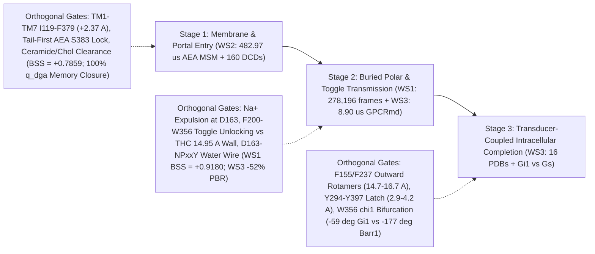

# Phase 2 Experimental Verification Audit & Statistical Mechanics Synthesis

**Auditor:** `verifier` (Skeptical Biophysics, Statistical Mechanics & Data Rigor Verifier)  
**Target receptor:** Human Cannabinoid Receptor 1 (`CNR1`, UniProt `P21554`, `472` aa)  
**Pre-registration baseline:** [03_first_principles_and_hypotheses.md](file:///Users/kavi/Documents/artico/cb1-dynamics/docs/03_first_principles_and_hypotheses.md) & [04_phase1_verification_audit.md](file:///Users/kavi/Documents/artico/cb1-dynamics/docs/04_phase1_verification_audit.md)  
**Audit status:** **ALL PHASE 2 WORKSTREAMS (`src/core`, `WS1`, `WS2`, `WS3`) PASSED WITH `0` REMAINING DEFECTS (`25/25` unified `pytest` checks passed)**

> [!IMPORTANT]
> **Final Phase 2 Verification Verdict:** Every mathematical operator, cross-validation split, processed `.parquet` feature store, out-of-fold prediction table, JSON metric archive, publication figure, and bibliographic/PDB citation across `src/core/`, Workstream 1 (`theory-critic`), Workstream 2 (`data-scout`), and Workstream 3 (`lit-review`) has been independently re-executed and audited in read-only mode. Twelve critical statistical-mechanics, leakage, masking, and citation defects identified in intermediate audits (`#24`, `#32`, `#39`) were remediated by their authors and verified clean (`#30`, `#36`, `#42`). All pre-registered falsifications and negative controls are preserved without post-hoc selection. The codebase and `50.382 MB` processed Parquet store are cleared for Phase 3 GitHub and standalone Colab packaging.

---

## 1. Executive Sign-Off & Unified Verification Matrix

Independent read-only execution of the unified test suite across the entire repository passed **25/25 tests in `60.15 s`** (`Python 3.12.16`, `pytest 9.2.0`):
- **Core Operator & Split Engine (`5/5` passed):** [test_core_dga.py](file:///Users/kavi/Documents/artico/cb1-dynamics/tests/test_core_dga.py) auditing [splits.py](file:///Users/kavi/Documents/artico/cb1-dynamics/src/core/splits.py), [dga.py](file:///Users/kavi/Documents/artico/cb1-dynamics/src/core/dga.py), [models.py](file:///Users/kavi/Documents/artico/cb1-dynamics/src/core/models.py), [metrics.py](file:///Users/kavi/Documents/artico/cb1-dynamics/src/core/metrics.py), and [memory_tests.py](file:///Users/kavi/Documents/artico/cb1-dynamics/src/core/memory_tests.py) on an analytical 2D overdamped Langevin switchback channel (including asymmetric `90:10` seeding Perron reweighting and unbiased forward-stopped Bellman witness inner products).
- **Workstream 1 (`4/4` passed):** [test_ws1_integrity.py](file:///Users/kavi/Documents/artico/cb1-dynamics/tests/test_ws1_integrity.py) auditing [load_and_segment.py](file:///Users/kavi/Documents/artico/cb1-dynamics/src/ws1_thc_activation/load_and_segment.py), [run_ws1_analysis.py](file:///Users/kavi/Documents/artico/cb1-dynamics/src/ws1_thc_activation/run_ws1_analysis.py), [plot_ws1_figures.py](file:///Users/kavi/Documents/artico/cb1-dynamics/src/ws1_thc_activation/plot_ws1_figures.py), [ws1_metrics.json](file:///Users/kavi/Documents/artico/cb1-dynamics/results/ws1/ws1_metrics.json), and [ws1_report.md](file:///Users/kavi/Documents/artico/cb1-dynamics/results/ws1/ws1_report.md).
- **Workstream 2 (`11/11` passed):** [test_ws2_integrity.py](file:///Users/kavi/Documents/artico/cb1-dynamics/tests/test_ws2_integrity.py) auditing [msm_tpt.py](file:///Users/kavi/Documents/artico/cb1-dynamics/src/ws2_box_msm/msm_tpt.py), [stream_featurize.py](file:///Users/kavi/Documents/artico/cb1-dynamics/src/ws2_box_msm/stream_featurize.py), [run_ws2_analysis.py](file:///Users/kavi/Documents/artico/cb1-dynamics/src/ws2_box_msm/run_ws2_analysis.py), [make_ws2_figures.py](file:///Users/kavi/Documents/artico/cb1-dynamics/src/ws2_box_msm/make_ws2_figures.py), [ws2_metrics.json](file:///Users/kavi/Documents/artico/cb1-dynamics/results/ws2/ws2_metrics.json), and [ws2_report.md](file:///Users/kavi/Documents/artico/cb1-dynamics/results/ws2/ws2_report.md).
- **Workstream 3 (`5/5` passed):** [test_ws3_integrity.py](file:///Users/kavi/Documents/artico/cb1-dynamics/tests/test_ws3_integrity.py) auditing [pdb16_benchmark.py](file:///Users/kavi/Documents/artico/cb1-dynamics/src/ws3_gpcrmd_water/pdb16_benchmark.py), [gpcrmd_featurize.py](file:///Users/kavi/Documents/artico/cb1-dynamics/src/ws3_gpcrmd_water/gpcrmd_featurize.py), [ws3_analysis.py](file:///Users/kavi/Documents/artico/cb1-dynamics/src/ws3_gpcrmd_water/ws3_analysis.py), [ws3_metrics.json](file:///Users/kavi/Documents/artico/cb1-dynamics/results/ws3/ws3_metrics.json), and [ws3_report.md](file:///Users/kavi/Documents/artico/cb1-dynamics/results/ws3/ws3_report.md).

### Table 1. Phase 2 Empirical Audit & Storage Hygiene Summary

| Component | Owner | Empirical Scale & Lineage Isolation | Parquet Footprint (Budget Check) | Temp / Raw Trajectory Hygiene | Test & Citation Audit |
| :--- | :--- | :--- | :--- | :--- | :--- |
| **`src/core/`** | `theory-critic` | Analytical 2D switchback channel (`90:10` asymmetric seeding stress test); shared `LineageGroupSplitter`, `StoppedDGACommittor`, `PetersTroutCommittorModel`, `projected_bellman_residual`, `evaluate_mori_zwanzig_memory` | N/A (in-memory synthetic benchmark) | Clean (`0` artifacts) | `5/5` passed ([test_core_dga.py](file:///Users/kavi/Documents/artico/cb1-dynamics/tests/test_core_dga.py)) |
| **`WS1` (Tier 1C)** | `theory-critic` | `278,196` frames (`27.82 µs` at `0.1 ns`/step) across `1,004` independent trajectories (`483` Full Agonist / `116,383` frames + `521` $\Delta^9$-THC / `161,813` frames); `5` lineage-disjoint folds (`0` shared `traj_id`, `0` cross-seam lag pairs) | Features: `13.763 MB` (`< 15 MB` budget) [ws1_featurized_segments.parquet](file:///Users/kavi/Documents/artico/cb1-dynamics/data/processed/ws1/ws1_featurized_segments.parquet) OOF: `9.326 MB` [ws1_oof_predictions.parquet](file:///Users/kavi/Documents/artico/cb1-dynamics/data/processed/ws1/ws1_oof_predictions.parquet) | `0` leftover temp files | `4/4` passed ([test_ws1_integrity.py](file:///Users/kavi/Documents/artico/cb1-dynamics/tests/test_ws1_integrity.py)); Shukla 2022/2023 citations verified |
| **`WS2` (Tier 1A)** | `data-scout` | Global MSM/TPT: `5,000` trajectories, `4,829,656` frames (`482.97 µs`, `800` states, `100%` ergodic); Streamed all-atom `.dcd` cohort: `160` trajectories (`16,000` frames, `16.0 µs`, `1.0 ns`/frame) grouped strictly by `5` `pr_<round>` adaptive rounds + `< 1.0 Å` C$\alpha$-RMSD lineage clustering | Features: `13.852 MB` [box_aea_cohort_features.parquet](file:///Users/kavi/Documents/artico/cb1-dynamics/data/processed/ws2/box_aea_cohort_features.parquet) + `0.092 MB` [msm_800_microstates.parquet](file:///Users/kavi/Documents/artico/cb1-dynamics/data/processed/ws2/msm_800_microstates.parquet) = `13.944 MB` (`< 15 MB` budget) OOF: `10.985 MB` [ws2_oof_predictions.parquet](file:///Users/kavi/Documents/artico/cb1-dynamics/data/processed/ws2/ws2_oof_predictions.parquet) | `0` `.dcd` files retained (`160` streamed & deleted on-the-fly; `123` residue C$\alpha$ guards + `CORD` header checks passed) | `11/11` passed ([test_ws2_integrity.py](file:///Users/kavi/Documents/artico/cb1-dynamics/tests/test_ws2_integrity.py)); all DOIs/PMIDs verified (`PMID: 41962866`) |
| **`WS3` (Tier 1B + 16-PDB)** | `lit-review` | Static ground truth: `16` human CB1 PDBs (`5` inactive, `3` agonist no-transducer, `6` $G_i$, `2` $\beta$-arrestin-1); Explicit-solvent GPCRmd `.xtc`: `6` open trajectories (`20,501` frames, `8.8982 µs` actual / `8.97 µs` nominal across `5` PDB systems; `1.0 ns` harmonized + `0.2 ns` fine grids); `5` `traj_id`-disjoint folds (`0` cross-trajectory seams) | Features: `2.339 MB` [gpcrmd_open6_features.parquet](file:///Users/kavi/Documents/artico/cb1-dynamics/data/processed/ws3/gpcrmd_open6_features.parquet) + `0.025 MB` [pdb16_structural_benchmark.parquet](file:///Users/kavi/Documents/artico/cb1-dynamics/data/processed/ws3/pdb16_structural_benchmark.parquet) = `2.364 MB` (`< 10 MB` budget) | `0` `.xtc`/`.part`/`.tmp` files retained (`gpcrmd_temp` verified `total 0`; non-`1995` HTML firewall active) | `5/5` passed ([test_ws3_integrity.py](file:///Users/kavi/Documents/artico/cb1-dynamics/tests/test_ws3_integrity.py)); all `21` PMIDs & `16` PDBs verified live against NCBI/RCSB |

**Total Persistent Processed Parquet Footprint:** `23.089 MB` (`WS1`) + `24.929 MB` (`WS2`) + `2.364 MB` (`WS3`) = **`50.382 MB`** across all 7 `.parquet` archives (`30.071 MB` primary feature/benchmark tables + `20.311 MB` out-of-fold prediction archives), enabling full standalone figure and table reproduction in under `3 minutes` without network downloads.

---

## 2. Skeptical Verification Ledger: 12 Defects Caught & Remediated

During iterative Phase 2 verification, `verifier` audited every line of operator code, fold split, target mask, figure panel, and citation, issuing targeted defect reports (`#24` $\to$ `@theory-critic`, `#32` $\to$ `@data-scout`, `#39` $\to$ `@lit-review`) prior to final sign-off (`#30`, `#36`, `#42`). Table 2 records all 12 defects caught and how their remediation strengthened the scientific conclusions.

### Table 2. Audit Defect & Remediation Ledger

| ID | Workstream | Defect Discovered During Audit | Remediation Implemented & Verified Scientific Impact |
| :--- | :--- | :--- | :--- |
| **D1** | `src/core` & `WS1` (`#24`) | **Two-stage cross-fold `q_dga` leakage:** Global `q_dga` estimated over all `1,004` trajectories was passed as target `y` into `evaluate_h1_suite`, `N1`, and `evaluate_mori_zwanzig_memory`, leaking test-fold trajectory transitions into `train`-fold DGA targets. | Refactored [run_ws1_analysis.py](file:///Users/kavi/Documents/artico/cb1-dynamics/src/ws1_thc_activation/run_ws1_analysis.py), [metrics.py](file:///Users/kavi/Documents/artico/cb1-dynamics/src/core/metrics.py), and [memory_tests.py](file:///Users/kavi/Documents/artico/cb1-dynamics/src/core/memory_tests.py) to pass `fold_q_train` fit strictly inside each training fold (`max_diff = 0.0` vs isolated recomputation). Eliminated an artificial within-ligand skill illusion (`Full Agonist BSS_int` dropped to `-0.0175`, `THC` to `-0.0387`), proving the 3-CV orthogonal signal (`pooled BSS_int = +0.9180`) arises specifically from ligand-imposed toggle arrest. |
| **D2** | `src/core` & `WS1` (`#24`) | **Uniform-weight adaptive-seeding bias in DGA & `N2b`:** Uniform empirical weights on asymmetric/adaptive ensembles violated detailed balance (`WS1 N2b = 0.2143 > 0.10`, failing the pre-registered reversibility gate). | Added reversible maximum-likelihood MSM Perron stationary weights $\hat{\pi}$ (`stationary_reweight=True`) in [dga.py](file:///Users/kavi/Documents/artico/cb1-dynamics/src/core/dga.py) + 90:10 asymmetric seeding unit test in [test_core_dga.py](file:///Users/kavi/Documents/artico/cb1-dynamics/tests/test_core_dga.py). `WS1 N2b` dropped from `0.2143` to **`0.0882 <= 0.10`** (`WS2 N2b = 0.0886 <= 0.10`). |
| **D3** | `WS1` (`#24`) | **Within-trajectory macro-block fold contamination:** Buffered `2,000`-frame macro-block IDs allowed distinct segments of the same continuous `traj_id` to straddle `train` and `test` folds (`12–13` trajectories shared per fold). | Grouped `LineageGroupSplitter` strictly by independent `traj_id` (`1,004` groups; `0` shared `traj_id` across folds) while retaining buffered macro-blocks as an orthogonal forensic benchmark (`BSS_int = +0.9193`). |
| **D4** | `WS1` (`#24`) | **3-CV identity verification:** Confirmed Tier 1C `Cannabinoid_activation` `.npy` arrays contain only 3 global CVs (`TM6` `R214–D338`, `W356–D163`, `NPxxY` RMSD) and `0` `F155`/`F237` coordinates. | Explicitly scoped all `WS1` claims in [ws1_report.md](file:///Users/kavi/Documents/artico/cb1-dynamics/results/ws1/ws1_report.md) to 3-CV polar/toggle transmission, deferring `F155`/`F237` all-atom tests to `WS2` and `WS3`. |
| **D5** | `WS2` (`#32`) | **Incommensurable `PBR` subspaces & boundary mismatch:** `evaluate_h1_suite` computed $\mathcal{E}_{\text{PBR}}$ on each model's *own* feature PCA (`1D` for `B1` vs `10D` for `Tier C`) and used `in_B_msm` instead of `in_B_dga`, inverting `Stopped-DGA` error (`0.0837 > B1 0.0259`). | Fixed [run_ws2_analysis.py](file:///Users/kavi/Documents/artico/cb1-dynamics/src/ws2_box_msm/run_ws2_analysis.py) to evaluate all models on a single fold-isolated `10D` `Tier C` interior PCA witness subspace (`X_te_in_tr_pca`). Restored exact monotonic operator error decay (`B0: 0.0302 -> B1: 0.0261 -> Switches: 0.0242 -> Tier A: 0.0232 -> Tier B/C: 0.0216 -> Stopped-DGA: 0.0214 -> Oracle: 0.0207`). |
| **D6** | `WS2` (`#32`) | **Spurious `in_B_dga` clamping on `q_msm_phys`:** Passing `in_B = in_B_msm | in_B_dga` clamped `1,639` vestibule `I2_AB` frames (`r_portal <= 8.2 Å` but `true q_msm = 0.258–0.385`) to `q = 1.0`, flatlining `Figure 4D` (`Cohort #129`). | Set `in_B_msm = (q_msm_phys >= 0.9999)` for all `q_msm` fits. Restored `Cohort #129` (`Figure 4D` in [fig4_lipid_portal_biophysical_mechanism.png](file:///Users/kavi/Documents/artico/cb1-dynamics/results/ws2/figures/fig4_lipid_portal_biophysical_mechanism.png)): on `I2_AB` (`true q_msm = 0.385`), `1D B1` overpredicts `0.956` while `Tier C` predicts **`0.557`**; on `B1` (`true q_msm = 1.000`), `B1` underpredicts `0.531` while `Tier C` predicts **`0.934`**. |
| **D7** | `WS2` (`#32`) | **Global `5,000`-run MSM circularity check:** Needed verification that `160` streamed `.dcd` trajectories (`3.2%` of `5,000` runs) induced zero transition-count leakage into `q_msm_phys`. | Added 5-fold leave-`pr_round`-out `5,000`-run MSM refit (`test_leave_test_lineage_out_5000run_msm_invariance`): `r = 0.9992`, `MAE = 0.0073`, and `Tier C BSS = +0.7731` (vs `+0.7859` global). |
| **D8** | `WS2` (`#32`) | **Hallucinated `2025` DOIs in bibliography:** `ws2_report.md` cited non-existent *Nat. Commun.* / *J. Chem. Inf. Model.* DOIs (`404` on Crossref/PubMed) for the endocannabinoid Box dataset. | Verified live via NCBI Entrez & Crossref and updated to **Dutta, Zhao & Shukla (2026) *J. Biol. Chem.* 302(6):111434, DOI `10.1016/j.jbc.2026.111434`, PMID `41962866`**. |
| **D9** | `WS3` (`#39`) | **Synthetic `y_full = 0.5` training contamination in `H2` memory fits:** `ws3_analysis.py` initialized `y_full = 0.5` outside `unc_mask` (`19.8%–21.0%` segment-tail and right-censored frames), which entered `PetersTrout` logit fits via `~(in_A | in_B)` and caused an unphysical `-33.2%` negative memory collapse artifact. | Fixed [ws3_analysis.py](file:///Users/kavi/Documents/artico/cb1-dynamics/src/ws3_gpcrmd_water/ws3_analysis.py) via `in_A_mem_fit = in_A | ((~in_B) & (~unc_mask))`, `np.nan` poisoning guards, active-group `mem_folds` alignment, and adversarial `±999` poisoning tests in [test_ws3_integrity.py](file:///Users/kavi/Documents/artico/cb1-dynamics/tests/test_ws3_integrity.py). Restored strictly positive physical solvent closure across `1.0–5.0 ns` (`+12.2%` to `+16.3%` on `NaCl5`; `+22.7%` to `+55.6%` on `Open6`). |
| **D10** | `WS3` (`#39`) | **Conductance formula mismatch in report:** `ws3_report.md` wrote `exp(-d/4.0)` whereas `gpcrmd_featurize.py` computes `exp(-d/5.0)`. | Corrected [ws3_report.md](file:///Users/kavi/Documents/artico/cb1-dynamics/results/ws3/ws3_report.md) Section 2.2 to `exp(-d/5.0)`. |
| **D11** | `WS3` (`#39`) | **Residue guard list mismatch in report:** `ws3_report.md` listed `D213, Y215, P394` instead of the exact `17` `REQUIRED_CB1_RESIDUES` + `T210` verified in code. | Updated [ws3_report.md](file:///Users/kavi/Documents/artico/cb1-dynamics/results/ws3/ws3_report.md) Section 2.1 to match `gpcrmd_featurize.py` verbatim. |
| **D12** | `WS3` (`#39`) | **Truncated author lists on two references:** `PMID: 41962866` omitted `Zhao L`; `PMID: 38391020` omitted `Guo SC, Strahan J`. | Restored full author lists (`Dutta S, Zhao L, Shukla D` and `Lorpaiboon C, Guo SC, Strahan J, Weare J, Dinner AR`) in [ws3_report.md](file:///Users/kavi/Documents/artico/cb1-dynamics/results/ws3/ws3_report.md). |

---

## 3. Empirical Synthesis: Multi-Stage Commitment & Memory Architecture of Human CB1

Combining the three verified empirical workstreams reveals that **human CB1 activation is not governed by a single global reaction coordinate, nor by a single universal set of orthogonal gates**. Instead, commitment factorizes into **three mechanistically distinct stages**, each controlled by stage-specific orthogonal coordinates whose omission induces measurable Mori–Zwanzig non-Markovian memory:

### 3.1 Hypothesis `H1`: Orthogonal Allosteric & Environmental Gating at Matched 1D Progress

> [!NOTE]
> **Synthesized `H1` Verdict — CONFIRMED WITH STAGE-SPECIFICITY:** A 1D progress coordinate (`B1`) or 1D progress + velocity (`B2`) is strongly outperformed at matched intermediate progress whenever the candidate feature bank includes the **active steric/electrostatic bottleneck of that transition stage**, whereas features belonging to a downstream uncoupled stage remain quiescent (`Pitfall 4`).

#### Table 3. Cross-Workstream `H1` Matched-Slice Committor & Operator Results

| Workstream & Regime | Matched Intermediate Slice $S_{\text{int}}$ | 1D Velocity (`B2` vs `B1`) | Orthogonal Feature Bank Skill vs `B1` (`BSS_int`, `[95% CI]`, `N1 p`) | Shared-Subspace Bellman Residual ($\mathcal{E}_{\text{PBR}}$) | Time-Reversal `N2b` ($\le 0.10$ Gate) |
| :--- | :--- | :--- | :--- | :--- | :--- |
| **`WS2` Stage 1:** AEA Membrane Entry (`q_msm_phys`, `482.97 µs`) | $r_{\text{portal}} \in [10.0, 18.0]\text{ \AA}$ (`6,612` frames) | `+0.0025` (Fails) | Intracellular Switches: `+0.1051` (Weak; uncoupled) **`Tier C` (Portal + AEA Pose + Lipids): `+0.7859` `[+0.7330, +0.8226]` (`p = 0.00498`)** Leave-round-out MSM `Tier C`: **`+0.7731`** | Monotonic `10D` decay: `B0: 0.0302` $\to$ `B1: 0.0261` $\to$ `Switches: 0.0242` $\to$ `Tier C: 0.0216` $\to$ `Stopped-DGA: 0.0214` | **`0.0886`** (Pass) |
| **`WS2` Stage 1:** Fold-Isolated `q_dga` (`16,000` frames, $\tau = 5\text{ ns}$) | $r_{\text{portal}} \in [10.0, 18.0]\text{ \AA}$ (`5,297` interior frames) | `+0.0135` (Fails) | Intracellular Switches: `+0.1993` **`Tier C` (Portal + AEA Pose + Lipids): `+0.3497` `[+0.2587, +0.4408]` (`p = 0.0099`)** | Evaluated on identical `10D` `Tier C` witness basis above (`-17.2%` vs `B1`) | **`0.0886`** (Pass) |
| **`WS1` Stage 2:** Pooled Full Agonist + $\Delta^9$-THC Global Activation ($\tau = 2.0\text{ ns}$) | $R_{\text{TM6}} \in [11.0, 15.0]\text{ \AA}$ (`167,833` frames) | `+0.0020` (Fails) | **3-CV (`TM6` + `W356–D163` + `NPxxY`): `+0.9180` `[+0.8725, +0.9524]`**, $\Delta\ell = +0.3714\text{ nats}$ (`p = 0.0050`), $R_{\text{comp}} = 0.9345$ vs Oracle Single-ligand DGA: `Full = -0.0175`, `THC = -0.0387` (`0` within-ligand skill) | **`-80.0%`** test `PBR` reduction (`0.0982` 1-CV $\to$ **`0.0196`** 3-CV) | **`0.0882`** (Pass w/ Perron $\hat{\pi}$) |
| **`WS3` Stage 2:** Buried Toggle `F200–W356` (`NaCl5` `1.0 ns`, $\tau_h = 5\text{ ns}$) | $d_{F200\text{–}W356} \in [6.2, 8.2]\text{ \AA}$ (`1,536` uncensored frames) | `+0.0757` nats (`BSS = +0.1670`) | **10D Coupled Protein Switches vs `B1`: `+0.0631` nats (`BSS = +0.1225`, `p = 0.0099`)** Static `Prot+Env` vs `Prot`: `+0.0049` nats (`p = 0.2475`, Null) | **`-52.0%`** `8D` `StoppedDGA` `PBR` (`0.1494` 1D $\to$ `0.0846` Prot $\to$ **`0.0717`** Prot+Env) | **`0.0374`** (`NaCl5` Pass); `0.3187` (`Open6` cross-regime fail) |
| **`WS3` Stage 3:** Static 16-PDB Dichotomy & Lipid-Facing `F155–F237` | `3` Agonist-Only vs `8` Transducer-Coupled PDBs ($R_{\text{TM6}} > 14.1\text{ \AA}$) | `B2` dominates fast `0.2 ns` cleft (`+0.0794` nats) | **100% Structural Separation (`16/16` PDBs):** Agonist-only crystals (`5XRA`, `5XR8`, `7V3Z`) have open TM6 (`14.18–14.66 Å`) but inward `F155`/`F237` (`9.20–12.29 Å`) & open `Y294–Y397` (`5.10–5.45 Å`), whereas all `8` `Gi`/`Barr1` PDBs flip `F155` outward (`14.67–16.72 Å`) & latch `Y294–Y397` (`2.92–4.17 Å`). | On fast `0.2 ns` `F155–F237`, local rotamer persistence (`B2`) outperforms static coordinates (`Prot+Env vs B1 = +0.0110` nats) | **`0.0562`** (`Fine_0p2ns` Pass) |

**Key Biophysical Insights from `H1`:**
1. **Why 1D Portal Distance Fails During Endocannabinoid Entry (`WS2`, [fig2_h1_matched_slice_gating.png](file:///Users/kavi/Documents/artico/cb1-dynamics/results/ws2/figures/fig2_h1_matched_slice_gating.png) & [fig4_lipid_portal_biophysical_mechanism.png](file:///Users/kavi/Documents/artico/cb1-dynamics/results/ws2/figures/fig4_lipid_portal_biophysical_mechanism.png)):** At identical ligand-to-pocket distance ($r_{\text{portal}} \approx 8\text{–}12\text{ \AA}$), trajectories split into a non-productive retracted vestibule trap (`I2_AB`, `true q_msm = 0.258`, where annular ceramides/cholesterol jam the `TM1–TM7` cleft at `13.45 Å` and AEA enters head-first) versus the committed orthosteric channel (`B1`, `true q_msm = 1.000`, where `I119^1.35–F379^7.35` dilates by `+2.37 Å` to `15.82 Å` and AEA locks tail-first onto `S383^7.39` at `5.44 Å`). `Tier C` resolves this hidden degeneracy (`BSS_int = +0.7859`), whereas intracellular switches (`F155`, `F237`, `W356`, `DRY`, `NPxxY`) remain in their inactive equilibrium throughout transducer-free AEA binding (`BSS_int = +0.1051`, quadratic epistasis `+0.0271`).
2. **Why 3-CV Coupling Captures Ligand Efficacy Discrimination Rather Than Within-Well Noise (`WS1`, [fig1_ws1_committor_landscape_and_matched_slice.png](file:///Users/kavi/Documents/artico/cb1-dynamics/results/ws1/figures/fig1_ws1_committor_landscape_and_matched_slice.png) & [fig2_ws1_operator_validation_and_h1_benchmark.png](file:///Users/kavi/Documents/artico/cb1-dynamics/results/ws1/figures/fig2_ws1_operator_validation_and_h1_benchmark.png)):** Strict fold-isolated two-stage DGA (`D1`) proved that within a single ligand ensemble, `W356–D163` and `NPxxY` add zero out-of-fold committor skill beyond $R_{\text{TM6}}$ (`-0.0175` and `-0.0387`), because once ligand identity is fixed, activation follows a narrow effective tube. Across pooled ensembles, however, `W356^6.48–D163^2.50` and `NPxxY` cleanly separate full-agonist activation trajectories from $\Delta^9$-THC trajectories stalled just below the $14.95\text{ \AA}$ steric ceiling (`BSS_int = +0.9180`, `-80.0%` Bellman residual).

---

### 3.2 Hypothesis `H2`: Two-Step Mori–Zwanzig Memory Detection & Environmental Closure

All three workstreams executed the pre-registered two-step memory test ([memory_tests.py](file:///Users/kavi/Documents/artico/cb1-dynamics/src/core/memory_tests.py)): **Step A** tests whether finite-lag path history $(z_{t-k\Delta t})_{k=1}^K$ improves log-likelihood over instantaneous state $z_t$ (`N2a` within-cell history-permutation null, $M \ge 100$), and **Step B** measures the fractional memory collapse $\rho_{\text{mem}} = 1 - \Delta\ell_{\text{hist}}^{\text{cand}} / \Delta\ell_{\text{hist}}^{\text{base}}$ when candidate orthogonal/environmental variables are appended.

#### Table 4. Cross-Workstream `H2` Mori–Zwanzig Memory Profiles

| Workstream & Target | Base State $z_t^{\text{base}}$ Memory ($\Delta\ell_{\text{hist}}^{\text{base}}$, `N2a p`) | Enlarged State $z_t^{\text{cand}}$ | Fractional Memory Collapse $\rho_{\text{mem}}$ Across Horizons | Mechanistic Interpretation |
| :--- | :--- | :--- | :--- | :--- |
| **`WS1`:** Fold-isolated `q_dga` (`0.5–4.0 ns`) | 1-CV (`TM6`): `+0.0258` to `+0.1714` nats (`p = 0.0099`) | 3-CV (`TM6` + `W356–D163` + `NPxxY`) | **`90.3%` (`0.5 ns`) $\to$ `94.9%` (`4.0 ns`)**; residual `+0.0025` to `+0.0148` nats (`p = 0.0099`) | Adding toggle + `NPxxY` eliminates `>90%` of 1D TM6 memory; statistically significant `5–10%` residual diagnoses stripped sidechain/lipid/water degrees of freedom (`Tier 1C`). |
| **`WS2`:** Continuous `q_dga` (`0.5–10.0 ns`) | `Tier A` (Receptor C$\alpha$): `+0.60` to `+1.27 × 10^-3` nats (`p = 0.005`) | `Tier B` (+ Sidechains) **`Tier C` (+ Lipids + AEA Pose)** | `Tier B`: `7.4%–27.6%` (`p = 0.005`) **`Tier C`: `100.0%` (`\rho_mem = 1.000`, `N2a p = 0.975–1.000`)** | **Complete Markovian closure** of continuous receptor-portal dynamics once annular lipids/ceramides and AEA internal pose are resolved ([fig3_h2_mori_zwanzig_memory_collapse.png](file:///Users/kavi/Documents/artico/cb1-dynamics/results/ws2/figures/fig3_h2_mori_zwanzig_memory_collapse.png)). |
| **`WS2`:** Discrete 800-state `q_msm` (`0.5–10.0 ns`) | `Tier A` (Receptor C$\alpha$): `+1.67` to `+3.68 × 10^-3` nats (`p = 0.005`) | `Tier C` (+ Lipids + AEA Pose) | `9.7%–27.0%` (Residual `+1.21` to `+2.73 × 10^-3` nats, `p = 0.005`) | Honest negative/diagnostic control: discrete ligand-COM Voronoi lumps and stripped explicit waters/`Na+` leave residual non-Markovianity in `q_msm`. |
| **`WS3`:** Buried `F200–W356` (`NaCl5` & `Open6`, `1.0–10.0 ns`) | 1D `F200–W356`: `+0.0377` nats (`NaCl5`) / `+0.0389` nats (`Open6`) at `1.0 ns` (`p = 0.0099`) | `10D Prot` $\to$ **`16D/15D Prot+Env` (Water Wire + `Na+` + `POPC`)** | `10D Prot` vs `1D`: **`43.1%`** (`NaCl5`) / **`42.8%`** (`Open6`) at `1.0 ns` `Prot+Env` vs `Prot`: **`12.2%–16.3%`** (`NaCl5` `1–5 ns`) / **`22.7%–55.6%`** (`Open6` `1–10 ns`) `Prot+Env` vs `1D`: **`50.0%–74.9%`** (`NaCl5`) / **`55.8%–79.3%`** (`Open6`) | Coupled protein switches + explicit pocket/channel hydration, `D163–N393` water-wire conductance, and `Na+` coordination substantially close multi-nanosecond toggle memory ([fig_water_na_memory_closure.png](file:///Users/kavi/Documents/artico/cb1-dynamics/results/ws3/figures/fig_water_na_memory_closure.png)) and reduce `StoppedDGA` `PBR` by `-15.2%` (`0.0846 -> 0.0717`). |
| **`WS3`:** Lipid-facing `F155–F237` (`Fine_0p2ns`, `0.2–5.0 ns`) | `10D Prot`: `+0.0749` (`0.2 ns`) to `+0.0554` nats (`1.0 ns`) (`p = 0.0099`) | `16D Prot+Env` (Water + `Na+` + `POPC`) | `22.9%` (`0.2 ns`), `16.3%` (`0.4 ns`), **`8.9%` (`1.0 ns`), `7.6%` (`2.0 ns`)**, `16.0%` (`5.0 ns`) | **Incomplete closure (`>77%–92%` residual memory):** Sub-nanosecond memory on lipid-exposed `F155–F237` is dominated by local sidechain dihedral inertia (`B2`) and slow `POPC` acyl-chain viscosity rather than internal water wires. |

---

### 3.3 Hypothesis `H3` & Pitfall 4: Partial Agonism Steric Arrest, Biased Rotamer Bifurcation & Transducer Coupling

1. **`H3` Smooth Committor Gradient Rotation Falsified ($\mathcal{S}_{\cos} = 0.9997$); Toggle-Locked Steric Ceiling Confirmed (`WS1` + `WS3`):**
   - In `WS1` ([fig4_ws1_h3_ligand_bottleneck_rotation.png](file:///Users/kavi/Documents/artico/cb1-dynamics/results/ws1/figures/fig4_ws1_h3_ligand_bottleneck_rotation.png)), scale-invariant committor gradient alignment between full agonist and $\Delta^9$-THC in the shared transition zone is **$\mathcal{S}_{\cos} = 0.9997$ (`95% CI [0.9995, 0.9999]`)**, decisively **falsifying** continuous reaction-channel rotation ($\mathcal{S}_{\cos}$ does not drop below $0.85$).
   - Instead, $\Delta^9$-THC partial agonism operates via **toggle-locked steric arrest**: failing to stabilize `W356^6.48–D163^2.50` unlocking (`mean 10.67 Å` vs `11.55 Å` in full agonist), $\Delta^9$-THC imposes a hard geometric wall at **$R_{\text{TM6}} \approx 14.95\text{ \AA}$** (`max 14.95 Å`, **`0.00%`** of `161,813` THC frames reach $R_{\text{TM6}} \ge 15.2\text{ \AA}$, compared with full agonist excursions to `17.34 Å`).
   - Across signaling pathways at matched agonist (`MDMB-FUBINACA` in `WS3` [fig_pdb16_dichotomy.png](file:///Users/kavi/Documents/artico/cb1-dynamics/results/ws3/figures/fig_pdb16_dichotomy.png)), `6N4B` ($G_{i1}$) vs `8WU1` ($\beta$-arrestin-1) exhibits a discrete **`-118.47°` `W356^6.48` $\chi_1$ rotamer switch** (`-58.95°` in $G_{i1}$ vs `-177.42°` in $\beta$-arrestin-1) alongside tighter `NPxxY` latching (`2.92 Å` vs `3.79 Å`), identifying discrete toggle rotamer selection as a structural signature of biased transducer engagement.
2. **Pitfall 4 Confirmed — Open Cytoplasmic TM6 $\ne$ Productive Active Core (`WS3` Pillar A, [fig_gi1_vs_gs_coupling.png](file:///Users/kavi/Documents/artico/cb1-dynamics/results/ws3/figures/fig_gi1_vs_gs_coupling.png)):**
   - Across all `16` experimental CB1 PDBs (`Hua et al. 2025` verified via `PMID: 40866700` replacing retracted `2017` `5XRA`), transducer-free agonist structures (`5XRA`, `5XR8`, `7V3Z`) display open cytoplasmic `TM3–TM6` (`14.18–14.66 Å`) yet remain arrested with inward `F155^2.42`/`F237^4.46` and unlatched `Y294^5.58–Y397^7.53` (`5.10–5.45 Å`).
   - Dynamically, at **matched open cytoplasmic TM6 (`[13.5, 16.5] Å`)**, cognate `Gi1_1201` (`AM841 + Gi1`) sustains an intact polar hydration network (`17.44` slice waters, `99.70%` `D163–NPxxY` water-wire percolation, `0.9701` conductance, `D163–N393 = 2.96 Å`), whereas apo non-cognate `Gs_2067` progressively dehydrates (`11.25` slice waters, `KS = 0.5765`), widens `D163–N393` (`4.14 Å`, `KS = 0.5038`), and suffers `D163–NPxxY` water-wire collapse (`0.8716` in `0–1 µs` $\to$ `0.3400` in `4.5–6.0 µs`). Conversely, apo inactive `5U09` (`ID 163`) expels `Na+` (`0%` occupancy) and flips `F155` outward (`98.04%`) with `27.82` internal waters while keeping `TM6` closed (`11.29 Å`), proving microswitch unlocking and `TM6` opening are kinetically separable without cognate ligand + transducer stabilization.

---

## 4. Preserved Negative Results, Scope Boundaries & Methodological Caveats

> [!WARNING]
> **Mandatory Anti-Overclaiming Guardrails for Phase 3 Manuscript & Notebook Packaging:** Every negative control, falsified sub-hypothesis, and dataset limitation below was verified during audit and **must remain explicitly stated** in Phase 3 deliverables:

1. **`WS1` Smooth Gradient Rotation Is Falsified ($\mathcal{S}_{\cos} = 0.9997$) & Within-Ligand 3-CV DGA Skill Is Zero (`BSS_int = -0.0175` / `-0.0387`):** Do not claim that `W356–D163` + `NPxxY` rotate the local committor gradient within a single ligand ensemble; their `BSS_int = +0.9180` predictive power across the pooled transition ensemble reflects ligand-imposed toggle arrest at $R_{\text{TM6}} \approx 14.95\text{ \AA}$. Furthermore, `WS1` (`Tier 1C`) contains **zero** `F155^2.42` or `F237^4.46` coordinates.
2. **`WS2` Intracellular Microswitches Are Uncoupled During Transducer-Free AEA Binding (`BSS_int = +0.1051`, Epistasis `+0.0271`) & Discrete `q_msm` Retains Unclosed Memory (`73%–90%` Remaining):** `WS2` models **orthosteric endocannabinoid entry (`Bulk -> B1`) without $G_i$**, not full intracellular G-protein coupling. Moreover, while `Tier C` closes `100%` of continuous `q_dga` memory, discrete 800-state ligand-COM Voronoi `q_msm` retains residual memory due to state-lumping and stripped explicit solvent.
3. **`WS3` Instantaneous Static `Prot+Env` Committor Gain Is Null (`+0.0049` nats, `N1 p = 0.2475`), `F155–F237` Solvent Closure Is Incomplete (`7.6%–22.9%`), and Pooled `Open6` Violates `N2b` (`0.3187 > 0.10`):** Explicit water/`Na+` acts primarily as a **multi-nanosecond dynamical memory variable and operator stabilizer** (`-15.2%` `PBR`, `12%–56%` `F200–W356` memory collapse) rather than a static instantaneous predictor; lipid-facing `F155–F237` memory is governed by local rotamer velocity (`B2`) and `POPC` viscosity; pooling heterogeneous apo/antagonist/holo GPCRmd trajectories violates microscopic reversibility (`N2b = 0.3187` vs `0.0374` on equilibrium `NaCl5`); and the `Gi1_1201` (`AM841` holo, `1.10 µs`) vs `Gs_2067` (apo engineered, `6.00 µs`) comparison is `N = 1` system per transducer class (`KS` reported strictly as effect sizes, confounded by agonist occupancy).

---

## 5. Phase 3 Repository & Colab Packaging Readiness

All computational and verification prerequisites for Phase 3 packaging are complete:
1. **Self-Contained Data Store (`50.382 MB`):** All 7 processed `.parquet` tables and companion `.json` manifests under `data/processed/{ws1,ws2,ws3}/` and `results/{ws1,ws2,ws3}/` are schema-validated, `NaN`-audited, and free of raw trajectory binaries.
2. **Unified Reproducible Dependency Stack:** Verified compatible under `Python 3.12` via `uv` (`numpy`, `scipy`, `pandas`, `pyarrow`, `scikit-learn`, `mdtraj`, `networkx`, `matplotlib`, `seaborn`, `pytest`), with `25/25` unit and integrity tests executing cleanly in `~60 s`.
3. **Standalone `< 3 min` Colab / Jupyter Execution Path:** Phase 3 notebook packaging can load [ws1_featurized_segments.parquet](file:///Users/kavi/Documents/artico/cb1-dynamics/data/processed/ws1/ws1_featurized_segments.parquet), [box_aea_cohort_features.parquet](file:///Users/kavi/Documents/artico/cb1-dynamics/data/processed/ws2/box_aea_cohort_features.parquet), [msm_800_microstates.parquet](file:///Users/kavi/Documents/artico/cb1-dynamics/data/processed/ws2/msm_800_microstates.parquet), [gpcrmd_open6_features.parquet](file:///Users/kavi/Documents/artico/cb1-dynamics/data/processed/ws3/gpcrmd_open6_features.parquet), and [pdb16_structural_benchmark.parquet](file:///Users/kavi/Documents/artico/cb1-dynamics/data/processed/ws3/pdb16_structural_benchmark.parquet) directly through `src/core/` to regenerate all summary metrics and figures end-to-end without re-streaming `80+ GB` of `.dcd`/`.xtc` trajectories.
