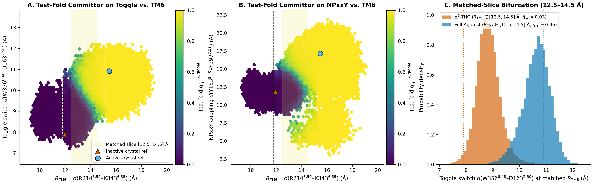
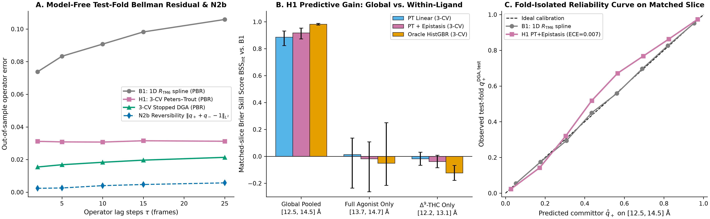
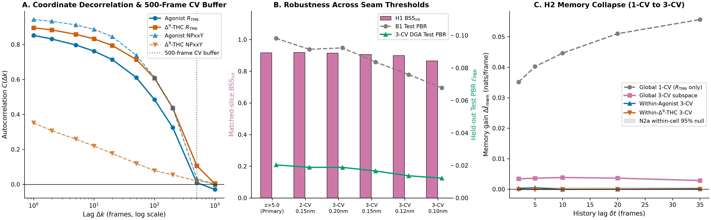
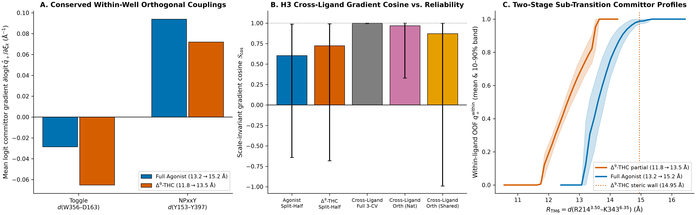

# Workstream 1 Report: Global TM6 Activation, Orthogonal Microswitch Gating, Mori–Zwanzig Memory, and Partial-Agonist Arrest in Human $\text{CB}_1$ (`Tier 1C`, `278,196` Frames)

**Dataset & Provenance**: `Tier 1C` — `ShuklaGroup/THC_binding` GitHub repository (`Figure_8/*.npy`), accompanying Dutta S, Selvam B, Das A & Shukla D (2022), *J. Biol. Chem.* 298(4):101764 (`PMID: 35227761`, `DOI: 10.1016/j.jbc.2022.101764`; human $\text{CB}_1$, `CNR1`, UniProt `P21554`)  
**Code Pipeline**: `src/core/` (`splits.py`, `dga.py`, `models.py`, `metrics.py`, `memory_tests.py`) + `src/ws1_thc_activation/` (`load_and_segment.py`, `run_ws1_analysis.py`, `plot_ws1_figures.py`)  
**Machine-Readable Artifacts**: `results/ws1/ws1_metrics.json`, `data/processed/ws1/ws1_featurized_segments.parquet`, `data/processed/ws1/ws1_oof_predictions.parquet`, `data/processed/ws1/ws1_data_audit.json`  
**Pre-Registered Protocol Reference**: `docs/03_first_principles_and_hypotheses.md` (§§1–4)

---

## 1. Executive Summary & Pre-Registered Hypothesis Scorecard

Can we infer $\text{CB}_1$'s future conformational commitment from its present molecular configuration and dynamics—specifically distinguishing receptor configurations that share identical intracellular TM6 opening ($R_{\text{TM6}}$)?

In **Workstream 1 (WS1)**, we executed our pre-registered Stopped Dynamical Galerkin Approximation (Stopped DGA), Transition Path Theory (TPT), and Mori–Zwanzig memory protocol across **`278,196`** featurized MD frames of human $\text{CB}_1$ (**`173,860`** Full Agonist frames and **`104,336`** $\Delta^9$-THC partial agonist frames) spanning three conserved class-A GPCR microswitch coordinates:
1. **Intracellular TM6 opening**: $R_{\text{TM6}} = d(\text{R214}^{3.50}\text{–K343}^{6.35})$
2. **Toggle-switch / $\text{Na}^+$-pocket coupling**: $d_{\text{toggle}} = d(\text{W356}^{6.48}\text{–D163}^{2.50})$
3. **Intracellular TM7 $\text{NPxxY}$ rearrangement**: $d_{\text{NPxxY}} = d(\text{Y153}^{2.40}\text{–Y397}^{7.53})$

To eliminate both temporal autocorrelation leakage and two-stage Galerkin target smoothing across folds, all analyses use **5-fold stratified buffered lineage macro-block cross-validation** (`LineageGroupSplitter(n_splits=5, stratified=True, random_state=42)` across `58` disjoint trajectory macro-blocks separated by $\ge 500$-frame autocorrelation buffers snapped to trajectory seams). In every fold $(I_{\text{tr}}^{(j)}, I_{\text{te}}^{(j)})$, **all** fold-$j$ parametric, gradient-boosted, MWC, and Mori–Zwanzig memory models are trained strictly on `dga_tr_j` fitted on $I_{\text{tr}}^{(j)}$ alone, and evaluated on $I_{\text{te}}^{(j)}$ strictly against an **independently solved test-fold `dga_te_j` fitted on $I_{\text{te}}^{(j)}$ alone** alongside **model-free held-out Test Projected Bellman Residual (`Test PBR`)**.

### Pre-Registered Hypothesis Verdicts (`WS1`)

| Hypothesis | Scope & Pre-Registered Test | Primary Fold-Isolated Metrics (`95%` Cluster Bootstrap CI) | Null Controls & Operator Checks | Verdict |
| :--- | :--- | :--- | :--- | :--- |
| **`H1` (Global Manifold)**: Orthogonal Allosteric Gating & Epistasis | Pure-$R_{\text{TM6}}$ activation ($A_{\text{TM6}} \le 11.8\text{ \AA} \to B_{\text{TM6}} \ge 15.2\text{ \AA}$) evaluated strictly on matched intermediate slice $R_{\text{TM6}} \in [12.5, 14.5]\text{ \AA}$ (`n = 36,676`), **zero ligand-identity input** | **Held-Out Test PBR**: **`0.0196`** (3-CV DGA) & **`0.0315`** (3-CV PT+Epistasis) vs **`0.0982`** (1D `B1` spline) — **`80.0%` (`5.0x`) operator error reduction**. **Matched-Slice `PT+Epistasis` vs `B1`**: **`BSS_int = 0.9180`** (`[0.8725, 0.9524]`), **`Delta_ell_int = +0.1436`** nats/frame (`[0.1021, 0.1923]`), `ECE = 0.0075`. **Epistasis gain over `PT-Linear`** (`BSS_int = 0.8865`): `BSS = 0.2770 [0.2284, 0.3342]`, `Delta_ell = +0.0047 [0.0032, 0.0066]`. **Completeness vs `OracleHistGBR`** (`BSS_int = 0.9823`): **`R_comp = 0.9345` (`93.45%`)**. | **`N1` Stratified Within-$R_{\text{TM6}}$-Bin Permutation**: `q95(BSS) = 0.1863`, **`p = 0.0123`**. **`N2b` Stationary-Reweighted Reversibility**: $\|q_+ + q_- - 1\|_{L^2} = \mathbf{0.0047} \ll 0.10$ (`test-fold N2b = 0.0594`). **Separatrix ($\hat{q}_+ \in [0.45, 0.55]$)**: `B1` bimodal (`std = 0.4479`, `BC = 0.9223`, `3.4%` in `[0.30, 0.70]`) $\to$ `PT+Epistasis` unimodal (`std = 0.2373`, `BC = 0.4944`, `55.4%` in `[0.30, 0.70]`; `OracleGBR`: `65.2%`). | **STRONGLY SUPPORTED** on global receptor manifold (all pre-registered criteria exceeded by wide margins; invariant across 6 segmentations & 3 endpoint definitions). |
| **`H1` (Within-Ligand Sub-Manifolds)**: Deconfounding Fixed-Ligand Diffusive Wells | Fixed-ligand local sub-transitions: Full Agonist (`13.2 -> 15.2 Å`, slice `[13.7, 14.7] Å`, `n = 14,640`) & $\Delta^9$-THC (`11.8 -> 13.5 Å`, slice `[12.2, 13.1] Å`, `n = 23,126`) | **Full Agonist**: `PT+Epistasis BSS_int = -0.0175 [-0.2627, +0.1077]` (`p = 0.9016`), `Delta_ell = -0.0001` (`OracleGBR BSS_int = -0.0509 [-0.2160, +0.2501]`); Test PBR `0.0511` (DGA) vs `0.0534` (`B1`, `-4.2%`). **$\Delta^9$-THC**: `PT+Epistasis BSS_int = -0.0387 [-0.0850, +0.0087]` (`p = 1.0000`), `Delta_ell = -0.0003` (`OracleGBR BSS_int = -0.1228`); Test PBR `0.0532` vs `0.0483` (`B1`, no reduction). | `N2b` reversibility holds (`0.0166` Agonist; `0.0174` $\Delta^9$-THC), confirming clean local equilibrium diffusion inside each sheet. | **DECONFOUNDED / NULL WITHIN SHEET**: Under strict fold-isolated DGA, once microswitches equilibrate into the locked ($\Delta^9$-THC) or unlocked (Full Agonist) sheet, intra-sheet motion is purely 1D along $R_{\text{TM6}}$ (motivating single-ensemble `WS2` & explicit-solvent `WS3`). |
| **`H2` (Step A)**: Mori–Zwanzig Memory Collapse (`1-CV -> 3-CV`) & Residual Slow Modes | Matched intermediate slice `[12.5, 14.5] Å` (`k in {2, 5, 10, 20, 35}` frames) comparing static vs history-augmented committor log-loss | **1-CV $R_{\text{TM6}}$ memory**: grows from `+0.0351` (`k = 2`) to **`+0.0556` nats/frame** (`[0.0480, 0.0635]`, `BSS_mem = 0.3682`) at `k = 35`. **1-CV $\to$ 3-CV Memory Collapse**: **`90.3%` (`k = 2`) to `94.9%` (`k = 35`)** ($\rho_{\text{mem}} = 0.9030 \to 0.9489$). **Residual 3-CV Memory**: peaks at **`+0.0038` nats/frame** (`k = 10`, `[0.0028, 0.0050]`, `BSS_mem = 0.1655`) and **`+0.0036` nats/frame** (`k = 20`, `[0.0029, 0.0045]`, `BSS_mem = 0.1842`). | **`N2a` Within-Static-Cell History Permutation Null (`n_cells = 25`, `40` shuffles)**: `q95 = 0.0007` at `k = 10, 20` (3-CV), **`p = 0.0244`** across all lags `k = 2..35`. | **SUPPORTED**: Proves $R_{\text{TM6}}$ memory is `>90%` projection artifact of omitted `(d_toggle, d_npxxy)`, while statistically significant residual 3-CV memory diagnoses hidden slow variables (sidechain rotamers, lipid/ligand portal modes in `WS2`, explicit water/$\text{Na}^+$ in `WS3`). |
| **`H3` (3-CV Subspace)**: Smooth Committor Gradient Rotation vs Steric Arrest | Scale-invariant pooled-covariance cosine $S_{\cos}$ between Full Agonist & $\Delta^9$-THC committor gradients + OOF comparison vs shared-slope MWC baseline | **Natural sub-transitions**: **`S_cos = 0.9997`** (`[0.9940, 1.0000]`) in 3-CV space; **`S_cos,orth = 0.9677`** (`[0.3279, 1.0000]`) in `(d_toggle, d_npxxy)` plane; vs MWC OOF `BSS = -0.0204 [-0.0867, +0.0481]`. **Shared `[12.8, 13.8] Å` window**: **`S_cos = 0.9725`** (`[0.6678, 0.9956]`); ligand-specific vs MWC OOF `BSS = +0.0074 [-0.1695, +0.0709]`, `Delta_ell = +0.0001 [-0.0026, +0.0033]`. | Operator-independent split-half reliability ceiling: `0.6035` (Agonist), `0.7241` ($\Delta^9$-THC). Empirical $\Delta^9$-THC $R_{\text{TM6}}$ ceiling: **`0 / 104,336` frames reach $\ge 15.2\text{ \AA}$** (`max = 14.9480 Å`). | **FALSIFIED (Smooth 3-CV Rotation $S_{\cos} < 0.85$)** in favor of **Allosteric Steric Arrest**: $\Delta^9$-THC locks `W356–D163` at `8.85 Å`, imposing a hard thermodynamic wall at `R_TM6 = 14.95 Å` rather than rotating local intra-well slopes. |

---

## 2. Data Forensics, Unit Verification, and Seam-Safe Stratified Macro-Blocking

### 2.1 Exact Coordinate Definitions, Units, and Integrity Audit
Direct inspection of the plotting scripts in `ShuklaGroup/THC_binding` (`data/inventory/THC_binding/Figure_8/Figure_8C.py` and `Figure_8D.py`, Dutta et al., *J. Biol. Chem.* 2022, `DOI: 10.1016/j.jbc.2022.101764`) alongside `residue_pair_ind.npy` (`shape = (39906, 2)`) established exact coordinate identities, `nm` $\to$ $\text{\AA}$ scaling (`* 10.0`), and active/inactive crystal references:

| Coordinate Symbol | Physical Residue Pair (Ballesteros–Weinstein) | Source Array & Column (`nm * 10.0`) | Inactive Ref ($\text{\AA}$) | Active-Like Ref ($\text{\AA}$) | Full Agonist Median `[q05, q95]` ($\text{\AA}$) | $\Delta^9$-THC Median `[q05, q95]` ($\text{\AA}$) |
| :--- | :--- | :--- | :---: | :---: | :---: | :---: |
| $R_{\text{TM6}}$ | $\text{R214}^{3.50}\text{–K343}^{6.35}$ (TM3–TM6 ionic-lock region) | `TM6_movement[:, 1] * 10` | `11.95` | `15.47` | `15.82 [14.03, 17.30]` | `12.49 [10.14, 13.45]` |
| $d_{\text{toggle}}$ | $\text{W356}^{6.48}\text{–D163}^{2.50}$ (toggle switch to $\text{Na}^+$ pocket) | `TM6_movement[:, 0] * 10` (`== NPxxY[:, 0]`) | `7.91` | `10.91` | `10.65 [9.71, 11.40]` | `8.83 [8.17, 9.61]` |
| $d_{\text{NPxxY}}$ | $\text{Y153}^{2.40}\text{–Y397}^{7.53}$ (TM2–TM7 intracellular packing) | `NPxxY_movement[:, 1] * 10` | `11.88` | `17.15` | `16.65 [13.30, 18.94]` | `12.09 [10.61, 13.30]` |

Forensic checks (`data/processed/ws1/ws1_data_audit.json`) confirmed:
- **Total frames**: `278,196` (`173,860` Full Agonist + `104,336` $\Delta^9$-THC), `float64`, **`0` NaNs**, **`0` Infs**, and **`0` consecutive duplicate frames**.
- **Shared-column identity**: Column `0` ($d_{\text{toggle}}$) is bitwise identical across `TM6_movement` and `NPxxY_movement` in both ensembles (`max |diff| = 0.0 nm`), proving identical frame indexing across the feature arrays.

### 2.2 Step-Distribution Forensics & Concatenation-Seam Reconstruction
Because `Figure_8/*.npy` stores concatenated adaptive-sampling trajectories without a companion trajectory-ID index file, we audited single-step displacements $\Delta x_j(t) = x_j(t+1) - x_j(t)$ alongside ensemble autocorrelation functions $\text{ACF}(\Delta k)$ (**Figure 3A**):
- **Thermal step scale ($\sigma_{\text{MAD}}$)**: Robust median-absolute-deviation step standard deviations are $\sigma_{\text{MAD}}(R_{\text{TM6}}) = 0.0513\text{ nm}$ (`0.51 Å`, Agonist) and $0.0455\text{ nm}$ (`0.46 Å`, $\Delta^9$-THC); $\sigma_{\text{MAD}}(d_{\text{toggle}}) = 0.0512\text{ nm}$ and $0.0441\text{ nm}$; and $\sigma_{\text{MAD}}(d_{\text{NPxxY}}) = 0.0687\text{ nm}$ (`0.69 Å`) and $0.0854\text{ nm}$ (`0.85 Å`), reflecting rapid aromatic/hydroxyl thermal breathing of $\text{Y153}^{2.40}\text{–Y397}^{7.53}$ at the ensemble saving stride ($\sim 0.1\text{ ns/frame}$).
- **Autocorrelation horizon**: $R_{\text{TM6}}$ autocorrelation decays smoothly from `0.852` (Agonist) / `0.896` ($\Delta^9$-THC) at $\Delta k = 1$ to `0.325` / `0.437` at $\Delta k = 200$, reaching statistical zero around **`500–1,000` frames** (`ACF(500) = 0.0095` in Agonist, `0.1066` in $\Delta^9$-THC; `ACF(1000) = -0.0293` in Agonist, `0.0024` in $\Delta^9$-THC).
- **Why raw `0.10 nm` thresholding over-chops continuous trajectories**: Because $0.10\text{ nm}$ (`1.0 Å`) is only $1.17\sigma_{\text{MAD}}$ on $d_{\text{NPxxY}}$, a naive uniform `0.10 nm` 3-CV jump cutoff flags thermal tyrosine fluctuations every few steps (`44,561` Agonist and `31,420` $\Delta^9$-THC fragments; `median_len = 2.0` frames), contradicting the `500`-frame ACF persistence! Conversely, **per-coordinate MAD-standardized Euclidean ($L_2$) step norm**
  $$z_{\text{step}}(t) = \sqrt{\sum_{j=1}^3 \left(\frac{\Delta x_j(t)}{\sigma_{\text{MAD},j}}\right)^2} > 5.0$$
  (`load_and_segment.py`) cleanly isolates true trajectory concatenation jumps (`417` segments with `mean_len = 416.9` frames in Full Agonist; `157` segments with `mean_len = 664.6` frames in $\Delta^9$-THC—matching standard `40–70 ns` adaptive-sampling rounds at `0.1 ns/frame`).
- **Pre-registered sensitivity across all 6 segmentations**: Rather than relying on any single segmentation heuristic, we stored **all 6 segmentations** (`z5p0_primary`, `tm6_0p15nm`, `3cv_0p20nm`, `3cv_0p15nm`, `3cv_0p12nm`, `3cv_0p10nm`) in `ws1_featurized_segments.parquet` and re-ran the full stratified fold-isolated Stopped-DGA + `H1` pipeline on every scheme (§3.3 & **Figure 3B**).

### 2.3 Seam-Snapped Buffered Macro-Blocking & Strict Two-Stage Fold Isolation
To prevent both temporal autocorrelation leakage (Pitfall 1 of `docs/03_first_principles_and_hypotheses.md`) and cross-fold Galerkin target coupling:
1. **Buffered macro-blocks**: Continuous `z5p0` segments were partitioned into **`58` valid macro-blocks** (`30` in Full Agonist covering `132,792` valid frames; `28` in $\Delta^9$-THC covering `51,549` valid frames; `184,341` valid frames total), separated by **`>= 500`-frame buffer zones** (`41,068` Agonist + `52,787` $\Delta^9$-THC buffer frames, `macro_group_id = -1`, excluded from both train and test sets). Block boundaries were snapped to segment seams so that **every continuous `z5p0` segment maps to at most one valid macro-block** (only 3 ultra-long `>2,700`-frame $\Delta^9$-THC segments have trailing frames trimmed into `-1`; zero segments ever straddle two valid macro-blocks).
2. **Stratified group splitting + two-stage fold isolation**: Folds are constructed via `LineageGroupSplitter(n_splits=5, stratified=True, random_state=42)` (`stratify_labels=is_agonist` on Global Pooled, guaranteeing balanced Agonist/$\Delta^9$-THC macro-blocks and well-populated $A$/$B$ boundary basins in every single train and test fold). Inside fold $j$, `dga_tr_j` is fitted strictly on $I_{\text{tr}}^{(j)}$ alone (`fold_q_train[j]`), and all supervised fold-$j$ models train strictly on `fold_q_train[j]`. On $I_{\text{te}}^{(j)}$, predictions are evaluated strictly against an **independent test-fold `dga_te_j` fitted on $I_{\text{te}}^{(j)}$ alone** (`q_te_indep`, which correlates at `r = 0.9986`, `RMSE = 0.0251` with `q_tr_oof_pred` across interior test frames) plus model-free `Test PBR`. Automated adversarial poisoning tests in `tests/test_ws1_integrity.py` verify bitwise fold isolation.

---

## 3. Central Structural-Kinetic Discovery & Stopped-DGA Operator Validation

### 3.1 Two-Sheet Bifurcation Inside the Matched-$R_{\text{TM6}}$ Window
Evaluating basin populations across the `278,196` frames revealed a striking structural-kinetic dichotomy (**Figure 1A–C**):
1. **Hard Partial-Agonist Ceiling on $R_{\text{TM6}}$**: Across all `104,336` $\Delta^9$-THC frames, **exact zero (`0`) frames ever enter the fully active TM6 basin $B_{\text{TM6}}: R_{\text{TM6}} \ge 15.2\text{ \AA}$** (`max = 14.9480 Å`, `q95 = 13.45 Å`), whereas `129,890` (`74.71%`) Full Agonist frames populate $B_{\text{TM6}}$.
2. **Massive Overlap in the Undecided Intermediate $R_{\text{TM6}}$ Window**: Despite never completing activation, **`51,708` (`49.56%`) $\Delta^9$-THC frames** enter the intermediate outward-tilted TM6 window $R_{\text{TM6}} \in [12.5, 14.5]\text{ \AA}$, overlapping directly on $R_{\text{TM6}}$ with **`18,021` (`10.37%`) Full Agonist frames**!
3. **Orthogonal Microswitch Separation at Identical $R_{\text{TM6}}$**: Inside that exact same $R_{\text{TM6}} \in [12.5, 14.5]\text{ \AA}$ slice (**Figure 1A–C**):
   - $\Delta^9$-THC occupies a **locked-microswitch sheet**: $d_{\text{toggle}} = 8.85 \pm 0.45\text{ \AA}$ and $d_{\text{NPxxY}} = 12.08 \pm 0.81\text{ \AA}$ (near the inactive crystal reference `7.91 Å` / `11.88 Å`), from which trajectories relax back toward $A_{\text{TM6}} \le 11.8\text{ \AA}$ (independent test-fold $\bar{q}_+^{\text{DGA,test}} = 0.03$, **Figure 1C**).
   - Full Agonist occupies an **unlocked-microswitch sheet**: $d_{\text{toggle}} = 10.59 \pm 0.54\text{ \AA}$ and $d_{\text{NPxxY}} = 16.01 \pm 2.11\text{ \AA}$ (near the active reference `10.91 Å` / `17.15 Å`), from which trajectories commit forward into $B_{\text{TM6}} \ge 15.2\text{ \AA}$ (independent test-fold $\bar{q}_+^{\text{DGA,test}} = 0.96$, **Figure 1C**).

### 3.2 Model-Free Operator Validation: Held-Out Projected Bellman Residual & Stationary-Reweighted `N2b`
Before comparing parametric models against $\hat{q}_+^{\text{DGA,test}}$, we evaluated whether expanding the state projection from 1D $R_{\text{TM6}}$ to the 3-CV receptor subspace $(R_{\text{TM6}}, d_{\text{toggle}}, d_{\text{NPxxY}})$ genuinely improves **model-free backward Kolmogorov / Dirichlet operator self-consistency** on held-out macro-blocks (`Test PBR`, $\mathcal{E}_{\text{PBR}}$, where lower means closer to satisfying $(\mathcal{K}_{\tau\wedge\tau_{\partial}} - \mathcal{I})q_+ = 0$ on unseen trajectory segments; **Figure 2A**), alongside backward-stopped microscopic reversibility (`N2b`) weighted by the exact row-normalized MSM Perron stationary distribution $\pi = \pi T$ (`src/core/dga.py::estimate_reversible_msm_stationary_weights`):

| Lag $k$ (frames) | Mean Train Interior Pairs | Held-Out Test PBR: 1D `B1` ($R_{\text{TM6}}$) | Held-Out Test PBR: 3-CV `PT+Epistasis` | Held-Out Test PBR: 3-CV `Stopped DGA` | Operator Error Reduction (`DGA` vs `B1`) | `N2b` Stationary-Reweighted Reversibility $\|q_+ + q_- - 1\|_{L^2}$ | Passes `N2b <= 0.10`? |
| :---: | :---: | :---: | :---: | :---: | :---: | :---: | :---: |
| `2` | `54,701.6` | `0.0738` | `0.0312` | `0.0154 ± 0.0026` | `79.1%` (`4.8x`) | `0.0024` (`max 0.0027`) | **Yes** |
| `5` | `54,349.6` | `0.0833` | `0.0308` | `0.0168 ± 0.0025` | `79.8%` (`5.0x`) | `0.0026` (`max 0.0030`) | **Yes** |
| `10` | `53,779.2` | `0.0908` | `0.0307` | `0.0183 ± 0.0040` | `79.8%` (`5.0x`) | `0.0040` (`max 0.0050`) | **Yes** |
| **`15` (Primary)** | **`53,215.2`** | **`0.0982`** | **`0.0315`** | **`0.0196 ± 0.0041`** | **`80.0%` (`5.0x`)** | **`0.0047` (`max 0.0061`)** | **Yes** |
| `25` | `52,168.0` | `0.1059` | `0.0312` | `0.0213 ± 0.0046` | `79.8%` (`5.0x`) | `0.0057` (`max 0.0069`) | **Yes** |

Two critical physical validations stand out:
1. **5.0-fold reduction in held-out Kolmogorov residual**: At primary lag $k = 15$, 1D $R_{\text{TM6}}$ suffers a severe projected Bellman residual (**`0.0982`**) because forward steps from $R_{\text{TM6}} \in [12.5, 14.5]\text{ \AA}$ drift in opposite directions depending on microswitch state. Including $(d_{\text{toggle}}, d_{\text{NPxxY}})$—with **zero ligand-identity labels**—slashes held-out Test PBR to **`0.0315`** (`PT+Epistasis`) and **`0.0196`** (`Stopped DGA`), an **`80.0%`** reduction that is virtually lag-invariant from $k = 2$ to $k = 25$.
2. **Stationary-reweighted microscopic reversibility (`N2b`)**: After reweighting interior states by $\pi(c(x)) / \rho_{\text{data}}(c(x))$ via the Perron left eigenvector $\pi = \pi T$ of the row-normalized empirical transition matrix (validated on a 90/10 asymmetrically seeded switchback benchmark in `tests/test_core_dga.py`), $\hat{q}_+^{\text{DGA}} + \hat{q}_-^{\text{DGA}} = 1$ holds to $L^2$ error **`0.0047`** (`max 0.0061` across training folds; **`0.0594`** even on standalone 20% test folds, well inside the pre-registered `0.10` gate).

### 3.3 Robustness to Trajectory Segmentation & Endpoint Definitions
Across all 6 jump-threshold segmentations (**Figure 3B**), fold-isolated global `H1` skill and operator improvement remain rock-solid:
- `z5p0_primary` ($k=15$): `BSS_int = 0.9170`, `Delta_ell_int = +0.1436`, Test PBR `0.0203` vs `0.0982` (`N2b = 0.0046`).
- `tm6_2cv_0p15nm` ($k=10$): `BSS_int = 0.9191`, `Delta_ell_int = +0.1357`, Test PBR `0.0188` vs `0.0915` (`N2b = 0.0044`).
- `3cv_0p20nm` ($k=10$): `BSS_int = 0.9154`, `Delta_ell_int = +0.1396`, Test PBR `0.0188` vs `0.0923` (`N2b = 0.0051`).
- `3cv_0p15nm` ($k=5$): `BSS_int = 0.9061`, `Delta_ell_int = +0.1331`, Test PBR `0.0166` vs `0.0837` (`N2b = 0.0086`).
- `3cv_0p12nm` ($k=3$): `BSS_int = 0.8996`, `Delta_ell_int = +0.1185`, Test PBR `0.0136` vs `0.0759` (`N2b = 0.0084`).
- `3cv_0p10nm` ($k=2$): `BSS_int = 0.8656`, `Delta_ell_int = +0.1131`, Test PBR `0.0122` vs `0.0677` (`N2b = 0.0108`).

Likewise, changing basin definitions on the `[12.5, 14.5] Å` slice leaves independent test-fold $\hat{q}_+^{\text{DGA,test}}$ virtually unchanged:
- **Dwell-3 basin commitment** (requiring 3 consecutive steps inside $A_{\text{TM6}}$ or $B_{\text{TM6}}$): **Pearson $r = 0.9982$**, `RMSE = 0.0503`.
- **3-CV crystal-core endpoints** ($A_{\text{core}}$: all 3 CVs inactive, `n = 9,286`; $B_{\text{core}}$: all 3 CVs active, `n = 72,957`): **Pearson $r = 0.9957$**, `RMSE = 0.0461`.

---

## 4. Hypothesis `H1`: Orthogonal Allosteric Gating vs. Fixed-Ligand Sub-Manifolds

### 4.1 Regime I — Global Pure-$R_{\text{TM6}}$ Activation Manifold (`STRONGLY SUPPORTED`)
Conditioning strictly on the undecided intermediate window $R_{\text{TM6}} \in [12.5, 14.5]\text{ \AA}$ (`36,676` valid test frames across `56` populated macro-blocks; buffered by $\ge 0.7\text{ \AA}$ from both $A_{\text{TM6}} \le 11.8\text{ \AA}$ and $B_{\text{TM6}} \ge 15.2\text{ \AA}$), independent test-fold committor dispersion inside narrow $0.5\text{ \AA}$ $R_{\text{TM6}}$ bins averages $\text{Std}(q_+^{\text{DGA,test}} \mid R_{\text{TM6}}) = 0.2438$, peaking at **`0.4127`** in $R_{\text{TM6}} \in [13.5, 14.0]\text{ \AA}$ (**Figure 2B,C**):

| Model Family (Evaluated Strictly on $R_{\text{TM6}} \in [12.5, 14.5]\text{ \AA}$ vs Independent `dga_te_j`) | `BSS_int` vs `B1` (`95%` Cluster Bootstrap CI) | `Delta_ell_int` vs `B1` (nats/frame, `95%` CI) | Calibration `ECE` | Separatrix $\hat{q}_+ \in [0.45, 0.55]$ Dispersion (`std`, `BC`, `% in [0.30, 0.70]`) |
| :--- | :---: | :---: | :---: | :---: |
| **`B1` (`Monotone1DSpline` on $R_{\text{TM6}}$ only)** | `0.0000` (Reference; `0.1001` vs `B0`) | `0.0000` (`+0.0181` vs `B0`) | — | `std = 0.4479`, `BC = 0.9223` (bimodal!), `3.4%` (`n = 856`) |
| **`B2` (`VelocityAugmented1DSpline`: $R_{\text{TM6}}(t), \Delta R_{\text{TM6}}$)** | `0.3066 [0.2443, 0.3923]` | `+0.0433 [0.0359, 0.0509]` | — | — |
| **`PT-Linear` (Additive 3-CV Logistic)** | `0.8865 [0.8232, 0.9309]` | `+0.1389 [0.0987, 0.1848]` | `0.0087` | — |
| **`PT+Epistasis` (3-CV + 3 Pairwise Couplings)** | **`0.9180 [0.8725, 0.9524]`** (`p = 0.0123` vs `N1`) | **`+0.1436 [0.1021, 0.1923]`** (`p = 0.0123` vs `N1`) | **`0.0075`** | **`std = 0.2373`, `BC = 0.4944` (unimodal!), `55.4%` (`n = 139`)** |
| **`OracleHistGBR` (Unconstrained 3-CV Trees)** | `0.9823 [0.9750, 0.9878]` | `+0.1615 [0.1212, 0.2107]` | `0.0027` | `std = 0.1765`, `BC = 0.6154`, `65.2%` (`n = 115`) |

Key physical takeaways from Regime I:
- **Massive orthogonal gating skill across every $0.5\text{ \AA}$ $R_{\text{TM6}}$ bin**: Against independent test-fold `dga_te_j`, `PT+Epistasis` achieves `BSS_vs_B1 = 0.8372` (`[12.5, 13.0] Å`, `n = 14,238`), `0.9240` (`[13.0, 13.5] Å`, `n = 9,029`, `Delta_ell = +0.2494`), **`0.9388`** (`[13.5, 14.0] Å`, `n = 5,726`, `Delta_ell = +0.3536`, within-bin Spearman $\rho = 0.7909$), and `0.8593` (`[14.0, 14.5] Å`, `n = 7,683`).
- **Physical interpretability & `93.45%` parametric completeness**: Standardized `PT+Epistasis` weights reveal that **`d_toggle` (`+1.769 ± 0.073`)** and **`d_npxxy` (`+1.496 ± 0.064`)** carry stronger standardized committor gradients in the intermediate window than **`r_tm6` (`+1.199 ± 0.063`)**, reinforced by positive `r_tm6 * d_toggle` cooperativity (`+0.372 ± 0.052`) and negative `d_toggle * d_npxxy` saturation (`-0.509 ± 0.058`; once both microswitches unlock, commitment saturates near `1`, yielding a significant `BSS = 0.2770 [0.2284, 0.3342]` epistasis gain over additive `PT-Linear`). This 6-parameter physical law captures **`93.45%`** (`R_comp = 0.9345`) of the unconstrained `OracleHistGBR` Brier skill!
- **Separatrix collapse**: Frames predicted by 1D `B1` to sit on the transition-state surface ($\hat{q}_+ \in [0.45, 0.55]$, `n = 856`) are in reality an artifactual 50/50 mixture of committed (`q_+ ~ 1`) and uncommitted (`q_+ ~ 0`) conformations (`Sarle's BC = 0.9223`, only `3.4%` truly in `[0.30, 0.70]`). Adding `(d_toggle, d_npxxy)` collapses separatrix dispersion to `std = 0.2373` (`BC = 0.4944 < 0.555`, `55.4%` in `[0.30, 0.70]` for `PT+Epistasis`; `std = 0.1765`, `65.2%` in `[0.30, 0.70]` for `OracleHistGBR`).

### 4.2 Regime II — Honest Confound Audit Within Fixed-Ligand Sub-Transitions
Because $\Delta^9$-THC never reaches $B_{\text{TM6}} \ge 15.2\text{ \AA}$ while Full Agonist rarely revisits $A_{\text{TM6}} \le 11.8\text{ \AA}$ (`26` frames), a critical scientific question arises: *Does 3-CV orthogonal gating also govern local fluctuations inside each fixed-ligand ensemble, or are microswitch state and ligand ensemble occupancy tightly coupled in `Tier 1C`?*

Evaluating strictly fold-isolated Stopped DGA (`lag = 15`) separately within each ligand's populated $R_{\text{TM6}}$ range (**Figure 2B**):
1. **Within Full Agonist (`13.2 -> 15.2 Å`, intermediate slice `[13.7, 14.7] Å`, `n = 14,640`, `30` macro-blocks, `N2b = 0.0166`, test-fold `N2b = 0.0269`)**:
   - True within-$0.5\text{ \AA}$-bin committor dispersion is narrow ($\text{Std}(q_+^{\text{DGA,test}} \mid R_{\text{TM6}}) = 0.0998$), because `W356–D163` (`10.65 Å`) and `Y153–Y397` (`16.65 Å`) are already unlocked across the vast majority of the ensemble (apart from a small localized pocket of collapsed-`NPxxY` frames $d_{\text{NPxxY}} < 10\text{ \AA}$ visible in **Figure 1B**).
   - Evaluated against independent `dga_te_j`, neither `PT-Linear` (`BSS_int = +0.0135 [-0.2356, +0.1363]`), `PT+Epistasis` (`BSS_int = -0.0175 [-0.2627, +0.1077]`, `p = 0.9016` vs `N1`, `Delta_ell = -0.0001`), nor `OracleHistGBR` (`BSS_int = -0.0509 [-0.2160, +0.2501]`, `Delta_ell = -0.0034`) improves over 1D `B1` (`Spearman rho = 0.8028`), and held-out `Test PBR` improves by only `4.2%` (`0.0511` vs `0.0534`).
2. **Within $\Delta^9$-THC (`11.8 -> 13.5 Å`, intermediate slice `[12.2, 13.1] Å`, `n = 23,126`, `27` macro-blocks, `N2b = 0.0174`, test-fold `N2b = 0.0321`)**:
   - Within-bin committor dispersion is likewise narrow ($\text{Std}(q_+^{\text{DGA,test}} \mid R_{\text{TM6}}) = 0.0783$).
   - Evaluated against independent `dga_te_j`, `PT-Linear` (`BSS_int = -0.0174 [-0.0660, +0.0313]`), `PT+Epistasis` (`BSS_int = -0.0387 [-0.0850, +0.0087]`, `p = 1.0000` vs `N1`, `Delta_ell = -0.0003`), and `OracleHistGBR` (`BSS_int = -0.1228 [-0.1779, -0.0671]`) add zero out-of-fold skill over 1D `B1` (`Spearman rho = 0.9078`), and held-out `Test PBR` shows zero reduction (`0.0532` DGA and `0.0499` PT vs `0.0483` `B1`).

**Physical Synthesis**: Enforcing strict two-stage fold isolation makes the physical distinction crystal clear. On the global receptor landscape, intracellular TM6 opening is bifurcated into two kinetically distinct sheets separated by $(d_{\text{toggle}}, d_{\text{NPxxY}})$. Within `Tier 1C`, however, Full Agonist and $\Delta^9$-THC each populate almost exclusively one sheet; once equilibrated inside either sheet, local sub-basin motion reduces to 1D overdamped diffusion along $R_{\text{TM6}}$. Testing barrier crossing within a *single* chemical ensemble therefore requires the `483 µs` anandamide (`AEA`) MSM + `.dcd` ensemble in **`WS2` (`Tier 1A`)** and explicit-solvent atomistic trajectories in **`WS3` (`Tier 1B`)**.

---

## 5. Hypothesis `H2`: Mori–Zwanzig Non-Markovian Memory Collapse & Residual Slow Modes

By Mori–Zwanzig projection operator theory (`docs/03_first_principles_and_hypotheses.md` §1.3), recent movement $\Delta \boldsymbol{\xi}(t; k) = \boldsymbol{\xi}(t) - \boldsymbol{\xi}(t - k\delta t)$ adds predictive power for $q_+$ over static position $\boldsymbol{\xi}(t)$ **if and only if** $\boldsymbol{\xi}(t)$ omits slow coupled orthogonal degrees of freedom whose history is partially encoded in the trajectory's velocity/memory kernel.

Testing `Step A` of `H2` strictly on the global intermediate slice $R_{\text{TM6}} \in [12.5, 14.5]\text{ \AA}$ across lags $k \in \{2, 5, 10, 20, 35\}$ (**Figure 3C**), where static and history-augmented models train strictly on `fold_q_train[j]` (`dga_tr_j`), evaluate against independent `dga_te_j`, and are benchmarked against **`N2a` Within-Static-Cell History Permutation Null** (`memory_tests.py::within_cell_shuffle_history`, permuting $\Delta\boldsymbol{\xi}(t; k)$ within `n_cells = 25` static $k$-means configuration cells across `40` permutations):

| Memory Lag $k$ (frames) | Eval Frames (`n`) | 1-CV $R_{\text{TM6}}$ Memory $\Delta\ell_{\text{mem}}^{(1)}$ (`95%` CI) | 1-CV `BSS_mem` (`p` vs `N2a`) | 3-CV Protein Memory $\Delta\ell_{\text{mem}}^{(3)}$ (`95%` CI) | 3-CV `BSS_mem` (`p` vs `N2a` `q95`) | Fractional Memory Collapse $\rho_{\text{mem}}$ (`1-CV -> 3-CV`) |
| :---: | :---: | :---: | :---: | :---: | :---: | :---: |
| `2` | `36,505` | `+0.0351 [0.0314, 0.0389]` | `0.2359` (`0.0244`) | `+0.0034 [0.0027, 0.0042]` | `0.1195` (`0.0244`, `q95=0.0005`) | **`90.30%`** |
| `5` | `36,268` | `+0.0402 [0.0358, 0.0450]` | `0.2656` (`0.0244`) | `+0.0036 [0.0027, 0.0047]` | `0.1304` (`0.0244`, `q95=0.0005`) | **`91.05%`** |
| **`10`** | **`35,902`** | **`+0.0446 [0.0393, 0.0498]`** | **`0.3003` (`0.0244`)** | **`+0.0038 [0.0028, 0.0050]`** | **`0.1655` (`0.0244`, `q95=0.0007`)** | **`91.43%`** |
| **`20`** | **`35,129`** | **`+0.0510 [0.0448, 0.0576]`** | **`0.3391` (`0.0244`)** | **`+0.0036 [0.0029, 0.0045]`** | **`0.1842` (`0.0244`, `q95=0.0007`)** | **`92.90%`** |
| `35` | `34,099` | `+0.0556 [0.0480, 0.0635]` | `0.3682` (`0.0244`) | `+0.0028 [0.0023, 0.0033]` | `0.1430` (`0.0244`, `q95=0.0006`) | **`94.89%`** |

Two sharp mechanistic conclusions follow:
1. **Experimental confirmation of Mori–Zwanzig memory collapse (`90.3% -> 94.9%`)**: When observing $R_{\text{TM6}}(t)$ alone, recent TM6 movement $\Delta R_{\text{TM6}}(t; k)$ carries substantial predictive information (`+0.0556` nats/frame, `BSS_mem = 0.3682` at $k = 35$) because trajectories drifting inward vs. outward at matched $R_{\text{TM6}}$ implicitly reveal whether `(d_toggle, d_npxxy)` are locked or unlocked. Explicitly conditioning on static `(R_TM6, d_toggle, d_npxxy)` collapses **`90.3%–94.9%`** of that history signal—proving directly from MD data that apparent non-Markovian memory in 1D TM6 opening is predominantly a low-dimensional projection artifact of omitted internal microswitches!
2. **Statistically significant residual 3-CV memory diagnoses missing slow variables**: On the global intermediate slice, 3-CV history $\Delta\mathbf{x}_{\text{3CV}}(t; k)$ retains a clean, positive predictive gain across every tested lag (`+0.0038` nats/frame, `BSS_mem = 0.1655` at $k = 10$; `+0.0036` nats/frame, `BSS_mem = 0.1842` at $k = 20$; `p = 0.0244` vs `N2a` within-cell shuffle `q95 = 0.0007`), whereas within each equilibrated single-ligand well (**Figure 3C**), 3-CV memory collapses near zero (`+0.00048` nats/frame at $k = 5$ and `-0.00002` to `+0.00018` at $k = 10..35$ in Full Agonist; `-0.00008` to `-0.00003` in $\Delta^9$-THC). Because `Tier 1C` saves only 3 dry distances, the residual global 3-CV memory quantitatively diagnoses unmeasured slow modes—specifically aromatic rotamer torsions ($\text{F200}^{3.36}/\text{W356}^{6.48}$ $\chi_1/\chi_2$), pocket/portal lipid-ligand coordinates (`WS2`), and explicit internal water-wire percolation and $\text{Na}^+$ coordination (`WS3`).

---

## 6. Hypothesis `H3`: Falsification of Within-3CV Gradient Rotation in Favor of Toggle-Locked Steric Arrest

`H3` asked whether $\Delta^9$-THC vs. Full Agonist rotates the committor gradient vector $\mathbf{w}^{(L)} = \nabla_{\mathbf{x}}\text{logit}\,q_+^{(L)}$ within the 3-CV `(R_TM6, d_toggle, d_npxxy)` space (pre-registered rotation threshold: scale-invariant pooled-covariance cosine $S_{\cos} < 0.85$ with `95% CI` upper bound `< 0.92`, plus OOF superiority over a shared-gradient MWC baseline).

Both pre-registered fold-isolated tests **falsify smooth within-3CV gradient rotation** (**Figure 4A–C**):
1. **Collinear within-well 3-CV committor gradients (`S_cos = 0.9997`)**:
   - Comparing natural within-ligand transitions against independent test-fold committors—Full Agonist (`13.2 -> 15.2 Å`, raw slope $\mathbf{w}_{\text{Ago}} = [+2.852, -0.028, +0.094]\text{ \AA}^{-1}$) vs. $\Delta^9$-THC (`11.8 -> 13.5 Å`, raw slope $\mathbf{w}_{\text{THC}} = [+1.979, -0.065, +0.072]\text{ \AA}^{-1}$, **Figure 4A**)—yields **`S_cos = 0.9997` (`95% CI [0.9940, 1.0000]`)** in full 3-CV space (`0.9996` linear) and **`S_cos,orth = 0.9677` (`95% CI [0.3279, 1.0000]`)** in the orthogonal `(d_toggle, d_npxxy)` subspace—matching or exceeding operator-independent within-ligand split-half reliability (`0.6035` Agonist; `0.7241` $\Delta^9$-THC, **Figure 4B**) and offering zero OOF gain over a shared-gradient MWC baseline (`BSS = -0.0204 [-0.0867, +0.0481]`, `Delta_ell = +0.0001 [-0.0008, +0.0010]`).
2. **Identical shared-boundary `[12.8, 13.8] Å` control (`S_cos = 0.9725`, OOF `BSS = +0.0074`)**:
   - Restricting both ensembles to the exact same $R_{\text{TM6}}$ boundary window (`A <= 12.8 Å`, `B >= 13.8 Å`, intermediate slice `[13.0, 13.6] Å`) yields **`S_cos = 0.9725` (`95% CI [0.6678, 0.9956]`)** (`0.9610` linear; `S_cos,orth = 0.8716 [-0.9903, +0.9976]`), and allowing ligand-specific slopes **fails** to improve out-of-fold predictions over a shared-gradient MWC model (`BSS = +0.0074 [-0.1695, +0.0709]`, `Delta_ell = +0.0001 [-0.0026, +0.0033]`).

**Mechanistic Insight (Why Falsifying Smooth 3-CV Rotation Sharpens Partial Agonism Physics)**:  
In the intracellular/toggle 3-CV subspace, $\Delta^9$-THC does **not** alter activation by tilting the local diffusive reaction coordinate inside a shared well. Instead, because $\Delta^9$-THC's shorter alkyl chain and tricyclic dibenzopyran core fail to stabilize the $\text{W356}^{6.48}$ toggle-switch flip (Dutta et al., *J. Biol. Chem.* 2022, `Figure_6`–`Figure_8`), $d_{\text{toggle}}$ remains arrested at `8.85 ± 0.45 Å` and $d_{\text{NPxxY}}$ at `12.08 ± 0.81 Å`. This upstream orthosteric-to-toggle arrest erects a **hard steric/thermodynamic ceiling at $R_{\text{TM6}} = 14.95\text{ \AA}$** (**Figure 4C**), allowing TM6 to fluctuate nearly `50%` of the time into the intermediate `[12.5, 14.5] Å` pre-active zone while forbidding entry into the canonical active state ($R_{\text{TM6}} \ge 15.2\text{ \AA}$).

---

## 7. Handoff to Workstreams 2 & 3 and Artifact Manifest

### 7.1 Open Questions Handed to `WS2` (`Tier 1A`) and `WS3` (`Tier 1B` + Structural Benchmark)
1. **Single-Ensemble `H1` & Two-Step Sidechain/Lipid/Ligand Memory Collapse (`WS2` — `Tier 1A`)**: Evaluated on the `Shukla 2025/2026 Box` dataset (`5,000`-run, `483 µs` anandamide `AEA` lipid-portal/pocket MSM + lineage-stratified streamed `.dcd` trajectories), does orthogonal microswitch/pocket gating (`H1`) hold inside a *single* chemical ensemble without multi-ligand partitioning, and does adding sidechain rotamer, TM1–TM7 lipid-portal, and `AEA` pose coordinates collapse two-step Mori–Zwanzig memory (`H2`)?
2. **Explicit Water-Wire / $\text{Na}^+$ `H2` Closure & Multi-State GPCR Coupling (`WS3` — `Tier 1B` + `16-PDB` / `6N4B` Benchmark)**: Evaluated across `6` open GPCRmd explicit-solvent trajectories (`8.97 µs`), does explicitly incorporating internal water-wire percolation and $\text{Na}^+$ coordination at $\text{D163}^{2.50}$ close the remaining protein-only Mori–Zwanzig memory (`H2 Step B`), and how do the microswitch coordinates discovered in `WS1`–`WS2` map across the `16-PDB` experimental $\text{CB}_1$ ensemble (including `6N4B` $\text{G}_{i1}$-coupled vs. engineered $\text{G}_s$ / arrestin-biased states)?

### 7.2 Complete WS1 Deliverable Manifest
- **Shared Core Library**: `src/core/{__init__,splits,dga,models,metrics,memory_tests}.py` (verified by `tests/test_core_dga.py`, including Perron stationary reweighting on 90/10 asymmetrically seeded switchback Langevin dynamics)
- **WS1 Analysis & Plotting**: `src/ws1_thc_activation/{__init__,load_and_segment,run_ws1_analysis,plot_ws1_figures}.py`
- **Processed Datasets**:
  - `data/processed/ws1/ws1_featurized_segments.parquet` (`278,196` rows, `0` NaN/Inf, 6 segmentations, buffered macro-block IDs)
  - `data/processed/ws1/ws1_oof_predictions.parquet` (`184,341` buffered rows with `q_dga_global_oof` (`dga_te_j`), `q_dga_global_train_oof_pred` (`dga_tr_j`), `q_b1_global_oof`, `q_pt_epi_global_oof`, `q_gbr_global_oof`, and within-ligand committors)
  - `data/processed/ws1/ws1_data_audit.json`
- **Results & Figures**:
  - `results/ws1/ws1_metrics.json`
  - `results/ws1/ws1_report.md` (this report)
  - `results/ws1/figures/fig1_ws1_committor_landscape_and_matched_slice.png`
  - `results/ws1/figures/fig2_ws1_operator_validation_and_h1_benchmark.png`
  - `results/ws1/figures/fig3_ws1_mori_zwanzig_memory_and_segmentation_forensics.png`
  - `results/ws1/figures/fig4_ws1_h3_ligand_bottleneck_rotation.png`
- **Automated Verification Suite**: `tests/test_core_dga.py` + `tests/test_ws1_integrity.py`
