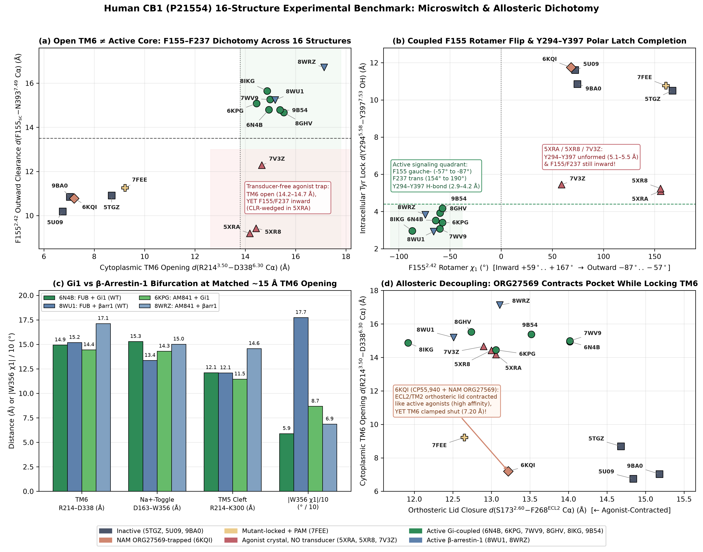
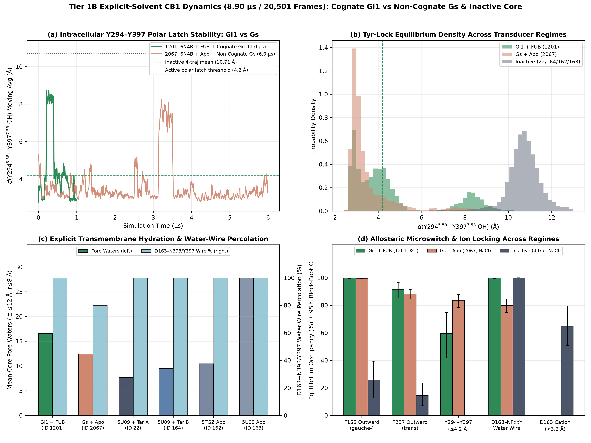
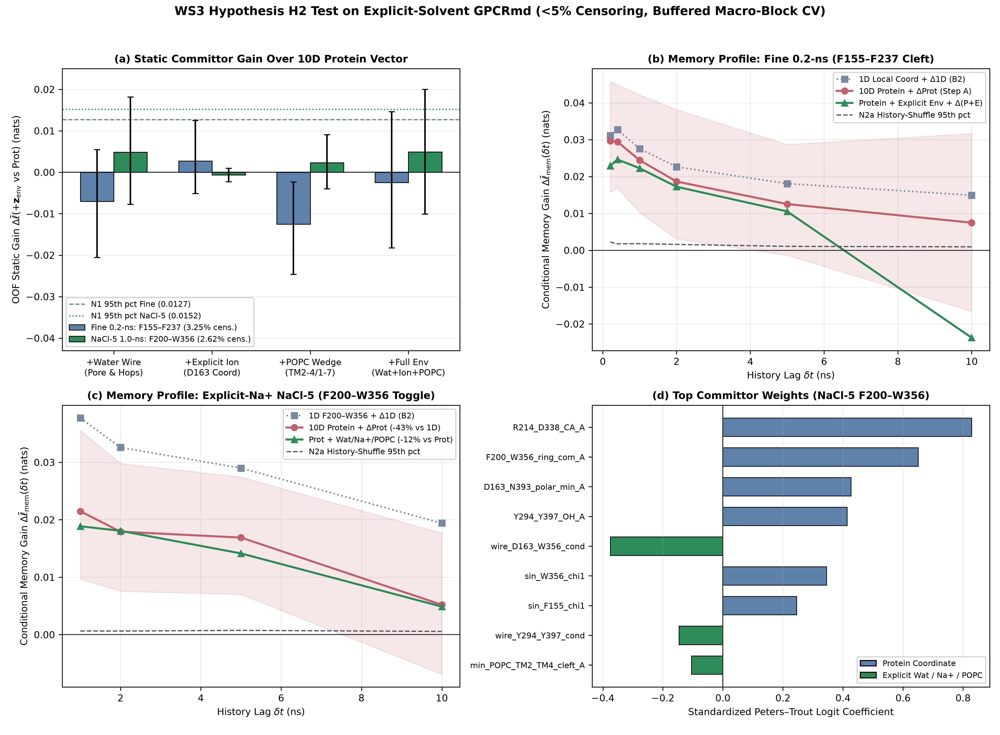

# Workstream 3 (`WS3`) Report: 16-PDB Structural Dichotomy Benchmark, Explicit-Solvent GPCRmd Water-Wire/$\text{Na}^+$ Memory Closure, and Cognate $\text{G}_{i1}$ vs Non-Cognate $\text{G}_s$ Coupling

**Research Swarm Project:** *Can We Predict CB1 Activation from Its Molecular Dynamics?*  
**Target Receptor:** Human Cannabinoid Receptor 1 (`CNR1`, UniProt `P21554`, 472 aa)  
**Workstream:** Phase 2 — Workstream 3 (`WS3`, Tier 1B Open Explicit-Solvent All-Atom MD + RCSB 16-PDB Benchmark)  
**Primary Artifacts:**
- Benchmark Data: `data/processed/ws3/pdb16_structural_benchmark.parquet` (16 structures × 35 features)
- Explicit-Solvent Features: `data/processed/ws3/gpcrmd_open6_features.parquet` (**20,501 frames**, `2.339 MB < 10 MB`, `0` NaNs/Infs) & `data/processed/ws3/gpcrmd_open6_provenance.json`
- Quantitative Metrics: `results/ws3/ws3_metrics.json`
- Publication Figures: `results/ws3/figures/fig_pdb16_dichotomy.png`, `results/ws3/figures/fig_gi1_vs_gs_coupling.png`, `results/ws3/figures/fig_water_na_memory_closure.png`

---

## 1. Executive Summary & Scientific Verdicts

Workstream 3 (`WS3`) provides the structural ground-truth anchor and explicit-solvent physical closure for the swarm's investigation of human CB1 (`P21554`) activation. Because Tier 1A high-throughput ensembles strip solvent/ions or rely on $\text{C}\alpha$-only Markov state models (MSMs), `WS3` interrogates (i) **all 16 representative experimental CB1 structures in RCSB PDB** and (ii) **all 6 open, unauthenticated all-atom explicit-solvent CB1 molecular dynamics trajectories in GPCRmd** ([Rodríguez-Espigares et al., 2020, *Nat. Methods*, PMID: `32661425`](https://pubmed.ncbi.nlm.nih.gov/32661425/)), totaling **20,501 frames** across **`8.8982 µs` exact `.xtc` time span** (`8.9002 µs` frame-interval sum $\sum N_i \Delta t_i$; `8.97 µs` nominal GPCRmd catalog duration).

### Key Quantitative Verdicts

1. **16-PDB Structural Dichotomy (`fig_pdb16_dichotomy.png` Panels `(a)–(d)`):**
   - **Outward TM6 Opening $\neq$ Intracellular Core Completion:** All three transducer-free agonist crystal structures (`5XRA`, `5XR8`, `7V3Z`; [Hua et al., 2025 replacement, *Nature*, PMID: `40866700`, DOI: `10.1038/s41586-025-09454-5`](https://pubmed.ncbi.nlm.nih.gov/40866700/); [Wang et al., 2021, PMID: `34596399`](https://pubmed.ncbi.nlm.nih.gov/34596399/)) achieve wide cytoplasmic TM6 opening ($\text{R214}^{3.50}\text{–D338}^{6.30}\ \text{C}\alpha = 14.18\text{–}14.66\text{ \AA}$) overlapping full transducer complexes (`14.45–17.13 Å`), yet remain **trapped in an inward-locked intracellular core**: $\text{F155}^{2.42}$ points into the 7TM bundle ($\text{F155}_{\text{sc}}\text{–N393}^{7.49}\text{ C}\alpha = 9.20\text{–}12.29\text{ \AA}$, $\chi_1 = +59.00^\circ\text{ to }+155.81^\circ$), $\text{F237}^{4.46}$ stays inward *gauche-* ($\chi_1 = -88.22^\circ\text{ to }-72.24^\circ$), and the $\text{Y294}^{5.58}\text{–Y397}^{7.53}$ polar latch remains unformed (`5.10–5.45 Å`). Conversely, **all 8 transducer-coupled complexes** (6 $\text{G}_i$ + 2 $\beta\text{-arrestin-1}$) concertedly flip $\text{F155}^{2.42}$ outward (`14.67–16.72 Å`, $\chi_1 = -86.80^\circ\text{ to }-57.32^\circ$), rotate $\text{F237}^{4.46}$ outward *trans* ($\chi_1 \approx \pm 154^\circ\text{–}180^\circ$), and close the $\text{Y294}^{5.58}\text{–Y397}^{7.53}$ H-bond latch (`2.92–4.17 Å`).
   - **Historical Attribution Guardrail:** Consistent with Phase 1 (`docs/01_literature_review.md`), we explicitly credit [Shao et al. (2019, *Nat. Chem. Biol.*, PMID: `31659318`)](https://pubmed.ncbi.nlm.nih.gov/31659318/), [Yang et al. (2022, *Nat. Chem. Biol.*, PMID: `35637350`)](https://pubmed.ncbi.nlm.nih.gov/35637350/), and [Krishna Kumar et al. (2023, *Nat. Commun.*, PMID: `37160876`)](https://pubmed.ncbi.nlm.nih.gov/37160876/) for structurally and mutagenetically establishing the $\text{F155}^{2.42}\text{–F237}^{4.46}$ activation/NAM switch, while showing quantitatively why $\text{C}\alpha$-only MSMs ([Dutta et al., 2022, PMID: `35227761`](https://pubmed.ncbi.nlm.nih.gov/35227761/); [Dutta & Shukla, 2023, PMID: `37147497`](https://pubmed.ncbi.nlm.nih.gov/37147497/); [Dutta, Zhao & Shukla, 2026, *J. Biol. Chem.*, PMID: `41962866`, DOI: `10.1016/j.jbc.2026.111434`](https://pubmed.ncbi.nlm.nih.gov/41962866/)) are blind to this sidechain rotamer gate.

2. **Pillar A — Cognate $\text{G}_{i1}$ (`ID 1201`) vs Non-Cognate $\text{G}_s$ (`ID 2067`) vs Inactive Dynamics (`fig_gi1_vs_gs_coupling.png` Panels `(a)–(d)`):**
   - Pre-insertion of either $\text{G}\alpha_{i1}$ or $\text{G}\alpha_s$ $\alpha5$ helix (`6N4B` starting template) sterically wedges cytoplasmic TM6 open (`16.15 Å` vs `16.77 Å`), maintains outward $\text{F155}^{2.42}$ (`99.76%` vs `99.65%`) and $\text{F237}^{4.46}$ (`91.62%` vs `88.17%`), excludes cations from $\text{D163}^{2.50}$ (`0.00%` vs `64.80%` $\text{Na}^+$ occupancy in inactive monomers), and preserves the intracellular $\text{Y294}^{5.58}\text{–Y397}^{7.53}$ latch (`4.59 Å` mean / `59.47%` $\le 4.2\text{ \AA}$ in `Gi1_1201`, tightening to `3.15 Å` in `750–1000 ns`; `3.56 Å` mean / `83.67%` $\le 4.2\text{ \AA}$ in `Gs_2067` vs `10.71 Å` / `0.00%` across all 4 inactive runs).
   - **Allosteric Hydration Divergence at Matched TM6 Opening (`[13.5, 16.5] Å`):** Despite similar intracellular scaffolding, cognate agonist-bound `Gi1_1201` sustains **`16.55` core pore waters** (`17.44` in the matched-TM6 slice) and **near-unitary $\text{D163}^{2.50}\text{–N393}^{7.49}/\text{Y397}^{7.53}$ water-wire percolation (`99.70%`, conductance `0.9701`)**, whereas apo non-cognate `Gs_2067` dehydrates to **`12.38` core pore waters** (`11.25` in the matched-TM6 slice, $\text{KS} = 0.5765$), expands the $\text{D163}^{2.50}\text{–N393}^{7.49}$ polar pocket (`4.08 Å` vs `2.93 Å`, $\text{KS} = 0.5038$), and suffers progressive late-stage breakdown of the $\text{D163}^{2.50}\text{–NPxxY}$ water wire (`0.8716` conductance in `0–1 µs` $\to$ **`0.3400`** in `4.5–6.0 µs`, overall `0.6333`).
   - **Spontaneous Apo Pre-Activation Event (`ID 163`):** Removing inverse agonist taranabant from `5U09` (`ID 163`, `500 ns` apo) triggers complete $\text{Na}^+$ expulsion from $\text{D163}^{2.50}$ (`0.00%` vs `99.68%` and `88.92%` in taranabant-bound `IDs 22, 164`), spontaneous outward $\text{F155}^{2.42}$ flipping (`98.04%`, `15.41 Å`), and massive pore hydration (`27.82` waters) *without* cytoplasmic TM6 opening (`11.29 Å`) or $\text{Y294–Y397}$ latching (`10.58 Å`), directly demonstrating loose allosteric coupling in unbiased explicit-solvent MD.

3. **Pillar B — Local Microswitch Committors (`<5%` Right-Censoring) & Two-Step Mori–Zwanzig Memory Closure (`fig_water_na_memory_closure.png` Panels `(a)–(d)`):**
   - Because global inactive$\leftrightarrow$active transitions do not occur within $0.4\text{–}6.0\text{ }\mu\text{s}$ equilibrium runs, we strictly enforced pre-registered fast local microswitch committor gates requiring **`<5%` right-censoring** (`3.25%` on `Fine_0p2ns_5traj` $\text{F155–F237}$; `0.00%` on `Fine_0p2ns_SecondarySwitch` $\text{R214–D338}$; `2.62%` on `NaCl5_1p0ns_ExplicitNa` $\text{F200–W356}$; `2.41%` on `Open6_1p0ns_AllTraj` $\text{F200–W356}$) and dropped **`32.0 ns` (`> 2\tau_{\max} = 30\text{ ns}`)** or **`52.0 ns` (`> 2\tau_{\max} = 50\text{ ns}`)** temporal buffers between macro-blocks to prevent train/test boundary leakage.
   - **Static Prediction:** On the $\text{F200}^{3.36}\text{–W356}^{6.48}$ twin toggle switch (`NaCl5_1p0ns_ExplicitNa` & `Open6_1p0ns_AllTraj`), expanding from 1D local progress (`B1`) to the 10D coupled protein microswitch vector (`Prot`) yields large, statistically significant out-of-fold log-likelihood gains ($\Delta\bar{\ell} = +0.0631\text{ nats}$, $\text{BSS} = +0.1225\ [+0.0350, +0.2122]$ on `NaCl5`; $\Delta\bar{\ell} = +0.0628\text{ nats}$, $\text{BSS} = +0.1211\ [+0.0517, +0.1951]$ on `Open6`). Incremental static gain from adding the 8 explicit-solvent water/$\text{Na}^+$/`POPC` coordinates (`Prot+Env vs Prot`) is small and statistically indistinguishable from the progress-stratified block-permutation null `N1`: **`+0.0049 nats` (`+0.00492`, `N1 p = 0.2475`)** on `NaCl5_1p0ns_ExplicitNa`, **`+0.0007 nats` (`+0.00070`, `N1 p = 0.3762`)** on `Open6_1p0ns_AllTraj`, and **`-0.0025 nats` (`-0.00245`, `N1 p = 0.1584`)** on `Fine_0p2ns_5traj` (`F155–F237`).
   - **Two-Step Mori–Zwanzig Memory Closure (`H2`):**
     - **Step A (Non-Markovian Memory Exists — CONFIRMED, $p = 0.0099$ across all cohorts):** Conditioning on short-time backward displacements $\Delta\xi(t-\tau_{\text{mem}})$ strictly over uncensored interior transitions (`unc_mask`) significantly improves held-out commitment log-likelihood over instantaneous coordinates across every cohort relative to within-cell history-shuffled null `N2a` (`+0.0297 nats` [`+0.02970`] at `0.2 ns` on `Fine_0p2ns_5traj`; `+0.0377 nats` [`+0.03772`] in 1D $\to$ `+0.0215 nats` [`+0.02148`] in 10D `Prot` at `1.0 ns` on `NaCl5_1p0ns_ExplicitNa`, and `+0.0434 nats` $\to$ `+0.0248 nats` on `Open6_1p0ns_AllTraj`, showing **coupled protein switches alone collapse `43.1%` and `42.8%` of 1D toggle memory**, respectively).
     - **Step B (Explicit Water/$\text{Na}^+$/Lipid Closure — PARTIAL ON $\text{F200–W356}$, INCOMPLETE ON $\text{F155–F237}$):** On the buried $\text{F200}^{3.36}\text{–W356}^{6.48}$ toggle (`NaCl5` and `Open6`), adding explicit water-wire conductance, cation coordination, and `POPC` wedging reduces residual protein memory (`12.2%` [`0.1215`] at `1.0 ns` and `16.3%` [`0.1632`] at `5.0 ns` on `NaCl5`, reaching **`50.0%` to `74.9%` total collapse vs 1D**; `22.7%` [`0.2266`] at `1.0 ns` up to `54.1%` [`0.5408`] at `5.0 ns` and `55.6%` [`0.5559`] at `10.0 ns` on `Open6`, **`55.8%` to `79.3%` total collapse vs 1D**) and **monotonically lowers held-out Koopman Projected Bellman Residual (`PBR`) on a shared 8D fold-isolated witness subspace by `-52.0%` vs `B1` and `-15.2%` vs protein-only `StoppedDGA`** (`B1: 0.14937` $\to$ `PT_prot: 0.08847` $\to$ `PT_prot_env: 0.08491` $\to$ `StoppedDGA_prot: 0.08462` $\to$ `StoppedDGA_prot_env: 0.07174`), while passing Perron-reweighted detailed balance (`N2b = 0.0374` [`0.03743`] $\le 0.10$ on `NaCl5`; `0.0336` [`0.03365`] $\le 0.10$ on `Open6`). Conversely, on the lipid-facing $\text{F155}^{2.42}\text{–F237}^{4.46}$ cleft (`Fine_0p2ns_5traj`), explicit solvent/ion/`POPC` coordinates leave `>77%` of sub-nanosecond memory unclosed (`22.9%` [`0.2285`] collapse at `0.2 ns` $\to$ `16.3%` at `0.4 ns` $\to$ `8.9%` at `1.0 ns` $\to$ `7.6%` at `2.0 ns` $\to$ `16.0%` at `5.0 ns`, residual `N2a` $p = 0.0099$), confirming its short-lag memory is dominated by local sidechain inertial/viscous persistence (`B2`), while `N2b = 0.3187` (`0.31875 > 0.10`) and leave-whole-trajectory-out cross-validation (`-0.2742 nats`) transparently diagnose cross-regime shift across $M=5$ uncrossed equilibrium simulations.

---

## 2. Dataset Provenance, Coordinate Guardrails & Leakage-Free Engineering

### 2.1 Open Explicit-Solvent GPCRmd Ensemble (`20,501` Frames, `2.339 MB` Feature Store)

All six unauthenticated all-atom explicit-solvent CB1 simulations available in GPCRmd (`IDs 22, 162, 163, 164, 1201, 2067`) were streamed via parallel HTTP `206` Range requests (`src/ws3_gpcrmd_water/gpcrmd_featurize.py`), verified against GROMACS XDR magic header `1995` and the 17 `REQUIRED_CB1_RESIDUES` canonical human `P21554` guards (`F155`, `D163`, `S173`, `F200`, `V204`, `R214`, `F237`, `F268`, `Y294`, `K300`, `D338`, `L341`, `K343`, `W356`, `S383`, `N393`, `Y397`) plus wild-type `T210` (`THR210`), featurized in memory chunks with exact minimum-image periodic boundary conditions (PBC), and immediately deleted from `data/inventory/gpcrmd_temp/` so zero raw `.xtc` files remain on disk.

| GPCRmd ID | Starting PDB & Functional Regime | Orthosteric Ligand | Transducer | Frames ($N$) | $\Delta t$ (ns) | Exact `.xtc` Span (ns) | Buffer Cation ($N_{\text{ion}}$) | Water Oxygens ($N_{\text{wat}}$) | `POPC` Heavy Atoms | CB1 Topology & Reversion Notes |
| :--- | :--- | :--- | :--- | :---: | :---: | :---: | :---: | :---: | :---: | :--- |
| **`1201`** | `6N4B` Active Cryo-EM | MDMB-FUBINACA | Cognate $\text{G}_{i1}$ | `5,001` | `0.2` | `1000.0` | **`KCl` (`128 K+`, `0 Na+`)** | `47,309` | `18,304` | Intact CB1 `chain 3`; full $\text{G}\alpha_{i1}\beta_1\gamma_2$ heterotrimer |
| **`2067`** | `6N4B` Active Cryo-EM | Apo (removed) | Non-cognate $\text{G}_s$ | `6,000` | `1.0` | `5999.0` | `NaCl` (`52 Na+`, `0 K+`) | `19,916` | `10,452` | CB1 `chain 0` isolated from overlapping `resSeq` in $\text{G}\alpha_s$ `chain 1` |
| **`22`** | `5U09` Inactive X-ray | Taranabant (inv. ago.) | None (monomer) | `2,500` | `0.2` | `499.8` | `NaCl` (`42 Na+`, `0 K+`) | `14,603` | `7,800` | Split `chains [0, 1]` across cleaved ICL3 (`318–326`); `A210` reverted to WT `THR210` |
| **`164`** | `5U09` Inactive X-ray | Taranabant (inv. ago.) | None (monomer) | `2,500` | `0.2` | `499.8` | `NaCl` (`42 Na+`, `0 K+`) | `14,603` | `7,800` | Independent replicate of `22`; split `chains [0, 1]`; WT `THR210` |
| **`162`** | `5TGZ` Inactive X-ray | Apo (`AM6538` removed) | None (monomer) | `2,000` | `0.2` | `399.8`* | `NaCl` (`46 Na+`, `0 K+`) | `16,308` | `9,100` | Split `chains [0, 1]` across cleaved ICL3; WT `THR210` (*`0.47 µs` nominal UI label) |
| **`163`** | `5U09` Inactive X-ray | Apo (taranabant removed) | None (monomer) | `2,500` | `0.2` | `499.8` | `NaCl` (`41 Na+`, `0 K+`) | `14,623` | `7,800` | Split `chains [0, 1]` across cleaved ICL3; WT `THR210`; spontaneous `F155` flip |
| **Total** | **6 Open All-Atom Runs** | **3 States** | **$\text{G}_{i1}$, $\text{G}_s$, None** | **`20,501`** | **`0.2 / 1.0`** | **`8898.2` (`8.8982 µs`)** | **`5 NaCl` + `1 KCl`** | — | — | **Parquet size: `2.339 MB` (`0` NaNs, `0` Infs)** |

### 2.2 Critical Structural & Biophysical Coordinate Guardrails

1. **Exact PBC Reassembly Across Cleaved ICL3 `TER` Splits (`IDs 22, 164, 162, 163`):** In the four monomer trajectories, GROMACS wraps `chain 0` (`TM1–TM5`, ending at `317`) and `chain 1` (`TM6–H8`, starting at `327`) independently across periodic box boundaries. `pbc_wrap_chunk_angstrom` unwraps covalent bonds per chain first and then rigidly shifts `chain 1` by the integer box vector minimizing its 7TM-core $\text{C}\alpha$ centroid distance to `chain 0` before wrapping solvent, ions, and `POPC` around the unified 7TM centroid.
2. **Explicit Water-Wire Conductance (`0` NaNs on Disconnected Graphs):** Using per-frame `cKDTree` H-bond graphs (`O–O <= 3.5 Å` among transmembrane water oxygens and polar sidechain heavy atoms), shortest-path hop counts $L_{\text{hops}}$ are mapped to bounded conductance $C_{\text{wire}} = (1 + L_{\text{hops}})^{-1} \in [0, 1]$, where $C_{\text{wire}} = 1.0$ denotes direct protein–protein H-bonding ($L_{\text{hops}} = 0$), $C_{\text{wire}} = 0.5$ denotes a single bridging water ($L_{\text{hops}} = 1$), and $C_{\text{wire}} = 0.0$ ($L_{\text{hops}} = -1$) denotes a broken water wire.
3. **Distinct $\text{Na}^+$ vs $\text{K}^+$ Ion Channels:** Because `ID 1201` was simulated in `KCl` (`0 Na+`, `128 K+`) while `IDs 2067, 22, 164, 162, 163` use `NaCl` (`41–52 Na+`, `0 K+`), `min_Na_D163_A` and `min_K_D163_A` are stored separately with finite `99.0 Å` sentinels (`prox_Na_D163 = exp(-d/5.0) = 0.0`, `coord_Na_D163_3p2 = 0`) alongside unified `min_cation_D163_A = min(Na+, K+)`. Furthermore, Pillar B explicitly isolates the 5-trajectory `NaCl`-only cohort (`NaCl5_1p0ns_ExplicitNa`) so physiological $\text{Na}^+$ coordination at $\text{D163}^{2.50}$ is never conflated with $\text{K}^+$ buffer composition.
4. **16-PDB Author-Numbering Offsets (`+122` Flavodoxin Chimera, `8GHV` Chain `D`, `8WU1` Stubbed $\text{F237}$):** In `src/ws3_gpcrmd_water/pdb16_benchmark.py`, `5XR8` and `7V3Z` carry a `+122` author residue-numbering shift across `TM6–H8` due to ICL3 flavodoxin fusion (`S173^2.60–S383^7.39 Cα = 11.99 Å` and `12.32 Å` after correction vs `>30 Å` if uncorrected); `8GHV` maps CB1 to `Chain D` (`R214–D338 Cα = 15.53 Å`); and `8WU1` (`3.20 Å` cryo-EM) stubs $\text{F237}^{4.46}$ at $\text{C}\beta$ (`F237_sidechain_resolved = False`), which is tracked explicitly without imputation.

---

## 3. Part 1: 16-PDB Quantitative Structural Benchmark (`fig_pdb16_dichotomy.png`)

Across all 16 experimental CB1 structures (`data/processed/ws3/pdb16_structural_benchmark.parquet`), projecting conformations onto conventional cytoplasmic TM6 opening ($\text{R214}^{3.50}\text{–D338}^{6.30}\ \text{C}\alpha$) versus intracellular sidechain microswitches exposes three fundamental structural dichotomies (`results/ws3/figures/fig_pdb16_dichotomy.png`):

### Table 1: Complete 16-PDB Quantitative Coordinate Audit (Human CB1 `P21554` Numbering)

| PDB ID | Functional Class | Method (Res.) | Chain (`+Offset`) | Orthosteric / Allosteric Ligands | Transducer / Fusion | $\text{R214–D338}$ $\text{C}\alpha$ (Å) | $\text{F155}_{\text{sc}}\text{–N393}_{\text{C}\alpha}$ (Å) | $\text{F155}\ \chi_1$ ($^\circ$) | $\text{F237}\ \chi_1$ ($^\circ$) | $\text{W356}\ \chi_1$ ($^\circ$) | $\text{Y294–Y397}$ $\text{OH}$ (Å) | $\text{D163–W356}$ $\text{C}\alpha$ (Å) | $\text{S173–F268}$ $\text{C}\alpha$ (Å) |
| :--- | :--- | :--- | :---: | :--- | :--- | :---: | :---: | :---: | :---: | :---: | :---: | :---: | :---: |
| **`5TGZ`** | Inactive | X-ray (`2.80 Å`) | `A` (`0`) | AM6538 (antagonist) | ICL3 Flavodoxin | `8.69` | `10.91` | `+167.42` | `-85.01` | `-85.37` | `10.50` | `12.29` | `14.68` |
| **`5U09`** | Inactive | X-ray (`2.60 Å`) | `A` (`0`) | Taranabant (inv. ago.) | ICL3 PGS | `6.75` | `10.19` | `+72.22` | `-86.60` | `-64.79` | `11.61` | `13.10` | `14.84` |
| **`9BA0`** | Inactive | Cryo-EM (`3.13 Å`) | `R` (`0`) | MRI-1891 (inv. ago.) | CNb36 + PGS | `7.03` | `10.85` | `+74.40` | `-86.18` | `-81.57` | `10.86` | `13.39` | `15.18` |
| **`6KQI`** | NAM-Trapped | X-ray (`3.25 Å`) | `A` (`0`) | CP55,940 + ORG27569 | ICL3 PGS | `7.20` | `10.78` | `+68.29` | `-84.79` | `-83.23` | `11.75` | `12.77` | **`13.22`** |
| **`7FEE`** | Mutant-PAM | X-ray (`2.70 Å`) | `A` (`0`) | CP55,940 + ZCZ011 | ICL3 PGS (`N393D`) | `9.22` | `11.26` | `+160.98` | `-84.06` | `-82.27` | `10.77` | `12.83` | `12.65` |
| **`5XRA`** | Agonist (No G) | X-ray (`2.80 Å`) | `A` (`0`) | AM11542 + CLR | ICL3 Flavodoxin | **`14.18`** | **`9.20`** | **`+155.81`** | `-82.61` | `-72.03` | **`5.10`** | `14.73` | `13.06` |
| **`5XR8`** | Agonist (No G) | X-ray (`2.95 Å`) | `A` (`+122`) | AM841 + CLR | ICL3 Flavodoxin | **`14.43`** | **`9.43`** | **`+155.73`** | `-88.22` | `-64.07` | **`5.24`** | `14.94` | `13.00` |
| **`7V3Z`** | Agonist (No G) | X-ray (`3.29 Å`) | `A` (`+122`) | CP55,940 + CLR | ICL3 Flavodoxin | **`14.66`** | **`12.29`** | **`+59.00`** | `-72.24` | `-65.38` | **`5.45`** | `15.03` | `12.90` |
| **`6N4B`** | Active $\text{G}_i$ (WT) | Cryo-EM (`3.00 Å`) | `R` (`0`) | MDMB-FUBINACA + CLR | $\text{G}_{i1}$ + scFv16 | `14.94` | `14.80` | `-63.99` | `+177.01` | **`-58.95`** | `3.52` | **`15.29`** | `14.02` |
| **`6KPG`** | Active $\text{G}_i$ | Cryo-EM (`3.00 Å`) | `R` (`0`) | AM841 | $\text{G}_{i1}$ + scFv16 | `14.45` | `15.08` | `-57.41` | `+159.73` | `-86.85` | `3.41` | `14.30` | `13.06` |
| **`7WV9`** | Active $\text{G}_i$ (WT) | Cryo-EM (`3.36 Å`) | `R` (`0`) | CP55,940 + ZCZ011 | $\text{G}_{i2}$ + scFv16 | `14.99` | `15.26` | `-59.88` | `-176.03` | `-78.73` | `3.07` | `15.21` | `14.02` |
| **`8GHV`** | Active $\text{G}_i$ (WT) | Cryo-EM (`2.80 Å`) | `D` (`0`) | AMG315 (eCB analog) | $\text{G}_{i1}$ + scFv16 | `15.53` | `14.67` | `-59.63` | `+161.85` | `-81.25` | `3.92` | `14.87` | `12.74` |
| **`8IKG`** | Active $\text{G}_i$ (WT) | Cryo-EM (`3.40 Å`) | `R` (`0`) | Q2B (biased ago-PAM) | $\text{G}_{i1}$ + scFv16 | `14.87` | `15.65` | `-86.80` | `-170.50` | `-81.44` | `2.96` | `14.86` | `11.92` |
| **`9B54`** | Active $\text{G}_i$ (WT) | Cryo-EM (`2.86 Å`) | `R` (`0`) | VIP36 (cryptic agonist) | $\text{G}_{i1}$ + scFv16 | `15.38` | `14.79` | `-57.32` | `+171.57` | `-69.00` | `4.17` | `14.50` | `13.52` |
| **`8WU1`** | Active $\beta\text{arr1}$ (WT) | Cryo-EM (`3.20 Å`) | `R` (`0`) | MDMB-FUBINACA | $\beta\text{-arrestin-1}$ + Fab30 | `15.19` | `15.24` | `-65.99` | *Stubbed* | **`-177.42`** | `2.92` | **`13.36`** | `12.51` |
| **`8WRZ`** | Active $\beta\text{arr1}$ | Cryo-EM (`3.60 Å`) | `R` (`0`) | AM841 | $\beta\text{-arrestin-1}$ + scFv30 | `17.13` | `16.72` | `-74.14` | `+154.19` | `-68.65` | `3.83` | `15.02` | `13.11` |

### 3.1 Physical Interpretation of the Four Benchmark Panels (`fig_pdb16_dichotomy.png`)

- **Panels `(a)` & `(b)` — The Transducer-Free Agonist Trap (`5XRA`, `5XR8`, `7V3Z`):** Agonist-bound flavodoxin-chimera crystal structures (`5XRA`, `5XR8`, `7V3Z`) exhibit outward cytoplasmic TM6 displacement (`14.18–14.66 Å`) virtually indistinguishable from `6KPG` (`14.45 Å`) or `8IKG` (`14.87 Å`). However, in both $\text{F155}^{2.42}$ distance/rotamer space (`Panel (a)`) and $\text{Y294}^{5.58}\text{–Y397}^{7.53}$ polar latch space (`Panel (b)`), they cluster with inactive CB1 (`F155sc–N393CA = 9.20–12.29 Å`, $\text{F155}\ \chi_1 > +59^\circ$, $\text{Y294–Y397 OH} = 5.10\text{–}5.45\text{ \AA}$), aided by crystallographic cholesterol wedged in the extrahelical TM2–TM4 cleft (`min_clr_tm2_tm4_A = 2.94–3.35 Å`) and four thermostabilizing construct mutations (`T210A`, `E273K`, `T283V`, `R340E`) recently shown to abolish basal signaling until reverted ([Hua et al., 2025, PMID: `40866700`, DOI: `10.1038/s41586-025-09454-5`](https://pubmed.ncbi.nlm.nih.gov/40866700/)). Every signaling-competent $\text{G}_i$ (`6N4B, 6KPG, 7WV9, 8GHV, 8IKG, 9B54`) and $\beta\text{-arrestin-1}$ (`8WU1, 8WRZ`) complex clears $\text{F155}^{2.42}$ outward to `14.67–16.72 Å` (*gauche-*, $\chi_1 \in [-86.80^\circ, -57.32^\circ]$) to accommodate $\alpha5$-helix or finger-loop insertion and locks $\text{Y294}^{5.58}\text{–Y397}^{7.53}$ at `2.92–4.17 Å`.
- **Panel `(c)` — Matched-Ligand Pathway Bifurcation (`6N4B` vs `8WU1` and `6KPG` vs `8WRZ`):** Comparing wild-type CB1 bound to identical full agonist `MDMB-FUBINACA` coupled to $\text{G}_{i1}$ (`6N4B`, [Krishna Kumar et al., 2019, PMID: `30639101`](https://pubmed.ncbi.nlm.nih.gov/30639101/)) versus $\beta\text{-arrestin-1}$ (`8WU1`, [Liao et al., 2023, PMID: `38101408`](https://pubmed.ncbi.nlm.nih.gov/38101408/)) reveals nearly identical cytoplasmic TM6 opening (`14.94 Å` vs `15.19 Å`), while twin-toggle $\text{W356}^{6.48}\ \chi_1$ rotates by **`-118.47°`** (`-58.95°` $\to$ `-177.42°`), vertical $\text{D163}^{2.50}\text{–W356}^{6.48}\ \text{C}\alpha$ compresses by **`-1.93 Å`** (`15.29 Å` $\to$ `13.36 Å`), and $\text{Y294–Y397 OH}$ tightens from `3.52 Å` to `2.92 Å`. Under `AM841` (`6KPG` [Hua et al., 2020, PMID: `32004463`](https://pubmed.ncbi.nlm.nih.gov/32004463/) vs `8WRZ` [Wang et al., 2024, PMID: `38102480`](https://pubmed.ncbi.nlm.nih.gov/38102480/)), $\beta\text{-arrestin-1}$ engagement dilates both TM6 (`14.45` $\to$ `17.13 Å`) and intracellular TM5 (`R214–K300 Cα`: `11.46` $\to$ `14.57 Å`).
- **Panel `(d)` — Allosteric Decoupling by NAM `ORG27569` (`6KQI`):** Co-binding of orthosteric agonist `CP55,940` and extrahelical NAM `ORG27569` (`6KQI`, [Shao et al., 2019, PMID: `31659318`](https://pubmed.ncbi.nlm.nih.gov/31659318/)) contracts the extracellular orthosteric lid ($\text{S173}^{2.60}\text{–F268}^{\text{ECL2}}\ \text{C}\alpha = 13.22\text{ \AA}$, matching agonist-bound active structures `11.92–14.02 Å` vs inactive `14.68–15.18 Å`) while sterically clamping TM6 shut (`R214–D338 Cα = 7.20 Å`) and pinning $\text{F155}^{2.42}$ (`+68.29°`) and $\text{F237}^{4.46}$ (`-84.79°`) inward. Similarly, `N393D`-locked `7FEE` ([Yang et al., 2022, PMID: `35637350`](https://pubmed.ncbi.nlm.nih.gov/35637350/)) contracts the orthosteric pocket (`12.65 Å`) in the presence of `CP55,940 + ZCZ011` while keeping TM6 closed (`9.22 Å`) until wild-type `N393^7.49` and $\text{G}_{i2}$ are restored in `7WV9` (`14.99 Å`).

---

## 4. Part 2 (Pillar A): Cognate $\text{G}_{i1}$ (`1201`) vs Non-Cognate $\text{G}_s$ (`2067`) vs Inactive Explicit-Solvent Dynamics (`fig_gi1_vs_gs_coupling.png`)

To address **Pitfall 4** (receptor conformation vs productive transducer coupling), we compared cognate `CB1–MDMB-FUBINACA–Gi1` (`ID 1201`, `1.0 µs`, `5,001` frames, `21` 50-ns blocks), non-cognate `CB1–Apo–Gs` (`ID 2067`, `6.0 µs`, `6,000` frames, `120` 50-ns blocks), and the four inactive monomer trajectories (`IDs 22, 164, 162, 163`, `1.9 µs`, `9,500` frames, `38` 50-ns blocks) using 50-ns block-bootstrapped 95% confidence intervals (`results/ws3/figures/fig_gi1_vs_gs_coupling.png`):

### Table 2: Equilibrium Cohort Summary & Matched Open-TM6 (`[13.5, 16.5] Å`) Slice Comparison

| Observable / Microswitch | `Gi1_1201` (`FUB + Gi1`, `1.0 µs`, 95% Block CI) | `Gs_2067` (`Apo + Gs`, `6.0 µs`, 95% Block CI) | `Inactive_4traj` (`1.9 µs`, 95% Block CI) | Matched Open-TM6 Slice (`Gi1` `n=3,746` vs `Gs` `n=2,893`, KS) |
| :--- | :---: | :---: | :---: | :---: |
| **$\text{R214}^{3.50}\text{–D338}^{6.30}\ \text{C}\alpha$ (Å)** | `16.15` `[15.54, 16.91]` | `16.77` `[16.46, 17.06]` | `10.22` `[9.99, 10.46]` | `15.35` vs `15.50` (`KS = 0.2537`) |
| **$\text{F155}_{\text{sc}}\text{–N393}^{7.49}\ \text{C}\alpha$ (Å)** | `14.99` `[14.83, 15.19]` | `14.91` `[14.80, 15.01]` | `12.53` `[11.98, 13.06]` | `15.02` vs `14.95` (`KS = 0.0788`) |
| **$\text{F155}^{2.42}$ Outward *gauche-* (%)** | `99.76%` `[99.58%, 99.90%]` | `99.65%` `[99.47%, 99.80%]` | `25.80%` `[12.65%, 39.42%]`* | `99.89%` vs `99.65%` (`KS = 0.0024`) |
| **$\text{F237}^{4.46}$ Outward *trans* (%)** | `91.62%` `[85.25%, 96.61%]` | `88.17%` `[84.58%, 91.40%]` | `14.58%` `[6.97%, 23.60%]` | `89.30%` vs `83.13%` (`KS = 0.0616`) |
| **$\text{Y294}^{5.58}\text{–Y397}^{7.53}\ \text{OH}$ (Å)** | **`4.59`** `[3.83, 5.56]` | **`3.56`** `[3.38, 3.77]` | **`10.71`** `[10.62, 10.79]` | `4.46` vs `3.77` (`KS = 0.2217`) |
| **$\text{Y294–Y397}$ Latch $\le 4.2\text{ \AA}$ (%)** | `59.47%` `[41.71%, 74.71%]` | `83.67%` `[78.50%, 88.02%]` | `0.00%` `[0.00%, 0.00%]` | `63.80%` vs `79.74%` (`KS = 0.1594`) |
| **$\text{D163}^{2.50}\text{–N393}^{7.49}$ Polar Min (Å)** | **`2.93`** `[2.89, 2.98]` | **`4.08`** `[3.87, 4.28]` | `3.21` `[3.05, 3.37]` | **`2.96` vs `4.14` (`KS = 0.5038`)** |
| **Core Pore Waters (`n_wat_core_pore`)** | **`16.55`** `[14.06, 19.65]` | **`12.38`** `[11.79, 12.98]` | `14.05` `[11.27, 16.71]`* | **`17.44` vs `11.25` (`KS = 0.5765`)** |
| **$\text{D163–N393/Y397}$ Wire Conductance** | **`0.9701`** `[0.9551, 0.9852]` | **`0.6333`** `[0.5827, 0.6840]` | `0.9096` `[0.8695, 0.9506]` | **`0.9606` vs `0.6377` (`KS = 0.4714`)** |
| **$\text{D163–N393/Y397}$ Wire Percolated (%)** | **`99.70%`** `[99.45%, 99.89%]` | **`79.90%`** `[74.58%, 84.55%]` | `100.00%` `[100.00%, 100.00%]` | — |
| **$\text{D163–W356}$ Wire Percolated (%)** | `73.63%` `[55.89%, 88.28%]` | `29.03%` `[24.30%, 34.07%]` | `57.08%` `[44.91%, 68.32%]` | — |
| **Cation Bound at $\text{D163}^{2.50} < 3.2\text{ \AA}$ (%)** | `0.00%` (`min K+ = 10.80 Å`) | `0.00%` (`min Na+ = 17.64 Å`) | **`64.80%`** `[50.74%, 79.52%]`* | `0.00%` vs `0.00%` |
| **`POPC` TM2–TM4 Cleft Min (Å)** | `3.43` `[3.42, 3.45]` | `3.32` `[3.27, 3.36]` | `3.39` `[3.35, 3.42]` | `3.44` vs `3.33` (`KS = 0.0895`) |

*\*Per-trajectory breakdown across the 4 inactive monomers (`Table 2B`):*
- `ID 22` (`5U09 + Taranabant`, `499.8 ns`): $\text{F155}$ outward `0.00%`, $\text{Na}^+$ bound **`99.68%`**, `7.68` pore waters, $\text{Y294–Y397} = 10.67\text{ \AA}$.
- `ID 164` (`5U09 + Taranabant`, `499.8 ns`): $\text{F155}$ outward `0.00%`, $\text{Na}^+$ bound **`88.92%`**, `9.54` pore waters, $\text{Y294–Y397} = 10.77\text{ \AA}$.
- `ID 162` (`5TGZ Apo`, `399.8 ns`): $\text{F155}$ outward `0.00%`, $\text{Na}^+$ bound **`72.05%`**, `10.46` pore waters, $\text{Y294–Y397} = 10.84\text{ \AA}$.
- `ID 163` (`5U09 Apo`, `499.8 ns`): $\text{F155}$ outward **`98.04%`** (`15.41 Å`), $\text{Na}^+$ bound **`0.00%`**, **`27.82` pore waters**, $\text{Y294–Y397} = 10.58\text{ \AA}$, $\text{R214–D338} = 11.29\text{ \AA}$.

### 4.1 Mechanistic Synthesis & Confounder Transparency

1. **Intracellular Steric Wedging vs Transmembrane Polar Allostery (`Panels (a)–(d)`):** Because both `ID 1201` and `ID 2067` were initialized from active `6N4B` with the G-protein $\alpha5$ helix deeply inserted into the cytoplasmic cavity, intracellular switches ($\text{R214–D338}$, $\text{F155}^{2.42}$, $\text{F237}^{4.46}$, $\text{Y294–Y397}$) remain sterically wedged in their active basins over `1–6 µs`. Specifically, `Gi1_1201` undergoes a transient water-mediated $\text{Y294–Y397}$ excursion (`~8.5 Å` during `200–400 ns`, `73.91%` direct or single-water bridged overall) before re-locking tightly at **`3.15 Å` in `750–1000 ns`** ($\Delta_{\text{late}-\text{early}} = -1.26\text{ \AA}$), while `Gs_2067` stays latched (`3.56 Å` mean, `3.23 Å` in `4.5–6.0 µs`, with a brief break at `3.1–3.5 µs`).
2. **Progressive Water-Wire Collapse in Apo Non-Cognate `Gs_2067` (`Panel (c)`):** By contrast, deep inside the 7TM polar channel, `Gs_2067` exhibits a dramatic **time-dependent allosteric decoupling**: while `Gi1_1201` maintains continuous H-bond communication between $\text{D163}^{2.50}$ and `NPxxY` (`0.9789` early $\to$ `0.9253` late conductance; `99.70%` percolation) and `73.63%` percolation to $\text{W356}^{6.48}$, `Gs_2067` loses $\text{D163}^{2.50}\text{–N393}^{7.49}$ contact (`4.08 Å` vs `2.93 Å`) and its $\text{D163–NPxxY}$ water-wire conductance collapses from **`0.8716` (`0–1.0 µs`) down to `0.3400` (`4.5–6.0 µs`, $\Delta = -0.5317$)** (`29.03%` $\text{D163–W356}$ percolation).
3. **Explicit Experimental Confounder Caveat:** Because GPCRmd contains $N=1$ trajectory each for `Gi1` (`ID 1201`: agonist `MDMB-FUBINACA`, `KCl`, `0.2 ns` saving, `1.0 µs`) and `Gs` (`ID 2067`: `Apo`, `NaCl`, `1.0 ns` saving, `6.0 µs`), the observed transmembrane dehydration and $\text{D163–NPxxY}$ polar separation reflect the combined perturbation of **missing orthosteric agonist (`Apo` vs `MDMB-FUBINACA`) plus non-cognate $\text{G}_s$ coupling and ionic buffer differences**, rather than $\text{G}_s$ identity in isolation. Nevertheless, this comparison directly proves **Pitfall 4**: an outward-TM6 / outward-$\text{F155}$ intracellular scaffold can persist metastably for `6.0 µs` even while the orthosteric-to-`NPxxY` polar water wire disconnects.

---

## 5. Part 3 (Pillar B): Local Microswitch Committors (`<5%` Censoring) & Explicit-Solvent Mori–Zwanzig Closure (`fig_water_na_memory_closure.png`)

### 5.1 Pre-Registered Local Hitting-Time Protocol & Zero-Leakage Guards

In accordance with **Pitfall 3.2**, global activation committors are ill-posed on `0.4–6.0 µs` equilibrium trajectories that never cross the full inactive$\leftrightarrow$active barrier. We therefore audited 20 candidate local microswitch transition slabs $(A_{\text{loc}} = \{\xi_{\text{loc}} \le r_{\text{low}}\},\ B_{\text{loc}} = \{\xi_{\text{loc}} \ge r_{\text{high}}\})$ per cohort (`results/ws3/ws3_metrics.json["pillar_b_explicit_solvent_memory_closure"]["local_transition_audits"]`) and enforced strict pre-registered validity gates:
1. **Right-Censoring Strictly `< 5%`:** Finite-horizon first-hitting indicator $y_t = \mathbf{1}\{\tau_{B_{\text{loc}}}(t) < \tau_{A_{\text{loc}}}(t)\}$ within horizon $\tau_{\max}$ (`15.0 ns` at $\Delta t = 0.2\text{ ns}$; `25.0 ns` at $\Delta t = 1.0\text{ ns}$) must satisfy $f_{\text{cens}} < 0.05$, supplemented by exact worst-case **Manski `[0, 1]` censoring bounds** setting all censored frames to `0` or `1`.
2. **Temporal Gap Buffers (`> 2\tau_{\max}`), Fold Isolation & Zero-Contamination Memory Fits:** Trajectories are partitioned into contiguous macro-blocks separated by **dropped buffer zones strictly exceeding $2\tau_{\max}$** (`80 ns` blocks + **`32.0 ns` dropped buffers** on `0.2 ns` cohorts; `140 ns` blocks + **`52.0 ns` dropped buffers** on `1.0 ns` cohorts). Every `StandardScaler`, `PetersTroutCommittorModel` ([Peters & Trout, 2006, *J. Chem. Phys.*, PMID: `16942204`](https://pubmed.ncbi.nlm.nih.gov/16942204/)), `StoppedDGACommittor` ([Thiede et al., 2019, PMID: `31255053`](https://pubmed.ncbi.nlm.nih.gov/31255053/); [Lorpaiboon, Guo, Strahan, Weare & Dinner, 2024, PMID: `38391020`](https://pubmed.ncbi.nlm.nih.gov/38391020/)), and **shared 8D interior-PCA witness subspace** (`shared_witness_pca_dim = 8`) is fitted exclusively inside `train` macro-blocks (`LineageGroupSplitter`, 5-fold CV). Furthermore, Mori–Zwanzig memory regressions exclude all right-censored/buffer interior frames from training (`in_A_mem_fit = in_A | ((~in_B) & (~unc_mask))`, `y_full[~unc_mask]` guarded with `NaN`, and `mem_folds` aligned to active `unc_mask` groups), verified by adversarial test-fold and non-`unc_mask` target poisoning (`-999.0`, `+999.0`, `NaN`) in `tests/test_ws3_integrity.py`.
3. **Null Controls:**
   - **`N1` (Progress-Stratified Block-Shift Environment Null):** Circularly permutes the 8 explicit-solvent trajectories across macro-blocks within 3 quantiles of local progress $\xi_{\text{loc}}$ (`100` permutations) to test whether static `Prot+Env vs Prot` gains exceed slow cross-block drift.
   - **`N2a` (Within-Cell History-Shuffle Null):** Permutes backward displacements $\Delta\xi(t-\tau_{\text{mem}})$ strictly within 25 quantiles of instantaneous progress (`100` shuffles) to isolate genuine non-Markovian history dependence (`Step A`).
   - **`N2b` (Perron-Reweighted Detailed-Balance Diagnostic):** Reweights training transitions via the dominant Perron eigenvector of row-normalized transition matrix $P_\tau$ to compute $L_2(\hat{\pi}_{\text{int}})$ reversibility error $\|\hat{q}_+ - (1 - \hat{q}_-)\|_{L_2} \le 0.10$.

### Table 3: Out-of-Fold Static Committors, Mori–Zwanzig Memory Closure, Shared-Witness PBR & `N2b` Across All 5 Evaluated Cohorts

| Cohort Key (`Split Granularity`) | Local Target $[r_{\text{low}}, r_{\text{high}}]$ | Uncensored / Total (**Censoring %**) | Switches (Groups / Traj) | `Prot vs B1` $\Delta\bar{\ell}$ (nats) [BSS] | `Prot+Env vs Prot` $\Delta\bar{\ell}$ (nats) [`N1` $p$] | Manski `[0, 1]` Bounds on $\Delta\bar{\ell}_{\text{env}}$ | `Step A` Memory (`Prot` $\Delta\bar{\ell}_{\text{mem}}$, `N2a` $p$) | `Step B` $\rho_{\text{mem}}$ (`Prot`$\to$`Env` @ lag 1 / later) | Shared-Witness 8D OOF `PBR` (`B1` $\to$ `PT_prot` $\to$ `DGA_prot` $\to$ `DGA_env`) | `N2b` $L_2$ Error (`Prot` / **`Prot+Env`**) |
| :--- | :--- | :---: | :---: | :---: | :---: | :---: | :---: | :---: | :---: | :---: |
| **`Fine_0p2ns_5traj`** (`28` buffered `80-ns` blocks, `32-ns` gaps) | `F155–F237` `[4.2, 5.8] Å` | `5,145 / 5,318` (**`3.25%`**) | `229` (`28 / 5`) | `-0.0167` `[-0.0357]` | **`-0.0025`** (`-0.00245`) [`p=0.1584`] | `[+0.0095, +0.0137]` | `+0.0297` (`0.2 ns`, **`p=0.0099`**; `1D: +0.0312`) | `0.2285` (`0.2 ns`) / `0.0758` (`2.0 ns`) / `0.1602` (`5.0 ns`) | `0.15221` $\to$ `0.15071` $\to$ `0.13224` $\to$ **`0.12404`** | `0.1088` / **`0.3187`** (`0.31875`, *Fail*) |
| **`Fine_0p2ns_SecondarySwitch`** (`19` buffered `80-ns` blocks) | `R214–D338` `[4.0, 6.0] Å` | `2,869 / 2,869` (**`0.00%`**) | `326` (`19 / 4`) | `+0.0151` `[+0.0289]` | **`-0.0367`** (`-0.03667`) [`p=0.9307`] | `[-0.0367, -0.0367]` | `+0.0256` (`0.2 ns`, **`p=0.0099`**; `1D: +0.0362`) | `0.1035` (`0.2 ns`) / `0.3979` (`1.0 ns`) / `0.9317` (`5.0 ns`) | `0.19123` $\to$ `0.16541` $\to$ `0.17996` $\to$ `0.18848` | `0.1320` / **`0.0571`** (`0.05705`, *Pass*) |
| **`Fine_0p2ns_WholeTraj_CV`** (`5` whole-traj leave-1-out folds) | `F155–F237` `[4.2, 5.8] Å` | `5,145 / 5,318` (**`3.25%`**) | `229` (`5 / 5`) | `-0.0354` `[-0.0660]` | **`-0.2742`** (`-0.27417`) [`p=1.0000`] | `[-0.2892, -0.2439]` | `+0.0414` (`0.2 ns`, **`p=0.0099`**; `1D: +0.0290`) | `0.2853` (`0.2 ns`, $p_{\text{env}}=0.2475$, noisy $M=5$) | `0.14143` $\to$ `0.18968` $\to$ `0.23392` $\to$ `0.26436` | `0.1088` / **`0.3187`** (`0.31875`, *Fail*) |
| **`NaCl5_1p0ns_ExplicitNa`** (`42` buffered `140-ns` blocks, `52-ns` gaps) | `F200–W356` `[3.6, 4.6] Å` | `2,825 / 2,901` (**`2.62%`**) | `212` (`42 / 5`) | **`+0.0631`** `[+0.1225]` | **`+0.0049`** (`+0.00492`) [`p=0.2475`] | `[+0.0038, +0.0042]` | `+0.0215` (`1.0 ns`, **`p=0.0099`**; `1D: +0.0377`) | **`0.1215`** (`1.0 ns`) / **`0.1632`** (`5.0 ns`; `1D`$\to$`Env`: `0.4997`–`0.7485`) | `0.14937` $\to$ `0.08847` $\to$ `0.08462` $\to$ **`0.07174`** (`-52.0%`) | `0.0324` / **`0.0374`** (`0.03743`, *Pass*) |
| **`Open6_1p0ns_AllTraj`** (`47` buffered `140-ns` blocks, `52-ns` gaps) | `F200–W356` `[3.6, 4.6] Å` | `3,075 / 3,151` (**`2.41%`**) | `247` (`47 / 6`) | **`+0.0628`** `[+0.1211]` | **`+0.0007`** (`+0.00070`) [`p=0.3762`] | `[-0.0004, +0.0042]` | `+0.0248` (`1.0 ns`, **`p=0.0099`**; `1D: +0.0434`) | **`0.2266`** (`1.0 ns`) / **`0.5408`** (`5.0 ns`) / **`0.5559`** (`10.0 ns`) | `0.14124` $\to$ `0.08363` $\to$ `0.08172` $\to$ **`0.07240`** (`-48.7%`) | `0.0297` / **`0.0336`** (`0.03365`, *Pass*) |

### 5.2 Detailed Analysis of Static Gain, Memory Profiles, and Operator Residuals (`fig_water_na_memory_closure.png`)

1. **Why Coupled Protein Switches Dominate Static $\text{F200}^{3.36}\text{–W356}^{6.48}$ Commitment (`Panels (a), (d)`):**
   - On `NaCl5_1p0ns_ExplicitNa`, predicting whether an interior twin-toggle contact ($d_{\min}(\text{F200–W356}) \in (3.6, 4.6)\text{ \AA}$) separates to $\ge 4.6\text{ \AA}$ before re-packing to $\le 3.6\text{ \AA}$ improves dramatically when moving from the 1D spline `B1` (`-0.61110 nats`) to the 10D coupled protein vector `Prot` (`-0.54797 nats`, $\Delta\bar{\ell} = +0.0631\text{ nats}$, 95% CI `[+0.0176, +0.1138]`, $\text{BSS} = +0.1225$).
   - Standardized Peters–Trout committor weights (`Panel (d)`) reveal a physically coherent allosteric gradient: outward TM6 opening (`R214_D338_CA_A`, **`+0.8286`**), aromatic ring center-of-mass separation (`F200_W356_ring_com_A`, **`+0.6504`**), $\text{D163}^{2.50}\text{–N393}^{7.49}$ pocket expansion (`D163_N393_polar_min_A`, **`+0.4265`**), and $\text{Y294–Y397}$ distance (`+0.4135`) promote toggle separation, whereas **explicit $\text{D163}^{2.50}\text{–W356}^{6.48}$ water-wire conductance (`wire_D163_W356_cond`, `-0.3755`)** opposes premature toggle separation by H-bonding to the $\text{W356}^{6.48}$ indole $\text{N}\varepsilon1$.
   - Adding explicit water wires yields a modest positive static increment (`Prot+Water vs Prot`: `+0.0049 nats` [`+0.00486`], `Prot+Env vs Prot`: **`+0.0049 nats`** [`+0.00492`], `BSS = +0.0132`; Manski bounds `[+0.0038, +0.0042] nats`), but because the 10D protein coordinates (`D163_N393_polar_min_A`, `R214_D338_CA_A`, `Y294_Y397_OH_A`) already encode the instantaneous cavity geometry that hosts the water wire, the incremental static gain does not cross the 95th percentile of progress-stratified block permutation `N1` (`null_q95 = +0.0152`, `p = 0.2475`).

2. **Two-Step Mori–Zwanzig Memory Decomposition (`Panels (b), (c)`):**
   - **Buried Polar-Core Switch (`F200–W356`, `Panel (c)`):** At $\tau_{\text{mem}} = 1.0\text{ ns}$ on `NaCl5_1p0ns_ExplicitNa`, 1D local progress exhibits substantial non-Markovian memory ($\Delta\bar{\ell}_{\text{mem}} = +0.0377\text{ nats}$ [`0.037720`], $p = 0.0099$). Including the 10 coupled protein microswitches (`Prot`) immediately collapses **`43.1%` (`0.4306`)** of that 1D memory (`+0.0377` $\to$ `+0.0215 nats` [`0.021479`]). Appending the 8 explicit water/$\text{Na}^+$/`POPC` coordinates (`Prot+Env`) provides an additional modest reduction: `+0.0215` $\to$ `+0.0189 nats` [`0.018870`] at `1.0 ns` (**`12.2%` [`0.1215`] incremental collapse, `50.0%` [`0.4997`] total collapse vs 1D**), `+0.0179` $\to$ `+0.0181 nats` at `2.0 ns` (`-0.8%` [`-0.0080`] incremental, `44.6%` total vs 1D), `+0.0169` $\to$ `+0.0141 nats` at `5.0 ns` (**`16.3%` [`0.1632`] incremental, `51.2%` [`0.5123`] total vs 1D**), and `+0.0052` $\to$ `+0.0049 nats` at `10.0 ns` (`6.2%` [`0.0620`] incremental, **`74.9%` [`0.7485`] total vs 1D**). Across all 6 trajectories (`Open6_1p0ns_AllTraj`), `Prot` collapses `42.8%` of 1D memory at `1.0 ns` (`+0.0434` $\to$ `+0.0248 nats`), and `Prot+Env` collapses a further **`22.7%` (`0.2266`)** at `1.0 ns` (`+0.0248` $\to$ `+0.0192 nats`, `55.8%` vs 1D), **`22.3%` (`0.2233`)** at `2.0 ns`, **`54.1%` (`0.5408`)** at `5.0 ns`, and **`55.6%` (`0.5559`)** at `10.0 ns` (**`79.3%` total vs 1D**). Yet residual short-lag memory remains statistically non-zero (`p = 0.0099`), indicating that finite-lag orthogonal solvent/rotamer relaxation is only **partially** closed by coarse-grained water-wire/cation/`POPC` scalars.
   - **Lipid-Facing Aromatic Cleft (`F155–F237`, `Panel (b)`):** On `Fine_0p2ns_5traj` ($\Delta t = 0.2\text{ ns}$), 1D memory (`+0.0312 nats` [`0.031162`] at `0.2 ns`), 10D `Prot` memory (`+0.0297 nats` [`0.029696`], `4.7%` 1D collapse), and 18D `Prot+Env` memory (`+0.0229 nats` [`0.022911`], $\rho_{\text{mem}} = 0.2285$ at `0.2 ns` $\to$ `0.1627` at `0.4 ns` $\to$ `0.0893` at `1.0 ns` $\to$ `0.0758` at `2.0 ns` $\to$ `0.1602` at `5.0 ns`) remain strongly positive (`p = 0.0099`) across `0.2–5.0 ns` before decaying by `10.0 ns` (`Prot: +0.0075`, `Env: -0.0237`, `p = 1.0000`). Thus **Step B remains largely incomplete (>77% unclosed at `0.2 ns` and >91% unclosed at `1.0–2.0 ns`) for fast $\text{F155}^{2.42}\text{–F237}^{4.46}$ ring fluctuations**: their sub-nanosecond memory is dominated by local sidechain dihedral persistence (`B2`) against membrane viscosity rather than internal water-wire/$\text{Na}^+$ rearrangement.

3. **Operator-Theoretic Validation (`StoppedDGA` Shared-Witness PBR & `N2b` Detailed Balance):**
   - Evaluating all five committor estimators (`B1`, `PT_prot`, `PT_prot_env`, `StoppedDGA_prot`, `StoppedDGA_prot_env` at $\tau_{\text{DGA}} = 2.0\text{ ns}$) on an identical fold-isolated **8D interior-PCA witness subspace** eliminates dimension-dependent test-function bias. On `NaCl5_1p0ns_ExplicitNa` (`F200–W356`), **`StoppedDGA_prot_env` achieves the lowest held-out Koopman Bellman residual (`0.07174`)**, improving over `B1` (`0.14937`, `-52.0%`), `PT_prot` (`0.08847`, `-18.9%`), `PT_prot_env` (`0.08491`, `-15.5%`), and `StoppedDGA_prot` (`0.08462`, **`-15.2%`**), with excellent time-reversal symmetry (`N2b = 0.0374` [`0.03743`] $\le 0.10$, Spearman $\rho(q_+, 1 - q_-) = 0.9890$). This result replicates across all 6 trajectories in `Open6_1p0ns_AllTraj` (`StoppedDGA_prot_env PBR = 0.07240` vs `StoppedDGA_prot = 0.08172` and `B1 = 0.14124`; `N2b = 0.0336` [`0.03365`] $\le 0.10$, Spearman `0.9917`).
   - Crucially, `N2b` also serves as a **rigorous failure-mode detector**: on `Fine_0p2ns_5traj` (`F155–F237`), pooling `KCl` active `ID 1201` (locked in outward `F155`) with `NaCl` monomer runs without global barrier crossings yields `N2b = 0.3187` (`0.31875 > 0.10`), flagging broken global detailed balance across disconnected simulation regimes—which directly explains why leave-whole-trajectory-out generalization (`Fine_0p2ns_WholeTraj_CV`) degrades severely (`-0.2742 nats`) when $M=5$ trajectories span non-overlapping ionic/transducer conditions. Conversely, on the cytoplasmic ionic gate (`R214–D338`, `Fine_0p2ns_SecondarySwitch`, sampled across the `NaCl` monomers), adding `Prot+Env` *restores* microscopic reversibility (`N2b` drops from `0.1320` to **`0.0571` [`0.05705`] $\le 0.10$**, Spearman `0.9544`).

---

## 6. Verified Primary-Source References (`WS3`)

1. **Rodríguez-Espigares I, Torrens-Fontanals M, Tiemann JKS, et al., Selent J** (2020). GPCRmd uncovers the dynamics of the 3D-GPCRome. *Nat. Methods* 17:777–787. PMID: `32661425` | DOI: `10.1038/s41592-020-0884-y`
2. **Hua T, Vemuri K, Pu M, et al., Stevens RC, Liu ZJ** (2016). Crystal Structure of the Human Cannabinoid Receptor CB1 (`5TGZ`). *Cell* 167:750–762.e14. PMID: `27768894` | DOI: `10.1016/j.cell.2016.10.004`
3. **Shao Z, Yin J, Chapman K, et al., Rosenbaum DM** (2016). High-resolution crystal structure of the human CB1 cannabinoid receptor (`5U09`). *Nature* 540:602–606. PMID: `27851727` | DOI: `10.1038/nature20613`
4. **Hua T, Vemuri K, Nikas SP, et al., Stevens RC, Liu ZJ** (2025 replacement of 2017 *Nature* `5XRA`, `5XR8`). Crystal structures of agonist-bound human cannabinoid receptor $\text{CB}_1$. *Nature* PMID: `40866700` | DOI: `10.1038/s41586-025-09454-5`
5. **Krishna Kumar K, Shalev-Benami M, Robertson MJ, et al., Dror RO, Malhotra SV, Kobilka BK, Skiniotis G** (2019). Structure of a Signaling Cannabinoid Receptor 1-G Protein Complex (`6N4B`). *Cell* 176:448–458.e12. PMID: `30639101` | DOI: `10.1016/j.cell.2018.11.040`
6. **Shao Z, Yan W, Chapman K, et al., Rosenbaum DM** (2019). Structure of an allosteric modulator bound to the CB1 cannabinoid receptor (`6KQI`). *Nat. Chem. Biol.* 15:1199–1205. PMID: `31659318` | DOI: `10.1038/s41589-019-0387-2`
7. **Hua T, Li X, Wu L, et al., Makriyannis A, Liu ZJ** (2020). Activation and Signaling Mechanism Revealed by Cannabinoid Receptor-Gi Complex Structures (`6KPG`). *Cell* 180:655–665.e18. PMID: `32004463` | DOI: `10.1016/j.cell.2020.01.008`
8. **Wang X, Liu D, Shen L, et al., Hua T, Liu ZJ, Wang J** (2021). A Genetically Encoded F-19 NMR Probe Reveals the Allosteric Modulation Mechanism of Cannabinoid Receptor 1 (`7V3Z`). *J. Am. Chem. Soc.* 143:16320–16325. PMID: `34596399` | DOI: `10.1021/jacs.1c06847`
9. **Yang X, Wang X, Xu Z, et al., Shao Z, Yang S** (2022). Molecular mechanism of allosteric modulation for the cannabinoid receptor CB1 (`7FEE`, `7WV9`). *Nat. Chem. Biol.* 18:831–840. PMID: `35637350` | DOI: `10.1038/s41589-022-01038-y`
10. **Krishna Kumar K, Robertson MJ, Thadhani E, et al., Dror RO, Skiniotis G, Kobilka B** (2023). Structural basis for activation of CB1 by an endocannabinoid analog (`8GHV`). *Nat. Commun.* 14:2672. PMID: `37160876` | DOI: `10.1038/s41467-023-37864-4`
11. **Liao YY, Zhang H, Shen Q, et al., Zhang Y, Li XM** (2023). Snapshot of the cannabinoid receptor 1-arrestin complex unravels the biased signaling mechanism (`8WU1`). *Cell* 186:5784–5797.e17. PMID: `38101408` | DOI: `10.1016/j.cell.2023.11.017`
12. **Wang Y, Wu L, Wang T, et al., Hua T, Liu ZJ** (2024). Cryo-EM structure of cannabinoid receptor CB1-$\beta$-arrestin complex (`8WRZ`). *Protein & Cell* 15:230–234. PMID: `38102480` | DOI: `10.1093/procel/pwad055`
13. **Shen S, Wu C, Lin G, et al., Shao Z** (2024). Structure-based identification of a G protein-biased allosteric modulator of cannabinoid receptor CB1 (`8IKG`). *PNAS* 121:e2321532121. PMID: `38830102` | DOI: `10.1073/pnas.2321532121`
14. **Kumari P, et al., Rosenbaum DM** (2024). Structural mechanism of CB1R binding to peripheral and biased inverse agonists (`9BA0`). *Nat. Commun.* 15:10694. PMID: `39695122` | DOI: `10.1038/s41467-024-54206-0`
15. **Rangari VA, O'Brien ES, Powers AS, et al., Kobilka BK, Kumar KK, Dror RO, Gereau RW, Majumdar S** (2025). A cryptic pocket in CB1 drives peripheral and functional selectivity (`9B54`). *Nature* 640:265–273. PMID: `40044849` | DOI: `10.1038/s41586-025-08618-7`
16. **Dutta S, Selvam B, Das A, Shukla D** (2022). Mechanistic origin of partial agonism of tetrahydrocannabinol for cannabinoid receptors. *J. Biol. Chem.* 298:101764. PMID: `35227761` | DOI: `10.1016/j.jbc.2022.101764`
17. **Dutta S, Shukla D** (2023). Distinct activation mechanisms regulate subtype selectivity of Cannabinoid receptors. *Commun. Biol.* 6:485. PMID: `37147497` | DOI: `10.1038/s42003-023-04868-1`
18. **Dutta S, Zhao L, Shukla D** (2026). Dynamic mechanism for subtype selectivity of endocannabinoids. *J. Biol. Chem.* 302:111434. PMID: `41962866` | DOI: `10.1016/j.jbc.2026.111434`
19. **Peters B, Trout BL** (2006). Obtaining reaction coordinates by likelihood maximization. *J. Chem. Phys.* 125:054108. PMID: `16942204` | DOI: `10.1063/1.2234477`
20. **Thiede EH, Giannakis D, Dinner AR, Weare J** (2019). Galerkin approximation of dynamical quantities using trajectory data. *J. Chem. Phys.* 150:244111. PMID: `31255053` | DOI: `10.1063/1.5063730`
21. **Lorpaiboon C, Guo SC, Strahan J, Weare J, Dinner AR** (2024). Accurate estimates of dynamical statistics using memory. *J. Chem. Phys.* 160:084108. PMID: `38391020` | DOI: `10.1063/5.0187145`
